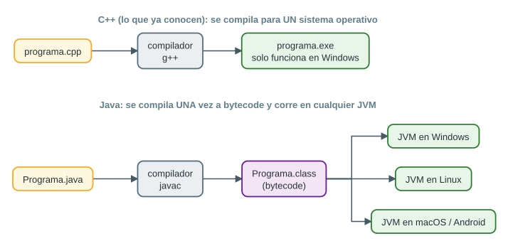
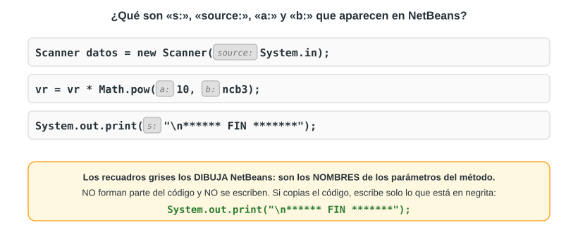

# Java desde cero (partiendo de lo que ya saben de C++)

Este capítulo explica **solo lo necesario** para entender los dos programas. La idea central para la exposición es: **Java se parece muchísimo a C++**; cambian algunos nombres, pero la lógica (variables, `if`, `switch`, `while`, operadores) es la misma.

## 1. ¿Qué es Java?

**Java** es un lenguaje de programación de alto nivel y orientado a objetos, creado en 1995 por James Gosling en *Sun Microsystems* (hoy pertenece a Oracle). Se usa en aplicaciones de escritorio, servidores, sistemas bancarios y en Android.

Su lema es *«escríbelo una vez, ejecútalo en cualquier lugar»*. La diferencia clave con C++ está en **cómo se traduce el programa**:



- En **C++**, el compilador produce un `.exe` en lenguaje máquina **para un sistema operativo** concreto.
- En **Java**, el compilador `javac` produce un archivo `.class` con **bytecode**, un código intermedio. Luego, la **Máquina Virtual de Java (JVM)** lo ejecuta. Como hay una JVM para Windows, otra para Linux, otra para macOS, etc., **el mismo `.class` funciona en todas**.

| Sigla | Nombre | Para qué sirve |
|---|---|---|
| **JVM** | *Java Virtual Machine* | Ejecuta el bytecode |
| **JRE** | *Java Runtime Environment* | JVM + bibliotecas: lo necesario para **ejecutar** programas Java |
| **JDK** | *Java Development Kit* | JRE + compilador (`javac`) y herramientas: lo necesario para **programar** |

## 2. NetBeans y los proyectos Maven

**NetBeans** es un **IDE** (*entorno de desarrollo integrado*): un editor que además compila, ejecuta y ayuda a encontrar errores. Los proyectos del curso son de tipo **Maven** (lo indica la ventana *Output* del profesor: `Building … 1.0-SNAPSHOT`, `maven-resources-plugin`).

Estructura de un proyecto Maven:

```text
Valor_Resistencia_segun_Colores_Bandas/       <- carpeta del proyecto
├── pom.xml                                   <- configuración del proyecto (Maven)
└── src/main/java/
    └── com/mycompany/valor_resistencia_segun_colores_bandas/
        └── Valor_Resistencia_segun_Colores_Bandas.java   <- el programa
```

- `com.mycompany.…` es el **paquete** (*package*): una carpeta que agrupa clases. NetBeans lo crea a partir del nombre del proyecto.
- El nombre del archivo **debe ser igual** al nombre de la clase pública (`Valor_Resistencia_segun_Colores_Bandas.java` ↔ `public class Valor_Resistencia_segun_Colores_Bandas`).

Atajos útiles:

| Acción | Atajo |
|---|---|
| Ejecutar el proyecto | <kbd>F6</kbd> |
| Ejecutar solo el archivo abierto | <kbd>Shift</kbd> + <kbd>F6</kbd> |
| Abrir un proyecto existente | *File → Open Project* (<kbd>Ctrl</kbd> + <kbd>Shift</kbd> + <kbd>O</kbd>) |
| Crear un proyecto | *File → New Project* (<kbd>Ctrl</kbd> + <kbd>Shift</kbd> + <kbd>N</kbd>) |
| Ordenar (formatear) el código | <kbd>Alt</kbd> + <kbd>Shift</kbd> + <kbd>F</kbd> |

Cuando el programa pide datos, **se escriben en la ventana *Output*** (abajo) y se presiona Enter.

### ¿Qué son «s:», «source:», «a:» y «b:»?

En las capturas del profesor aparecen cosas como `System.out.print(s: "...")` o `Math.pow(a: 10, b: ncb3)`. **Eso no es código**: son **pistas de parámetros** (*inline parameter hints*) que NetBeans dibuja en gris para indicar el nombre de cada parámetro del método. **No se escriben**; si se escribieran, el programa no compilaría.



## 3. Estructura de un programa en Java

```java
package com.mycompany.saludo;            // el paquete (carpeta) del archivo

public class Saludo                      // en Java TODO va dentro de una clase
{
    public static void main(String[] args)   // aquí empieza el programa
    {
        System.out.println("Hola, mundo");    // muestra el texto y salta de línea
    }
}
```

`public static void main(String[] args)` asusta un poco, pero cada palabra tiene un sentido:

| Palabra | Significado |
|---|---|
| `public` | Se puede usar desde fuera de la clase (la JVM necesita llamarlo) |
| `static` | Pertenece a la clase; no hace falta crear un objeto para ejecutarlo |
| `void` | No devuelve ningún valor (en C++, `main` devuelve `int`) |
| `main` | El nombre obligatorio del punto de inicio, igual que en C++ |
| `String[] args` | Una lista de textos que se le puede pasar al programa al iniciarlo (no la usamos) |

## 4. Tabla de equivalencias C++ ↔ Java

Esta tabla es **la herramienta principal para explicar Java** a quien ya vio C++:

| Concepto | C++ | Java |
|---|---|---|
| Usar una biblioteca | `#include <iostream>` | `import java.util.Scanner;` |
| Programa principal | `int main() { … return 0; }` | `public static void main(String[] args) { … }` |
| Mostrar y saltar línea | `cout << "Hola" << endl;` | `System.out.println("Hola");` |
| Mostrar sin saltar | `cout << "Hola";` | `System.out.print("Hola");` |
| Unir texto y variables | `cout << "Valor: " << vr;` | `System.out.print("Valor: " + vr);` |
| Preparar la lectura | (no hace falta) | `Scanner datos = new Scanner(System.in);` |
| Leer un entero | `cin >> n;` | `n = datos.nextInt();` |
| Leer una palabra | `cin >> s;` | `s = datos.next();` |
| Leer una línea | `getline(cin, s);` | `s = datos.nextLine();` |
| Texto | `string` | `String` (con **S** mayúscula) |
| Lógico | `bool` | `boolean` |
| Comparar dos textos | `s1 == s2` | `s1.equals(s2)` (**no** `==`) |
| Potencia | `pow(10, 3)` con `<cmath>` | `Math.pow(10, 3)` |
| Subcadena | `s.substr(inicio, cantidad)` | `s.substring(inicio, fin)` (¡posición **final**, no cantidad!) |
| Longitud | `s.length()` | `s.length()` |
| Convertir a real | `static_cast<double>(a)` | `(double) a` |
| `if`, `else`, `switch`, `while`, `for` | Igual | Igual |
| Operadores `+ - * / %`, `&& \|\| !`, `== !=` | Igual | Igual (incluida la división entera: `7 / 2` da `3`) |

## 5. Tipos de datos

En Java el tamaño de cada tipo es **el mismo en todas las computadoras**:

| Tipo | Guarda | Tamaño | Rango / precisión |
|---|---|---|---|
| `byte` | Entero pequeño | 1 byte | −128 a 127 |
| `short` | Entero | 2 bytes | −32 768 a 32 767 |
| `int` | Entero | 4 bytes | ≈ ±2 147 millones |
| `long` | Entero grande | 8 bytes | ≈ ±9.2 × 10¹⁸ |
| `float` | Real (simple precisión) | 4 bytes | ~7 cifras significativas |
| `double` | Real (doble precisión) | 8 bytes | ~15–16 cifras significativas |
| `char` | Un carácter | 2 bytes | Letras de casi todos los idiomas (Unicode) |
| `boolean` | Lógico | — | `true` o `false` |
| `String` | Texto | Variable | — |

El profesor usa `byte opc = 0;` para la variable que controla el ciclo: basta con 1 byte porque solo guarda 0 o 1.

## 6. Leer datos con `Scanner`

```java
import java.util.Scanner;                    // al inicio del archivo
...
Scanner datos = new Scanner(System.in);      // se crea UNA vez: "datos" leerá del teclado
String color = datos.next();                 // lee una palabra
byte n = datos.nextByte();                   // lee un número entero pequeño
double x = datos.nextDouble();               // lee un número real
String linea = datos.nextLine();             // lee una línea completa
```

- `new Scanner(System.in)` crea un **objeto** lector conectado al teclado (`System.in`). Es el equivalente de tener `cin` listo para usar.
- Si el usuario escribe letras donde se espera un número (`nextByte()`, `nextInt()`), el programa **se detiene con un error** (`InputMismatchException`). Por eso, en nuestro programa, la respuesta a «¿Desea terminar?» se lee como texto con `next()`.
- `nextDouble()` usa la configuración regional de la computadora: en algunas configuraciones en español hay que escribir `6,75` en vez de `6.75`. Por eso el programa de la Parte 1 lee el número como texto y cambia la coma por punto.

## 7. Mostrar datos

- `System.out.print(x)` muestra sin saltar de línea; `System.out.println(x)` muestra y salta.
- `"\n"` dentro de un texto también hace un salto de línea (como en C++). El profesor escribe `System.out.print("\n...")`.
- El operador `+` **une textos**: `"El valor es: " + vr + " Ohm"`.

> [!CAUTION]
> Cuidado con mezclar sumas y textos: `"Total: " + 2 + 3` muestra **`Total: 23`** (une el 2 y luego el 3), mientras que `"Total: " + (2 + 3)` muestra **`Total: 5`**. Los paréntesis obligan a sumar primero.

Un detalle de Java: los `double` muy grandes o muy pequeños se muestran en **notación científica**: `47000000.0` aparece como `4.7E7`, que significa 4.7 × 10⁷. Lo veremos en el programa de la resistencia.

## 8. Decisiones y repeticiones (igual que en C++)

**`if` / `else`:**

```java
if(sw==0)
{
    // si todos los colores fueron válidos
}
else
    System.out.print("No se puede calcular");
```

**`switch`:** elige un camino según el valor de una variable. Cada `case` es un valor posible; `break` sale del `switch`; `default` se ejecuta si ningún `case` coincidió.

```java
switch(colorb1)                 // desde Java 7 se puede usar switch con String
{
    case "negro":  ncb1 = 0;
                   break;       // sin break, seguiría ejecutando el case siguiente
    case "marron": ncb1 = 1;
                   break;
    default:       sw = 1;      // ningún case coincidió: color inválido
}
```

**`while`:** repite mientras la condición sea verdadera.

```java
byte opc = 0;
while(opc==0)          // se repite mientras opc valga 0
{
    // ... pedir colores, calcular, mostrar ...
    // si el usuario escribe 0:  opc = 1;  -> el ciclo termina
}
```

## 9. Textos (`String`) en Java

| Método | Qué hace | Ejemplo | Resultado |
|---|---|---|---|
| `s.length()` | Cantidad de caracteres | `"FIEE-2026-0145".length()` | `14` |
| `s.substring(i, f)` | Desde `i` **hasta antes de** `f` | `"FIEE-2026-0145".substring(5, 9)` | `"2026"` |
| `s.substring(i)` | Desde `i` hasta el final | `"FIEE-2026-0145".substring(10)` | `"0145"` |
| `s.toLowerCase()` | Todo a minúsculas | `"ROJO".toLowerCase()` | `"rojo"` |
| `s.equals(t)` | ¿Son iguales los textos? | `"rojo".equals("rojo")` | `true` |
| `s.replace(a, b)` | Cambia `a` por `b` | `"6,75".replace(',', '.')` | `"6.75"` |

> [!IMPORTANT]
> En Java, **los textos se comparan con `equals`**, nunca con `==`. El operador `==` compara si son *el mismo objeto en memoria*, no si tienen las mismas letras: dos textos `"rojo"` creados por separado pueden dar `false` con `==` y `true` con `equals`.

## 10. Métodos (funciones)

Un **método** es un bloque de código con nombre que se puede llamar varias veces, como una función de C++. El programa de la Parte 1 y la versión mejorada de la Parte 2 los usan:

```java
static int numeroDelColor(String color)   // recibe un texto y devuelve un int
{
    switch(color)
    {
        case "negro": return 0;
        case "marron": return 1;
        // ...
        default: return -1;               // -1 significa "color no válido"
    }
}
```

- `static`: se puede llamar directamente desde `main` sin crear objetos.
- `int`: el tipo del valor que devuelve (`void` si no devuelve nada).
- `return`: entrega el resultado y termina el método.

## 11. Mini-resumen para la exposición

1. Java = C++ con otros nombres: `System.out.print` es `cout`, `Scanner` es `cin`, `String` es `string`.
2. Todo va dentro de una **clase**, y el programa empieza en **`main`**.
3. `if`, `switch`, `while` y los operadores son **iguales** a C++.
4. Los textos se comparan con **`equals`**.
5. Lo gris que dibuja NetBeans (`s:`, `a:`, `b:`) **no se escribe**.
