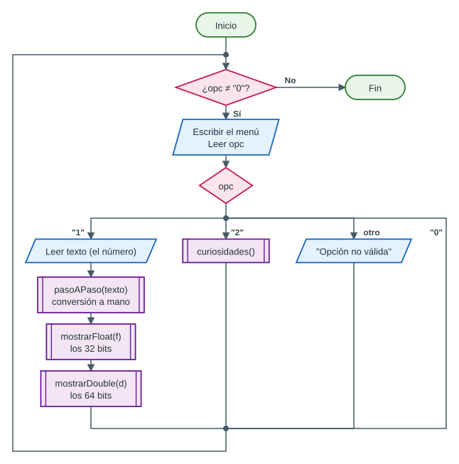

# Parte 1 — ¿Cómo se almacena un número real en la memoria?

## 1. La pregunta (y una sorpresa)

La computadora solo guarda **ceros y unos**. Guardar un entero como 19 es fácil, pero ¿cómo guarda un número con decimales como **6.75**, **0.1** o **4.7**?

Antes de responder, una sorpresa que sirve para abrir la exposición. En Java (y en C++, Python, Excel…):

```text
0.1 + 0.2 = 0.30000000000000004
0.1 + 0.2 == 0.3 ?  false
```

Al terminar este capítulo se entenderá **exactamente por qué** ocurre esto.

## 2. Bit, byte y memoria

- Un **bit** es la unidad mínima de información: vale **0 o 1** (como un interruptor apagado o encendido).
- Un **byte** son **8 bits**. Con un byte se pueden formar 2⁸ = 256 combinaciones (por ejemplo, la letra `A` es `01000001`, es decir, 65).
- La **memoria RAM** es como una fila enorme de casilleros de 1 byte. Cada casillero tiene un número único, su **dirección**.
- Una variable ocupa **varios bytes seguidos**: un `float` ocupa 4 bytes y un `double`, 8.


## 3. El sistema binario

En el sistema **decimal** (base 10) cada posición vale 10 veces más que la de su derecha. Lo mismo pasa con los decimales, pero dividiendo:

> 6.75 = 6 × 10⁰ + 7 × 10⁻¹ + 5 × 10⁻² = 6 + 0.7 + 0.05

En **binario** (base 2) solo hay dos dígitos (0 y 1) y cada posición vale **el doble** de la de su derecha:

| Posición | 2³ | 2² | 2¹ | 2⁰ | **.** | 2⁻¹ | 2⁻² | 2⁻³ | 2⁻⁴ |
|---|---|---|---|---|---|---|---|---|---|
| Valor | 8 | 4 | 2 | 1 | **.** | 0.5 | 0.25 | 0.125 | 0.0625 |
| 110.11₂ | | 1 | 1 | 0 | **.** | 1 | 1 | | |

> 110.11₂ = 4 + 2 + 0 + 0.5 + 0.25 = **6.75**

## 4. Convertir un decimal a binario (a mano)

Se trabaja por separado la **parte entera** y la **parte fraccionaria**:

- **Parte entera**: se divide entre 2 repetidamente y se anotan los **restos**; el número binario son los restos **leídos de abajo hacia arriba**.
- **Parte fraccionaria**: se multiplica por 2 repetidamente y se anota la **parte entera** de cada resultado (0 o 1); el binario son esos dígitos **leídos de arriba hacia abajo**. Se sigue con la parte decimal que queda, hasta que llegue a 0.


### El problema: algunos decimales son infinitos en binario

Hagamos lo mismo con **0.1**:

| Operación | Resultado | Bit |
|---|---|---|
| 0.1 × 2 | 0.2 | 0 |
| 0.2 × 2 | 0.4 | 0 |
| 0.4 × 2 | 0.8 | 0 |
| 0.8 × 2 | **1**.6 | 1 |
| 0.6 × 2 | **1**.2 | 1 |
| 0.2 × 2 | 0.4 | 0 ← ¡ya habíamos visto 0.2! |
| … | … | se repite para siempre |

0.1 = 0.0001100110011001100…₂ — **nunca termina**. Es como 1/3 en decimal (0.3333…): no se puede escribir exacto con una cantidad finita de dígitos. Como la memoria es finita, **hay que cortar y redondear**. Ese pequeño error es el origen del 0.30000000000000004.

| Número | ¿Exacto en binario? | Por qué |
|---|---|---|
| 6.75 | Sí | 0.75 = 1/2 + 1/4 |
| 0.5, 0.25, 0.125 | Sí | Son potencias de 2 |
| 4700 | Sí | Todo entero (no muy grande) es exacto |
| 0.1, 0.2, 0.3, 4.7 | **No** | Tienen infinitos dígitos binarios |

## 5. ¿Cómo se guardan los enteros? (para comparar)

Un `int` se guarda directamente en binario con 32 bits: 19 → `00000000 00000000 00000000 00010011`. Los negativos usan un método llamado **complemento a dos**. Los enteros se guardan **siempre exactos**, pero solo pueden ser enteros y tienen un rango limitado (±2 147 millones en un `int`).

Para los números reales se necesita otra idea, porque deben poder ser **muy grandes** (la distancia a una estrella) y **muy pequeños** (la carga de un electrón) a la vez.

## 6. La idea: notación científica en binario («punto flotante»)

En ciencias escribimos 6 750 000 como **6.75 × 10⁶**: un número corto (la **mantisa**) por una potencia de 10 (el **exponente**). La computadora hace lo mismo, pero en **base 2**:


> 110.11₂ = **1.1011**₂ × 2²

Mover el punto y compensar con el exponente se llama **normalizar**. Como el punto «se mueve» (flota) según el exponente, estos números se llaman de **punto flotante** (*floating point*); de ahí viene el nombre del tipo `float`.

Detalle clave: en binario, después de normalizar, **el primer dígito siempre es 1** (el único dígito distinto de 0 que existe). Como siempre es 1, **no hace falta guardarlo**: se gana un bit de precisión «gratis». Se le llama **bit implícito**.

## 7. El estándar IEEE 754

Desde 1985, prácticamente todas las computadoras guardan los reales con el estándar **IEEE 754**. Cada número se reparte en **tres campos**:


| | `float` (precisión simple) | `double` (precisión doble) |
|---|---|---|
| Tamaño total | 32 bits = 4 bytes | 64 bits = 8 bytes |
| Signo | 1 bit (0 = +, 1 = −) | 1 bit |
| Exponente | 8 bits, **sesgo 127** | 11 bits, **sesgo 1023** |
| Mantisa (fracción) | 23 bits (+ 1 implícito = 24) | 52 bits (+ 1 implícito = 53) |
| Cifras decimales confiables | ~7 | ~15–16 |
| Valor máximo | ≈ 3.4 × 10³⁸ | ≈ 1.8 × 10³⁰⁸ |
| Valor positivo mínimo (normal) | ≈ 1.2 × 10⁻³⁸ | ≈ 2.2 × 10⁻³⁰⁸ |
| En Java / C++ | `float` (literal `6.75f`) | `double` (literal `6.75`) |

La fórmula para reconstruir el valor es:

> **valor = (−1)^signo × 1.mantisa₂ × 2^(exponente − sesgo)**

### ¿Para qué sirve el «sesgo»?

El exponente puede ser negativo (0.1 = 1.6 × 2⁻⁴), pero el campo de exponente se guarda como un número **sin signo**. El truco es **sumarle un sesgo** antes de guardarlo:

- En `float`, exponente real −4 → se guarda −4 + 127 = **123** → `01111011`.
- Al leerlo: 123 − 127 = −4.

Así, el campo de 8 bits (0 a 255) representa exponentes reales de −126 a +127; los valores 0 y 255 se reservan para casos especiales (sección 10).

## 8. Ejemplo completo: −6.75 como `float`

| Paso | Qué se hace | Resultado |
|---|---|---|
| 1 | **Signo**: es negativo | bit de signo = **1** |
| 2 | **Binario** de 6.75 (sin el signo) | 110.11₂ |
| 3 | **Normalizar**: dejar un solo 1 antes del punto | 1.1011₂ × 2² |
| 4 | **Exponente con sesgo**: 2 + 127 | 129 = **10000001**₂ |
| 5 | **Mantisa**: los bits después del «1.», completando 23 bits con ceros | **1011**0000000000000000000 |
| 6 | **Juntar**: signo · exponente · mantisa | 1 10000001 10110000000000000000000 |
| 7 | **Hexadecimal** (grupos de 4 bits) | **C0D80000** |


**Comprobación** con la fórmula: (−1)¹ × 1.1011₂ × 2^(129 − 127) = −1.6875 × 4 = **−6.75** ✔. Como 6.75 tiene un binario finito, se guarda **sin ningún error**.

## 9. Ejemplo con trampa: 0.1 como `float`

| Paso | Resultado |
|---|---|
| Signo | positivo → **0** |
| Binario | 0.0001100110011001100…₂ (infinito) |
| Normalizar | 1.100110011001100…₂ × 2⁻⁴ |
| Exponente con sesgo | −4 + 127 = 123 → **01111011** |
| Mantisa | Se toman 23 bits: `10011001100110011001100` y el bit 24 es **1** → **se redondea hacia arriba**: `10011001100110011001101` |
| Resultado (hex) | **3DCCCCCD** |


Por el redondeo, el `float` no guarda 0.1 sino **0.100000001490116119384765625**, y el `double` guarda **0.1000000000000000055511151231257827…**. Java muestra «0.1» porque imprime el número más corto que identifica a ese valor, pero **por dentro no es 0.1**. Al sumar 0.1 + 0.2, los pequeños errores de ambos se acumulan y el resultado (el `double` más cercano a la suma) se imprime como 0.30000000000000004.

## 10. Valores especiales

Los valores extremos del campo de exponente se reservan para casos especiales:

| Exponente | Mantisa | Significado | Ejemplo en Java |
|---|---|---|---|
| Todo ceros | Cero | **Cero** (existe +0 y −0) | `0.0`, `-0.0` |
| Todo ceros | Distinta de cero | Números **subnormales** (más pequeños que el mínimo normal) | `Float.MIN_VALUE` |
| Todo unos | Cero | **Infinito** (+∞ o −∞) | `1.0 / 0` → `Infinity` |
| Todo unos | Distinta de cero | **NaN** (*Not a Number*, «no es un número») | `0.0 / 0` → `NaN` |

## 11. ¿En qué orden quedan los bytes en la RAM?

Un `float` ocupa 4 bytes seguidos, pero ¿en qué orden? En los procesadores **Intel y AMD** (y en la gran mayoría de celulares) se usa el orden **little-endian**: **el byte menos significativo va primero**, en la dirección más baja.


Java oculta este detalle al programador (siempre «ve» el número completo), pero así es como queda físicamente en la memoria de una PC. El programa de esta parte muestra los bytes en ese orden.

## 12. Consecuencias prácticas

1. **Precisión limitada.** Un `float` tiene ~7 cifras: 16 777 217 se guarda como 16 777 216 (no alcanzan los bits). Por eso en Java y C++ se usa `double` por defecto.
2. **No comparar reales con `==`.** En lugar de `a == b`, se compara con una tolerancia: `Math.abs(a - b) < 1e-9`.
3. **Los errores se acumulan.** Sumar 0.1 diez veces da 0.9999999999999999.
4. **Dinero.** Los sistemas de bancos y tiendas no usan `double` para el dinero: usan céntimos enteros o tipos decimales exactos (`BigDecimal` en Java).
5. **Los valores posibles no están repartidos de forma pareja**: hay muchos cerca del cero y cada vez menos (más separados) a medida que el número crece.


> [!NOTE]
> **Conexión con la Parte 2:** en la ampliación que calcula el valor de la resistencia, ese valor se guarda en un `double`. El multiplicador dorado es ×0.1, pero 0.1 no es exacto en binario: `12 * 0.1` da **1.2000000000000002**. Por eso ese programa **divide entre 10** (12 / 10 = 1.2, el valor guardado más cercano a 1.2) en lugar de multiplicar por 0.1.

## 13. El programa Java: `Numero_Real_en_Memoria`

Proyecto: `Parte1_Numero_Real_en_Memoria/` · Archivo: [`Numero_Real_en_Memoria.java`](../Parte1_Numero_Real_en_Memoria/src/main/java/com/mycompany/numero_real_en_memoria/Numero_Real_en_Memoria.java)

### 13.1 Qué hace

Muestra un menú con dos opciones:

1. **Analizar un número real**: el usuario escribe un número (acepta `6.75` o `6,75`) y el programa
   - hace la **conversión a mano, paso a paso**, exactamente como en las secciones 4 y 8 (divisiones, multiplicaciones, normalización, sesgo, mantisa y redondeo);
   - muestra los **32 bits reales del `float`** y los **64 bits reales del `double`** que guarda Java, separados en signo | exponente | mantisa;
   - muestra el **hexadecimal**, el **orden de los bytes en la RAM** (little-endian), el **valor exacto guardado** y el **error de redondeo**;
   - compara el resultado hecho «a mano» con el de Java (deben **coincidir**).
2. **Curiosidades**: 0.1 + 0.2, sumar 0.1 diez veces, el límite del `float`, 1/3, los huecos entre números, infinito y NaN, y el ejemplo de la resistencia (12 × 0.1).



### 13.2 Ejecución real con −6.75

```text
Elija una opcion: 1
Ingrese un numero real (ej: -6.75   0.1   4700): -6.75

----- PASO A PASO (como en papel), formato float de 32 bits -----
1) Signo: negativo -> bit de signo = 1
2) Parte entera = 6  (dividir entre 2 y anotar el resto)
      6 / 2 = 3   resto 0
      3 / 2 = 1   resto 1
      1 / 2 = 0   resto 1
   => 6 en binario = 110  (restos leidos de abajo hacia arriba)
3) Parte fraccionaria = 0.75  (multiplicar por 2 y anotar la parte entera)
      0.75 x 2 = 1.5   -> bit 1
      0.5 x 2 = 1   -> bit 1
   => numero completo en binario = 110.11
4) Normalizar (dejar un solo 1 antes del punto):
      1.1011 x 2^2
5) Exponente guardado = 2 + 127 = 129  ->  10000001 (8 bits)
6) Mantisa: se toman 23 bits despues del punto (el "1." NO se guarda)
      10110000000000000000000 | 0 ...  <- el bit 24 decide el redondeo
      el resto se descarta (redondeo hacia abajo)
7) Resultado a mano : 1 | 10000001 | 10110000000000000000000
   Lo que guardo Java: 1 | 10000001 | 10110000000000000000000   <- COINCIDEN

----- LO QUE JAVA GUARDA: float (32 bits = 4 bytes) -----
Bits        : 1 | 10000001 | 10110000000000000000000
Signo       : 1  (negativo)
Exponente   : 10000001 = 129  ->  exponente real = 129 - 127 = 2
Mantisa     : 10110000000000000000000
Hexadecimal : C0D80000
En la RAM   : [+0]00 [+1]00 [+2]D8 [+3]C0  (little-endian)
Java lo imprime como : -6.75
Valor EXACTO guardado: -6.75
Error de redondeo    : 0  (se guardo EXACTO)

----- LO QUE JAVA GUARDA: double (64 bits = 8 bytes) -----
Bits        : 1 | 10000000001 | 1011000000000000000000000000000000000000000000000000
Signo       : 1  (negativo)
Exponente   : 10000000001 = 1025  ->  exponente real = 1025 - 1023 = 2
Mantisa     : 1011000000000000000000000000000000000000000000000000
Hexadecimal : C01B000000000000
En la RAM   : [+0]00 [+1]00 [+2]00 [+3]00 [+4]00 [+5]00 [+6]1B [+7]C0  (little-endian)
Java lo imprime como : -6.75
Valor EXACTO guardado: -6.75
Error de redondeo    : 0  (se guardo EXACTO)
```

### 13.3 Ejecución real con 0.1 (parte del `float`)

```text
----- PASO A PASO (como en papel), formato float de 32 bits -----
1) Signo: positivo -> bit de signo = 0
2) Parte entera = 0  ->  en binario tambien es 0
3) Parte fraccionaria = 0.1  (multiplicar por 2 y anotar la parte entera)
      0.1 x 2 = 0.2   -> bit 0
      0.2 x 2 = 0.4   -> bit 0
      0.4 x 2 = 0.8   -> bit 0
      0.8 x 2 = 1.6   -> bit 1
      0.6 x 2 = 1.2   -> bit 1
      0.2 x 2 = 0.4   -> bit 0
      0.4 x 2 = 0.8   -> bit 0
      0.8 x 2 = 1.6   -> bit 1
      0.6 x 2 = 1.2   -> bit 1
      0.2 x 2 = 0.4   -> bit 0
      ... (54 pasos mas)
   => NUNCA llega a 0: en binario este numero tiene infinitos digitos
   => numero completo en binario = 0.00011001100110011001100110011001...
4) Normalizar (dejar un solo 1 antes del punto):
      1.10011001100110011001100110011001... x 2^-4
5) Exponente guardado = -4 + 127 = 123  ->  01111011 (8 bits)
6) Mantisa: se toman 23 bits despues del punto (el "1." NO se guarda)
      10011001100110011001100 | 1 ...  <- el bit 24 decide el redondeo
      el bit 24 es 1 -> se REDONDEA hacia arriba: 10011001100110011001101
7) Resultado a mano : 0 | 01111011 | 10011001100110011001101
   Lo que guardo Java: 0 | 01111011 | 10011001100110011001101   <- COINCIDEN

----- LO QUE JAVA GUARDA: float (32 bits = 4 bytes) -----
Bits        : 0 | 01111011 | 10011001100110011001101
Signo       : 0  (positivo)
Exponente   : 01111011 = 123  ->  exponente real = 123 - 127 = -4
Mantisa     : 10011001100110011001101
Hexadecimal : 3DCCCCCD
En la RAM   : [+0]CD [+1]CC [+2]CC [+3]3D  (little-endian)
Java lo imprime como : 0.1
Valor EXACTO guardado: 0.100000001490116119384765625
Error de redondeo    : 0.000000001490116119384765625
```

### 13.4 Ejecución real de las curiosidades

```text
----- CURIOSIDADES DE LOS NUMEROS REALES -----
1) 0.1 + 0.2 = 0.30000000000000004
   0.1 + 0.2 == 0.3 ?  false
   Por eso se comparan con tolerancia: Math.abs(suma - 0.3) < 1e-9 ?  true
2) Sumar 0.1 diez veces da: 0.9999999999999999  (no exactamente 1.0)
3) float 16777217 se guarda como 16777216  (el float solo tiene 24 bits de precision, ~7 cifras)
   double 16777217 se guarda como 16777217  (~16 cifras)
4) 1/3 en float  = 0.33333334
   1/3 en double = 0.3333333333333333
5) Distancia al siguiente float despues de 1.0       : 1.1920929E-7
   Distancia al siguiente float despues de 1000000.0 : 0.0625
   (mientras mas grande el numero, mas separados estan los valores posibles)
6) Valores especiales: 1.0/0 = Infinity ;  -1.0/0 = -Infinity ;  0.0/0 = NaN
7) Resistencia marron-rojo-dorado: 12 * 0.1 = 1.2000000000000002   pero 12 / 10.0 = 1.2
```

### 13.5 Las partes clave del código, explicadas

**a) Obtener los bits que Java guarda.** Java trae métodos que devuelven los bits de un real tal cual están en memoria: `Float.floatToIntBits(f)` (32 bits) y `Double.doubleToLongBits(d)` (64 bits). Luego los separamos con `substring`, igual que `substr` en C++:

```java
    static void mostrarFloat(String texto, float f)
    {
        int bits = Float.floatToIntBits(f);       // Java nos da los 32 bits del float
        String b = aBinario(bits, 32);
        String s = b.substring(0, 1);             // 1 bit de signo
        String e = b.substring(1, 9);             // 8 bits de exponente
        String m = b.substring(9);                // 23 bits de mantisa
        int expGuardado = Integer.parseInt(e, 2);
        String hex = aHexadecimal(b);
```

- `aBinario(bits, 32)` convierte el número a un texto de exactamente 32 ceros y unos.
- `b.substring(1, 9)` toma los caracteres 1 al 8: los **8 bits del exponente**. (En Java, el segundo número es la posición **final**, que no se incluye.)
- `Integer.parseInt(e, 2)` convierte el texto binario `"10000001"` al número decimal **129**; luego se le resta el sesgo 127.

**b) Herramientas auxiliares.**

```java
    // Escribe "valor" en binario usando exactamente nBits (rellena con ceros a la izquierda)
    static String aBinario(long valor, int nBits)
    {
        String s = Long.toBinaryString(valor);
        while(s.length() < nBits)
            s = "0" + s;
        return s.substring(s.length() - nBits);
    }

    // Convierte una cadena de bits a hexadecimal (cada 4 bits = 1 digito hex)
    static String aHexadecimal(String bits)
    {
        String hex = "";
        for(int i = 0; i < bits.length(); i += 4)
        {
            int valor = Integer.parseInt(bits.substring(i, i + 4), 2);   // 4 bits -> 0..15
            hex = hex + Integer.toHexString(valor).toUpperCase();           // 0..15 -> 0..F
        }
        return hex;
    }

    // En la RAM (procesadores Intel/AMD) los bytes se guardan del MENOS significativo al MAS
    // significativo (little-endian). Ej: 3DCCCCCD -> [+0]CD [+1]CC [+2]CC [+3]3D
    static String bytesEnMemoria(String hex)
    {
        String r = "";
        int nBytes = hex.length() / 2;
        for(int i = 0; i < nBytes; i++)
        {
            int fin = hex.length() - 2 * i;
            r = r + "[+" + i + "]" + hex.substring(fin - 2, fin) + " ";
        }
        return r.trim();
    }
```

**c) La conversión «a mano».** El método `pasoAPaso` repite el procedimiento de papel. La parte entera se divide entre 2 dentro de un `while` y cada resto se pega **a la izquierda** (así quedan «leídos de abajo hacia arriba»):

```java
            long q = entero;
            while(q > 0)
            {
                System.out.print("      " + q + " / 2 = " + (q / 2)
                                 + "   resto " + (q % 2) + "\n");
                binEntero = (q % 2) + binEntero;      // cada resto se escribe a la IZQUIERDA
                q = q / 2;
            }
```

La parte fraccionaria se multiplica por 2 y se guarda el bit (la parte entera del producto). Se usa `BigDecimal`, un tipo de Java que hace **cuentas decimales exactas**, para que el paso a paso sea idéntico al de papel (con `double` aparecerían los mismos errores que queremos explicar):

```java
        while(fr.signum() > 0 && pasos < 64)
        {
            BigDecimal producto = fr.multiply(new BigDecimal(2));
            int bit = (producto.compareTo(BigDecimal.ONE) >= 0) ? 1 : 0;
            if(pasos < 10)                        // solo mostramos los 10 primeros pasos
                System.out.print("      " + limpio(fr) + " x 2 = " + limpio(producto)
                                 + "   -> bit " + bit + "\n");
            binFrac = binFrac + bit;
            fr = producto.subtract(new BigDecimal(bit));   // queda solo lo de despues del punto
            pasos++;
        }
```

Después, el programa normaliza, suma el sesgo, toma 23 bits de mantisa y aplica el redondeo (si el bit 24 es 1, se suma 1 a la mantisa; en un empate exacto se aplica la regla del estándar: queda el valor cuyo último bit es 0). Al final compara con los bits de Java: en todas las pruebas **coinciden**, incluso en el caso límite 16 777 217.

### 13.6 Cómo ejecutarlo

1. En NetBeans: *File → Open Project* y elegir la carpeta `Parte1_Numero_Real_en_Memoria`.
2. Presionar <kbd>F6</kbd> (*Run Project*). La primera vez Maven puede demorar porque descarga lo que necesita.
3. En la ventana *Output*: escribir `1`, Enter, y luego un número (por ejemplo `-6.75`, `0.1` o `4700`). Escribir `2` para las curiosidades y `0` para salir.

Números recomendados para la demostración:

| Número | Qué muestra |
|---|---|
| `-6.75` | Caso exacto: el paso a paso coincide con el ejemplo de la sección 8 |
| `0.1` | Caso infinito: patrón repetido, redondeo y error de redondeo |
| `4700` | El valor de la resistencia del ejemplo de la Parte 2 |
| `16777217` | El límite de precisión del `float` |
| `NaN` o `-0` | Valores especiales |

## 14. Resumen en 8 ideas

1. La computadora guarda todo en bits; un `float` usa 32 y un `double`, 64.
2. Los reales se guardan en **notación científica binaria**: signo, exponente y mantisa (estándar **IEEE 754**).
3. Se normaliza a la forma **1.xxxx × 2^e**; el «1.» no se guarda (bit implícito).
4. El exponente se guarda **sumándole un sesgo** (127 en `float`, 1023 en `double`).
5. Muchos decimales (0.1, 0.2, 4.7) son **infinitos en binario**: se cortan y se redondean.
6. Por eso aparecen resultados como **0.30000000000000004** y no se deben comparar reales con `==`.
7. Los valores extremos del exponente representan **0, infinito y NaN**.
8. En una PC, los bytes del número quedan en la RAM en orden **little-endian**.

## 15. Preguntas para comprobar lo aprendido

1. ¿Cuántos bits tiene cada campo de un `float`?
2. ¿Por qué el exponente se guarda con sesgo?
3. ¿Qué es el bit implícito?
4. ¿Por qué 6.75 se guarda exacto y 0.1 no?
5. ¿Qué valor hexadecimal tiene −6.75 como `float`?
6. ¿Qué significa que una PC sea little-endian?
7. ¿Por qué no conviene comparar dos `double` con `==`?

**Respuestas:** 1) Signo 1, exponente 8, mantisa 23. 2) Para poder representar exponentes negativos usando un campo sin signo. 3) El 1 que siempre aparece antes del punto al normalizar; como siempre es 1, no se guarda. 4) Porque 6.75 = 110.11₂ tiene un binario finito, mientras que 0.1 = 0.000110011…₂ es infinito y hay que redondearlo. 5) `C0D80000`. 6) Que guarda primero (en la dirección más baja) el byte menos significativo: −6.75f queda como `00 00 D8 C0`. 7) Porque los valores pueden tener pequeños errores de redondeo: se compara con una tolerancia, `Math.abs(a - b) < 1e-9`.
