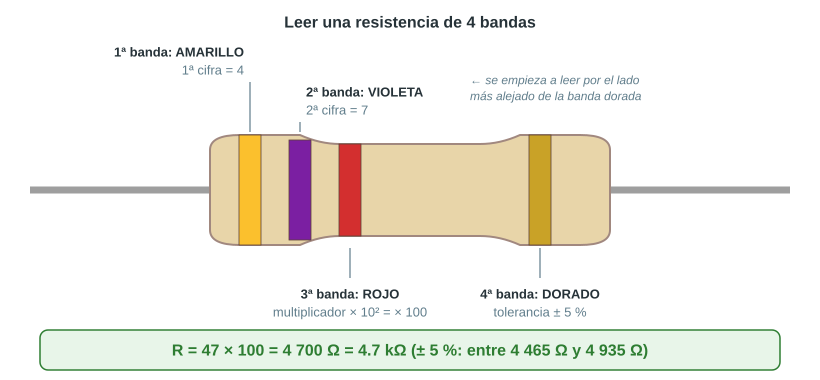
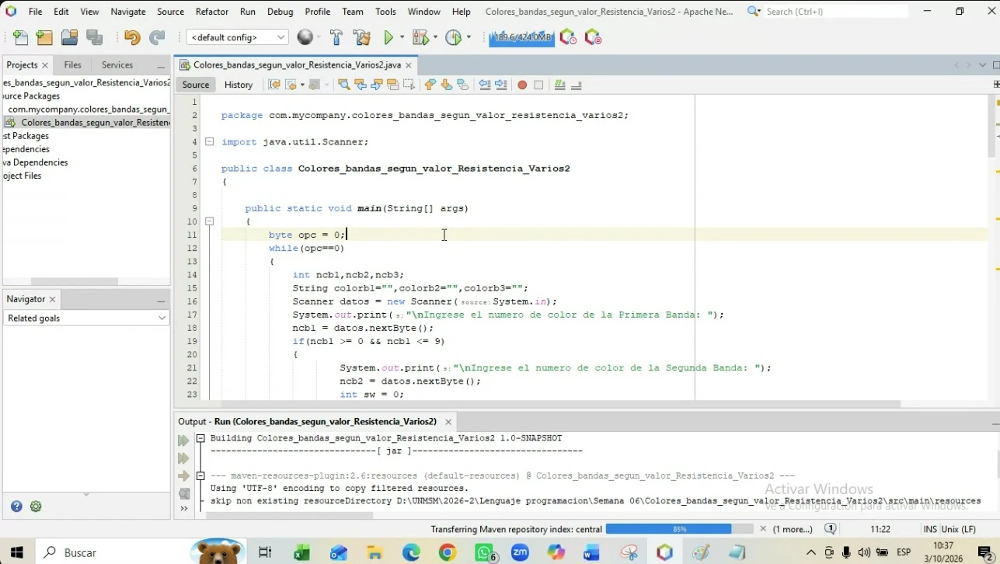
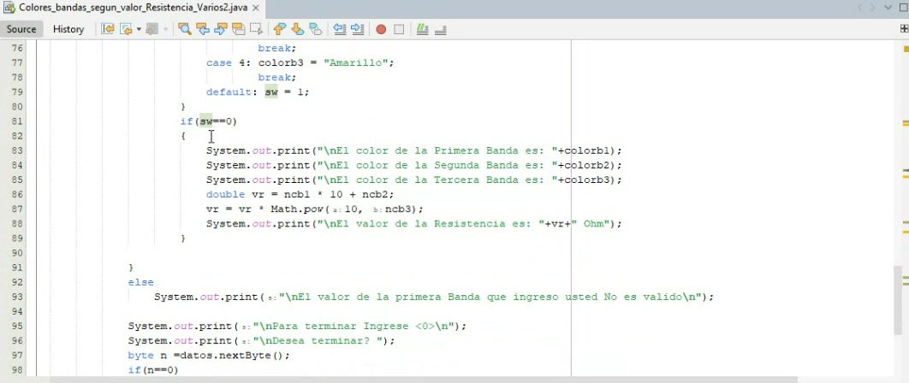
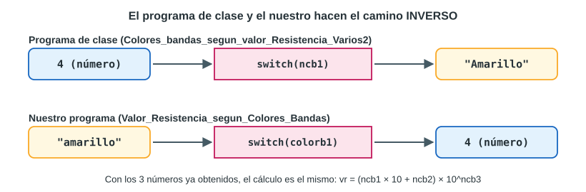
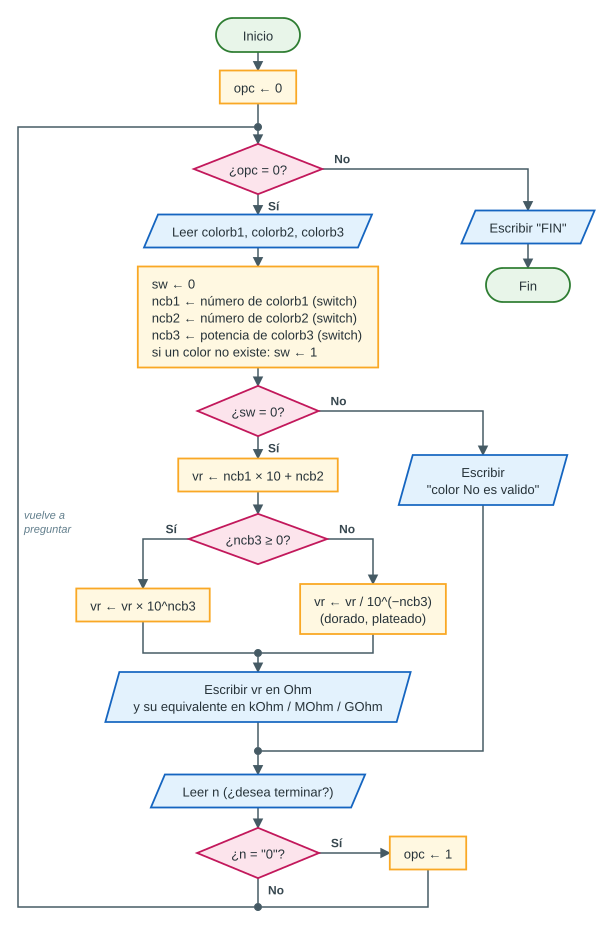

# Parte 2 — El valor de una resistencia a partir de sus colores

## 1. ¿Qué es una resistencia?

Una **resistencia** (o *resistor*) es un componente electrónico que **se opone al paso de la corriente eléctrica**. Se usa, por ejemplo, para limitar la corriente que llega a un LED y que no se queme, o para repartir un voltaje.

- Su valor se mide en **ohmios** (símbolo **Ω**, se lee «ohm»).
- Se relaciona con el voltaje y la corriente por la **ley de Ohm**: **V = I × R**.
- Como los valores pueden ser muy grandes, se usan prefijos:

| Prefijo | Símbolo | Equivale a | Ejemplo |
|---|---|---|---|
| — | Ω | 1 | 220 Ω |
| kilo | kΩ | 1 000 Ω | 4.7 kΩ = 4 700 Ω |
| mega | MΩ | 1 000 000 Ω | 1 MΩ |
| giga | GΩ | 1 000 000 000 Ω | 99 GΩ |

## 2. ¿Por qué tienen bandas de colores?

Las resistencias son muy pequeñas: un número impreso sería difícil de leer y se borraría. En cambio, **las bandas de colores se ven desde cualquier lado** y no se borran. Cada color representa un número según el **código de colores** (norma IEC 60062):


## 3. Cómo leer una resistencia de 4 bandas



1. Se empieza por el extremo **opuesto** a la banda dorada o plateada (la de tolerancia suele estar más separada).
2. **1.ª banda**: primera cifra. **2.ª banda**: segunda cifra. Juntas forman un número de dos cifras.
3. **3.ª banda**: el **multiplicador** (cuántos ceros se agregan, o sea, la potencia de 10).
4. **4.ª banda**: la **tolerancia** (cuánto puede variar el valor real).

> **Fórmula:** R = (cifra₁ × 10 + cifra₂) × 10^(multiplicador)

| Colores | Cálculo | Valor |
|---|---|---|
| Marrón – Negro – Rojo | 10 × 10² | 1 000 Ω = **1 kΩ** |
| Rojo – Rojo – Negro | 22 × 10⁰ | **22 Ω** |
| Amarillo – Violeta – Rojo | 47 × 10² | 4 700 Ω = **4.7 kΩ** |
| Verde – Azul – Naranja | 56 × 10³ | 56 000 Ω = **56 kΩ** |
| Marrón – Negro – Verde | 10 × 10⁵ | 1 000 000 Ω = **1 MΩ** |
| Marrón – Rojo – Dorado | 12 × 10⁻¹ | **1.2 Ω** |
| Naranja – Naranja – Plateado | 33 × 10⁻² | **0.33 Ω** |

> [!NOTE]
> Algunas resistencias de precisión tienen **5 bandas** (tres cifras, multiplicador y tolerancia). Además, las tablas pueden variar en tolerancias poco usadas (la norma IEC 60062 asigna también ±0.05 % al naranja y ±0.02 % al amarillo). El programa del curso trabaja con las **tres primeras bandas**, que son las que dan el valor.

## 4. El programa de clase (el de las imágenes)

El programa del profesor, `Colores_bandas_segun_valor_Resistencia_Varios2`, hace el camino **número → color**: el usuario escribe el **número** de cada banda y el programa muestra **el nombre del color** y el valor de la resistencia.





Transcripción completa: [`imagenes_originales/Colores_bandas_segun_valor_Resistencia_Varios2.java`](../imagenes_originales/Colores_bandas_segun_valor_Resistencia_Varios2.java) (se conserva la misma numeración de líneas que en las capturas).

### Qué hace cada parte del programa de clase

| Líneas | Qué hace |
|---|---|
| 11–13 | `byte opc = 0;` y `while(opc==0)`: el programa se repite hasta que el usuario pida terminar |
| 14–16 | Declara los números de banda (`ncb1`, `ncb2`, `ncb3`), los nombres de color (`colorb1`…) y crea el `Scanner` |
| 17–18 | Pide el **número** de la 1.ª banda con `datos.nextByte()` |
| 19 | `if(ncb1 >= 0 && ncb1 <= 9)`: verifica que la 1.ª banda esté entre 0 y 9 |
| 21–23 | Pide la 2.ª banda y crea `sw = 0` (un «interruptor»: 0 = todo bien, 1 = hubo un error) |
| 25–42 | `switch(ncb1)`: según el número, guarda el nombre del color; si no coincide, `sw = 1` |
| 43–60 | Lo mismo para la 2.ª banda |
| 61–62 | Pide la 3.ª banda |
| 63–80 | Lo mismo para la 3.ª banda |
| 81–89 | Si `sw == 0`: muestra los tres colores y calcula `vr = (ncb1 * 10 + ncb2) * 10^ncb3` con `Math.pow` |
| 92–93 | Si la 1.ª banda no estaba entre 0 y 9, muestra un mensaje de error |
| 95–99 | Pregunta si desea terminar; si escriben 0, `opc = 1` y el ciclo termina |
| 101 | Muestra `****** FIN *******` |

Ejecución real de la transcripción (4-3-2 y luego 2-2-5):

```text
Ingrese el numero de color de la Primera Banda: 4

Ingrese el numero de color de la Segunda Banda: 3

Ingrese el numero de color de la Tercera Banda: 2

El color de la Primera Banda es: Amarillo
El color de la Segunda Banda es: Naranja
El color de la Tercera Banda es: Rojo
El valor de la Resistencia es: 4300.0 Ohm
Para terminar Ingrese <0>

Desea terminar? 1

Ingrese el numero de color de la Primera Banda: 2

Ingrese el numero de color de la Segunda Banda: 2

Ingrese el numero de color de la Tercera Banda: 5

Para terminar Ingrese <0>

Desea terminar? 0

****** FIN *******
```

### Observaciones sobre el programa de clase

- Sus `switch` incluyen **7 de los 10 colores**: faltan **verde (5), azul (6) y violeta (7)**. Por eso, con 2-2-5 el programa **no muestra nada** (pone `sw = 1` sin avisar). Tampoco se puede calcular una resistencia tan común como amarillo-violeta-rojo (4.7 kΩ).
- No incluye el dorado ni el plateado del multiplicador.
- Si el usuario escribe una letra donde se espera un número, `nextByte()` detiene el programa con un error.
- El `Scanner` se crea en cada vuelta del ciclo (funciona, pero basta con crearlo una vez).

Nuestra versión mantiene **la misma estructura** (para que sea fácil compararlas) y agrega esos detalles.

## 5. Nuestro programa: colores → valor

La tarea pide hacer **el camino inverso**: el usuario escribe **los nombres de los colores** y el programa calcula **el número** (el valor de la resistencia).



### 5.1 Análisis Entrada – Proceso – Salida

| | Variable | Tipo | Descripción |
|---|---|---|---|
| **Entrada** | `colorb1`, `colorb2`, `colorb3` | `String` | Nombres de los colores de las 3 bandas (ej. `amarillo`) |
| **Entrada** | `n` | `String` | Respuesta a «¿Desea terminar?» (`0` = sí) |
| **Proceso** | `ncb1`, `ncb2` | `int` | Cifra de cada color (0 a 9), obtenida con `switch` |
| **Proceso** | `ncb3` | `int` | Potencia de 10 del multiplicador (−2 a 9) |
| **Proceso** | `sw` | `int` | 0 si todos los colores son válidos; 1 si alguno no lo es |
| **Proceso** | `vr` | `double` | `vr = (ncb1 × 10 + ncb2) × 10^ncb3` |
| **Salida** | — | — | La cifra de cada banda, el valor en Ohm y su equivalente en kOhm, MOhm o GOhm (o un mensaje de error) |

### 5.2 Pseudocódigo

```pseudo
Algoritmo ValorResistenciaSegunColores
    Definir colorb1, colorb2, colorb3, n Como Cadena
    Definir ncb1, ncb2, ncb3, sw, opc Como Entero
    Definir vr Como Real
    opc ← 0
    Mientras opc = 0 Hacer
        sw ← 0
        Leer colorb1, colorb2, colorb3          // en minúsculas
        Segun colorb1 Hacer
            "negro": ncb1 ← 0
            "marron": ncb1 ← 1
            ...                                 // rojo 2 ... blanco 9
            De Otro Modo: sw ← 1
                          Escribir "El color de la Primera Banda No es valido"
        FinSegun
        // lo mismo para colorb2 (ncb2)
        // y para colorb3 (ncb3), que además acepta dorado (-1) y plateado (-2)
        Si sw = 0 Entonces
            vr ← ncb1 * 10 + ncb2
            Si ncb3 >= 0 Entonces
                vr ← vr * 10 ^ ncb3
            SiNo
                vr ← vr / 10 ^ (-ncb3)
            FinSi
            Escribir "El valor de la Resistencia es: ", vr, " Ohm"
            Escribir el equivalente en kOhm, MOhm o GOhm
        SiNo
            Escribir "No se puede calcular: revise los colores."
        FinSi
        Escribir "Desea terminar? (0 = si)"
        Leer n
        Si n = "0" Entonces
            opc ← 1
        FinSi
    FinMientras
    Escribir "****** FIN *******"
FinAlgoritmo
```

### 5.3 Diagrama de flujo



### 5.4 Código completo

Proyecto: `Parte2_Valor_Resistencia_segun_Colores/` · Archivo: [`Valor_Resistencia_segun_Colores_Bandas.java`](../Parte2_Valor_Resistencia_segun_Colores/src/main/java/com/mycompany/valor_resistencia_segun_colores_bandas/Valor_Resistencia_segun_Colores_Bandas.java)

```java

package com.mycompany.valor_resistencia_segun_colores_bandas;

import java.util.Scanner;

/*
 * VALOR DE UNA RESISTENCIA SEGUN LOS COLORES DE SUS BANDAS
 * ---------------------------------------------------------
 * Es la version "al reves" del programa visto en clase
 * (Colores_bandas_segun_valor_Resistencia_Varios2):
 *   - En clase : se ingresaban NUMEROS y se mostraban los COLORES.
 *   - Aqui     : se ingresan los NOMBRES de los colores y el programa
 *                calcula el VALOR de la resistencia en Ohm.
 *
 *   Valor = (numero banda 1 x 10 + numero banda 2) x 10^(numero banda 3)
 *   Ejemplo: amarillo(4) violeta(7) rojo(2) -> 47 x 10^2 = 4700 Ohm
 */
public class Valor_Resistencia_segun_Colores_Bandas
{

    public static void main(String[] args)
    {
        Scanner datos = new Scanner(System.in);   // para leer lo que se escribe en el teclado
        byte opc = 0;                             // 0 = seguir, 1 = terminar

        System.out.print("===== VALOR DE UNA RESISTENCIA SEGUN SUS COLORES =====");
        System.out.print("\nColores validos (escribalos sin tildes):");
        System.out.print("\n  negro, marron, rojo, naranja, amarillo,");
        System.out.print("\n  verde, azul, violeta, gris, blanco");
        System.out.print("\n  (en la Tercera Banda tambien: dorado y plateado)\n");

        while(opc==0)
        {
            String colorb1, colorb2, colorb3;     // colores que escribe el usuario
            int ncb1 = 0, ncb2 = 0, ncb3 = 0;     // numero que le corresponde a cada color
            int sw = 0;                           // 0 = colores correctos, 1 = hubo un error

            // ---------- ENTRADA: se leen los NOMBRES de los colores ----------
            // toLowerCase() pasa todo a minusculas: "ROJO" y "Rojo" quedan como "rojo"
            System.out.print("\nIngrese el color de la Primera Banda: ");
            colorb1 = datos.next().toLowerCase();
            System.out.print("Ingrese el color de la Segunda Banda: ");
            colorb2 = datos.next().toLowerCase();
            System.out.print("Ingrese el color de la Tercera Banda: ");
            colorb3 = datos.next().toLowerCase();

            // ---------- PROCESO 1: convertir cada color en su numero ----------
            switch(colorb1)
            {
                case "negro":    ncb1 = 0;
                                 break;
                case "marron":   ncb1 = 1;
                                 break;
                case "rojo":     ncb1 = 2;
                                 break;
                case "naranja":  ncb1 = 3;
                                 break;
                case "amarillo": ncb1 = 4;
                                 break;
                case "verde":    ncb1 = 5;
                                 break;
                case "azul":     ncb1 = 6;
                                 break;
                case "violeta":  ncb1 = 7;
                                 break;
                case "gris":     ncb1 = 8;
                                 break;
                case "blanco":   ncb1 = 9;
                                 break;
                default: sw = 1;
                         System.out.print("\n * El color de la Primera Banda ("
                                          + colorb1 + ") No es valido");
            }
            switch(colorb2)
            {
                case "negro":    ncb2 = 0;
                                 break;
                case "marron":   ncb2 = 1;
                                 break;
                case "rojo":     ncb2 = 2;
                                 break;
                case "naranja":  ncb2 = 3;
                                 break;
                case "amarillo": ncb2 = 4;
                                 break;
                case "verde":    ncb2 = 5;
                                 break;
                case "azul":     ncb2 = 6;
                                 break;
                case "violeta":  ncb2 = 7;
                                 break;
                case "gris":     ncb2 = 8;
                                 break;
                case "blanco":   ncb2 = 9;
                                 break;
                default: sw = 1;
                         System.out.print("\n * El color de la Segunda Banda ("
                                          + colorb2 + ") No es valido");
            }
            // La Tercera Banda es el MULTIPLICADOR: ncb3 es la potencia de 10
            switch(colorb3)
            {
                case "negro":    ncb3 = 0;      // x 1
                                 break;
                case "marron":   ncb3 = 1;      // x 10
                                 break;
                case "rojo":     ncb3 = 2;      // x 100
                                 break;
                case "naranja":  ncb3 = 3;      // x 1 000
                                 break;
                case "amarillo": ncb3 = 4;      // x 10 000
                                 break;
                case "verde":    ncb3 = 5;      // x 100 000
                                 break;
                case "azul":     ncb3 = 6;      // x 1 000 000
                                 break;
                case "violeta":  ncb3 = 7;      // x 10 000 000
                                 break;
                case "gris":     ncb3 = 8;      // x 100 000 000
                                 break;
                case "blanco":   ncb3 = 9;      // x 1 000 000 000
                                 break;
                case "dorado":   ncb3 = -1;     // x 0.1
                                 break;
                case "plateado": ncb3 = -2;     // x 0.01
                                 break;
                default: sw = 1;
                         System.out.print("\n * El color de la Tercera Banda ("
                                          + colorb3 + ") No es valido");
            }

            // ---------- PROCESO 2 y SALIDA ----------
            if(sw==0)
            {
                System.out.print("\nEl numero de la Primera Banda (" + colorb1 + ") es: " + ncb1);
                System.out.print("\nEl numero de la Segunda Banda (" + colorb2 + ") es: " + ncb2);
                System.out.print("\nLa Tercera Banda (" + colorb3 + ") multiplica por: 10^"
                                 + ncb3);

                double vr = ncb1 * 10 + ncb2;          // 2 primeras bandas: 4 y 7 -> 47
                if(ncb3 >= 0)
                    vr = vr * Math.pow(10, ncb3);      // 47 x 10^2 = 4700
                else
                    vr = vr / Math.pow(10, -ncb3);     // dorado: 47 / 10 = 4.7 (ver nota 1)

                System.out.print("\nEl valor de la Resistencia es: " + vr + " Ohm");

                // Ademas lo mostramos en la unidad mas comoda (ver nota 2)
                if(vr >= 1000000000)
                    System.out.print("\nEquivale a: " + (vr / 1000000000) + " GOhm");
                else if(vr >= 1000000)
                    System.out.print("\nEquivale a: " + (vr / 1000000) + " MOhm");
                else if(vr >= 1000)
                    System.out.print("\nEquivale a: " + (vr / 1000) + " kOhm");
            }
            else
                System.out.print("\nNo se puede calcular: revise los colores.");

            System.out.print("\n\nPara terminar Ingrese <0>  (otro valor para continuar)");
            System.out.print("\nDesea terminar? ");
            String n = datos.next();          // se lee como texto: no falla si escriben una letra
            if(n.equals("0"))                 // los String se comparan con equals, NO con ==
                opc = 1;
        }
        System.out.print("\n****** FIN *******\n");
    }
}

/*
 * NOTA 1 - Por que DIVIDIMOS entre 10 en vez de multiplicar por 0.1:
 *   0.1 no se puede guardar exacto en binario (ver Parte 1: numeros reales
 *   en memoria). Por eso 12 * 0.1 da 1.2000000000000002, mientras que
 *   12 / 10 da 1.2 (el valor guardado mas cercano posible).
 *
 * NOTA 2 - Java muestra los double muy grandes en notacion cientifica:
 *   47000000.0 se imprime como 4.7E7 (es decir 4.7 x 10^7). Por eso
 *   tambien mostramos el valor en kOhm, MOhm o GOhm.
 */
```

### 5.5 Explicación por bloques

| Líneas | Código | Qué hace | Equivalente en C++ |
|---|---|---|---|
| 2–4 | `package …` / `import java.util.Scanner;` | Indica el paquete y trae la clase `Scanner` | `#include <iostream>` |
| 18–22 | `public class …` / `public static void main(…)` | La clase y el punto de inicio | `int main()` |
| 23 | `Scanner datos = new Scanner(System.in);` | Crea el lector del teclado (una sola vez) | `cin` ya existe |
| 24 | `byte opc = 0;` | Controla el ciclo: 0 = seguir | `int opc = 0;` |
| 26–30 | `System.out.print(…)` | Muestra la lista de colores válidos una vez | `cout << …` |
| 32 | `while(opc==0)` | Repite todo mientras `opc` valga 0 | igual |
| 34–36 | Variables | Los textos de color, sus números y `sw` | igual |
| 40–45 | `datos.next().toLowerCase()` | Lee **una palabra** y la pasa a minúsculas: `ROJO`, `Rojo` y `rojo` valen lo mismo | `cin >> colorb1;` |
| 48–73 | `switch(colorb1)` | Convierte el **nombre** del color en su **cifra** (0–9); si no existe, `sw = 1` y avisa | `if`/`else if` (C++ no permite `switch` con textos) |
| 74–99 | `switch(colorb2)` | Lo mismo para la 2.ª banda | |
| 101–130 | `switch(colorb3)` | Convierte el color en la **potencia de 10** del multiplicador; acepta dorado (−1) y plateado (−2) | |
| 133–138 | `if(sw==0)` y mensajes | Si todos los colores son válidos, muestra la cifra de cada banda | `if (sw == 0)` |
| 140 | `double vr = ncb1 * 10 + ncb2;` | Forma el número de dos cifras: 4 y 7 → 47 | igual |
| 141–144 | `Math.pow(10, ncb3)` | Multiplica por 10^ncb3, o **divide** si el exponente es negativo (dorado/plateado) | `pow(10, ncb3)` con `<cmath>` |
| 146 | `"… " + vr + " Ohm"` | Muestra el valor en ohmios | `cout << vr` |
| 149–154 | `if / else if` | Muestra el valor en GOhm, MOhm o kOhm según su tamaño | igual |
| 156–157 | `else` | Mensaje si algún color no era válido | igual |
| 159–163 | `datos.next()` y `n.equals("0")` | Pregunta si desea terminar; compara **textos con `equals`** | `if (n == "0")` |
| 165 | `****** FIN *******` | Mensaje final | |

### 5.6 Detalles importantes (las preguntas típicas)

**¿Por qué `toLowerCase()`?** Porque `switch` compara letra por letra y `"Rojo"` no es igual a `"rojo"`. Pasando todo a minúsculas, el usuario puede escribir como quiera.

**¿Por qué `switch` y no `if`?** Funcionarían ambos, pero cuando se compara **una misma variable contra muchos valores fijos**, el `switch` es más ordenado y fácil de leer. Además, es la estructura que usó el profesor. Desde Java 7, el `switch` acepta textos (`String`).

**¿Para qué sirve `sw`?** Es una **bandera** (*switch* o interruptor): empieza en 0 y, si algún `switch` llega a `default` (color inválido), se pone en 1. Al final, solo se calcula si `sw` sigue en 0. Es la misma técnica del profesor.

**¿Por qué `ncb3` puede ser negativo?** Porque el dorado multiplica por 0.1 = 10⁻¹ y el plateado por 0.01 = 10⁻². Guardar la **potencia** (−1, −2) permite usar la misma fórmula con `Math.pow`.

**¿Por qué dividir en lugar de multiplicar por 0.1?** Por lo visto en la Parte 1: 0.1 no es exacto en binario. Con la multiplicación, marrón-rojo-dorado daría `1.2000000000000002 Ohm`; con la división da `1.2 Ohm`. Se comprobó con las 1 200 combinaciones: multiplicando, 45 de ellas mostraban «ruido» de este tipo; dividiendo, ninguna.

**¿Qué es `4.7E8`?** Es la forma en que Java muestra los `double` grandes: 4.7 × 10⁸ = 470 000 000. Por eso el programa también muestra el valor en MOhm (`470.0 MOhm`).

**¿Por qué la respuesta se lee como `String`?** Con `nextByte()` (como en el original), si el usuario escribe una letra el programa se cae. Leyendo texto, cualquier respuesta distinta de `0` simplemente continúa. Y los textos se comparan con `equals`, no con `==`.

### 5.7 Ejecución real

```text
===== VALOR DE UNA RESISTENCIA SEGUN SUS COLORES =====
Colores validos (escribalos sin tildes):
  negro, marron, rojo, naranja, amarillo,
  verde, azul, violeta, gris, blanco
  (en la Tercera Banda tambien: dorado y plateado)

Ingrese el color de la Primera Banda: amarillo
Ingrese el color de la Segunda Banda: violeta
Ingrese el color de la Tercera Banda: rojo

El numero de la Primera Banda (amarillo) es: 4
El numero de la Segunda Banda (violeta) es: 7
La Tercera Banda (rojo) multiplica por: 10^2
El valor de la Resistencia es: 4700.0 Ohm
Equivale a: 4.7 kOhm

Para terminar Ingrese <0>  (otro valor para continuar)
Desea terminar? s

Ingrese el color de la Primera Banda: ROJO
Ingrese el color de la Segunda Banda: Rojo
Ingrese el color de la Tercera Banda: negro

El numero de la Primera Banda (rojo) es: 2
El numero de la Segunda Banda (rojo) es: 2
La Tercera Banda (negro) multiplica por: 10^0
El valor de la Resistencia es: 22.0 Ohm

Para terminar Ingrese <0>  (otro valor para continuar)
Desea terminar? s

Ingrese el color de la Primera Banda: marron
Ingrese el color de la Segunda Banda: rojo
Ingrese el color de la Tercera Banda: dorado

El numero de la Primera Banda (marron) es: 1
El numero de la Segunda Banda (rojo) es: 2
La Tercera Banda (dorado) multiplica por: 10^-1
El valor de la Resistencia es: 1.2 Ohm

Para terminar Ingrese <0>  (otro valor para continuar)
Desea terminar? s

Ingrese el color de la Primera Banda: amarillo
Ingrese el color de la Segunda Banda: violeta
Ingrese el color de la Tercera Banda: violeta

El numero de la Primera Banda (amarillo) es: 4
El numero de la Segunda Banda (violeta) es: 7
La Tercera Banda (violeta) multiplica por: 10^7
El valor de la Resistencia es: 4.7E8 Ohm
Equivale a: 470.0 MOhm

Para terminar Ingrese <0>  (otro valor para continuar)
Desea terminar? s

Ingrese el color de la Primera Banda: rosado
Ingrese el color de la Segunda Banda: negro
Ingrese el color de la Tercera Banda: rojo

 * El color de la Primera Banda (rosado) No es valido
No se puede calcular: revise los colores.

Para terminar Ingrese <0>  (otro valor para continuar)
Desea terminar? 0

****** FIN *******
```

### 5.8 Casos de prueba

| Colores ingresados | Cálculo | Esperado | Lo que muestra el programa |
|---|---|---|---|
| amarillo, violeta, rojo | 47 × 10² | 4.7 kΩ | `4700.0 Ohm` · `4.7 kOhm` ✔ |
| marron, negro, rojo | 10 × 10² | 1 kΩ | `1000.0 Ohm` · `1.0 kOhm` ✔ |
| ROJO, Rojo, negro | 22 × 10⁰ | 22 Ω | `22.0 Ohm` ✔ (acepta mayúsculas) |
| marron, rojo, dorado | 12 × 10⁻¹ | 1.2 Ω | `1.2 Ohm` ✔ |
| naranja, naranja, plateado | 33 × 10⁻² | 0.33 Ω | `0.33 Ohm` ✔ |
| verde, azul, naranja | 56 × 10³ | 56 kΩ | `56000.0 Ohm` · `56.0 kOhm` ✔ |
| marron, negro, verde | 10 × 10⁵ | 1 MΩ | `1000000.0 Ohm` · `1.0 MOhm` ✔ |
| amarillo, violeta, violeta | 47 × 10⁷ | 470 MΩ | `4.7E8 Ohm` · `470.0 MOhm` ✔ |
| blanco, blanco, blanco | 99 × 10⁹ | 99 GΩ | `9.9E10 Ohm` · `99.0 GOhm` ✔ |
| rosado, negro, rojo | — | Error en la 1.ª banda | `El color de la Primera Banda (rosado) No es valido` ✔ |
| rojo, dorado, celeste | — | Error en la 2.ª y 3.ª banda | Dos mensajes de error ✔ (el dorado no es una cifra) |

### 5.9 Prueba de escritorio (amarillo, violeta, rojo)

| Paso | Instrucción | `colorb1` | `colorb2` | `colorb3` | `ncb1` | `ncb2` | `ncb3` | `sw` | `vr` |
|---|---|---|---|---|---|---|---|---|---|
| 1 | Leer los 3 colores | amarillo | violeta | rojo | 0 | 0 | 0 | 0 | |
| 2 | `switch(colorb1)` → `case "amarillo"` | | | | **4** | 0 | 0 | 0 | |
| 3 | `switch(colorb2)` → `case "violeta"` | | | | 4 | **7** | 0 | 0 | |
| 4 | `switch(colorb3)` → `case "rojo"` | | | | 4 | 7 | **2** | 0 | |
| 5 | `if(sw==0)` → verdadero | | | | | | | 0 | |
| 6 | `vr = ncb1 * 10 + ncb2` | | | | | | | | **47.0** |
| 7 | `ncb3 >= 0` → `vr = vr * Math.pow(10, 2)` | | | | | | | | **4700.0** |
| 8 | `vr >= 1000` → `vr / 1000` | | | | | | | | muestra **4.7 kOhm** |

## 6. Versión mejorada (opcional)

Archivo: [`Valor_Resistencia_Version_Mejorada.java`](../Parte2_Valor_Resistencia_segun_Colores/src/main/java/com/mycompany/valor_resistencia_segun_colores_bandas/Valor_Resistencia_Version_Mejorada.java) (está en el mismo proyecto; se ejecuta con clic derecho → *Run File*).

Sirve si el profesor pregunta **«¿se puede mejorar?»**. Hace lo mismo, pero:

1. Usa **métodos**: el `switch` de colores se escribe **una sola vez** y se reutiliza para las tres bandas.
2. Lee la **4.ª banda (tolerancia)** y calcula el valor **mínimo** y **máximo** que puede tener la resistencia.
3. Muestra siempre el resultado en la unidad más cómoda y redondea el «ruido» de los `double`.

```java
    // Devuelve el numero (0 a 9) que corresponde a un color, o -1 si no es valido.
    static int numeroDelColor(String color)
    {
        switch(color)
        {
            case "negro":    return 0;
            case "marron":   return 1;
            case "rojo":     return 2;
            case "naranja":  return 3;
            case "amarillo": return 4;
            case "verde":    return 5;
            case "azul":     return 6;
            case "violeta":  return 7;
            case "gris":     return 8;
            case "blanco":   return 9;
            default:         return -1;
        }
    }
```

Ejecución real:

```text
===== RESISTENCIA DE 4 BANDAS (version mejorada) =====

Banda 1 (1er digito)   : amarillo
Banda 2 (2do digito)   : violeta
Banda 3 (multiplicador): rojo
Banda 4 (tolerancia; si no tiene escriba ninguno): dorado

Valor nominal : 4.7 kOhm  +-5.0 %
Valor minimo  : 4.465 kOhm
Valor maximo  : 4.935 kOhm

Para terminar Ingrese <0>  (otro valor para continuar): s

Banda 1 (1er digito)   : marron
Banda 2 (2do digito)   : negro
Banda 3 (multiplicador): dorado
Banda 4 (tolerancia; si no tiene escriba ninguno): plateado

Valor nominal : 1.0 Ohm  +-10.0 %
Valor minimo  : 0.9 Ohm
Valor maximo  : 1.1 Ohm
```

## 7. Cómo ejecutar los programas en NetBeans

### Opción A — Abrir el proyecto incluido (la más rápida)

1. Copiar la carpeta `Parte2_Valor_Resistencia_segun_Colores` a la computadora.
2. En NetBeans: *File → Open Project…*, seleccionar esa carpeta (tiene el ícono de proyecto Maven) y *Open Project*.
3. Presionar <kbd>F6</kbd> (*Run Project*). La primera vez Maven puede tardar porque descarga lo necesario.
4. Escribir los colores en la ventana *Output* (abajo) y presionar Enter después de cada uno.
5. Para la versión mejorada: abrir `Valor_Resistencia_Version_Mejorada.java`, clic derecho → *Run File* (<kbd>Shift</kbd> + <kbd>F6</kbd>).

### Opción B — Crear el proyecto desde cero y pegar el código

1. *File → New Project… → Java with Maven → Java Application → Next*.
2. *Project Name*: `Valor_Resistencia_segun_Colores_Bandas` → *Finish*. NetBeans crea el paquete `com.mycompany.valor_resistencia_segun_colores_bandas` y una clase con el mismo nombre del proyecto.
3. Borrar el contenido de esa clase y pegar el código del punto 5.4.
4. Verificar que la línea `package …` del código coincida con el paquete que creó NetBeans (si el proyecto tiene otro nombre, cambiar solo esa línea y el nombre de la clase para que coincida con el nombre del archivo).
5. <kbd>F6</kbd> para ejecutar.

### Problemas frecuentes

| Problema | Causa | Solución |
|---|---|---|
| `class … is public, should be declared in a file named …` | El nombre de la clase no coincide con el del archivo | Usar el mismo nombre en ambos |
| `package … does not exist` o la clase no aparece | La línea `package` no coincide con la carpeta | Corregir la línea `package` |
| Escribo `Marrón` y dice que no es válido | Tilde | Escribir sin tildes: `marron` |
| No pasa nada al escribir | Se está escribiendo en el editor y no en *Output* | Hacer clic en la ventana *Output* antes de escribir |
