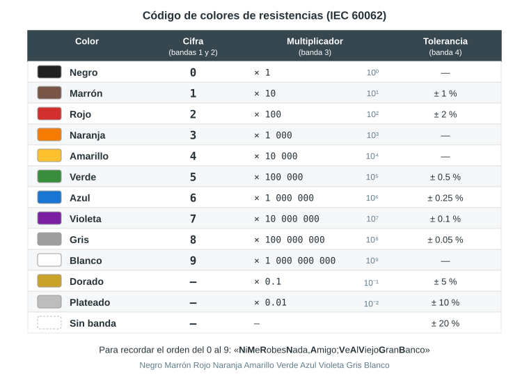
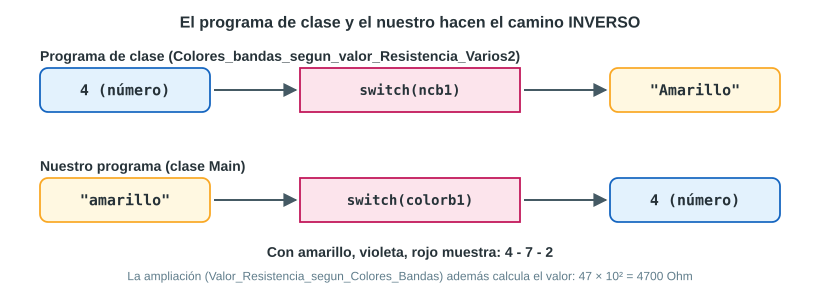
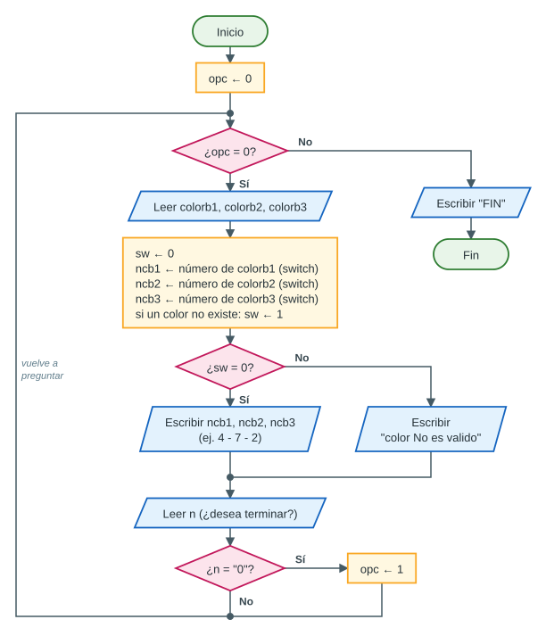

# Guion detallado: el programa «número de cada banda según su color»

Este guion sirve para exponer, de principio a fin, el programa en Java (clase `Main`) que **recibe los nombres de los colores** de las tres bandas de una resistencia y **muestra el número de cada banda**. Está pensado para un público que **no sabe Java**: indica qué decir, qué mostrar y, sobre todo, **por qué** el código está hecho así, que es lo que demuestra que se entiende el programa.

Todo lo que aparece aquí se comprobó compilando y ejecutando el código: las salidas son reales.

## 0. Cómo leer este guion

| Marca | Significa |
|---|---|
| Recuadro con «comillas» | Lo que se **dice** en voz alta. No hay que memorizarlo: basta con la idea. |
| **Mostrar:** | Lo que se pone en pantalla o se señala en el editor. |
| **Razonamiento:** | El **porqué** de esa parte. Es lo que el profesor suele preguntar. |
| **Si preguntan:** | Una pregunta probable y su respuesta corta. |

Los números de línea son los del código completo del **anexo A** (al final): 134 líneas, y la línea 1 es `import java.util.Scanner;`. Si su archivo tiene líneas extra arriba (por ejemplo, la línea `package …;` o el comentario que agrega NetBeans), los números se corren: guíense por el contenido.

## 1. La idea central

> **En una frase:** el programa **traduce el nombre de un color al número** que representa en el código de colores de las resistencias, para cada una de las tres bandas, y lo repite hasta que el usuario escribe `0`.

Ejemplo: `amarillo`, `violeta`, `rojo` → **4 - 7 - 2**.

Al terminar, el público debería poder responder cuatro preguntas:

1. ¿Qué **entra**, qué se **procesa** y qué **sale**?
2. ¿Cómo convierte Java el texto `"amarillo"` en el número 4? → Con un **`switch`** que compara textos.
3. ¿Cómo sabe el programa que un color no existe? → Por el **`default`** y la **bandera `sw`**.
4. ¿Cómo se repite y cómo termina? → Con **`while(opc==0)`** y **`n.equals("0")`**.

## 2. Estructura y tiempos

Hay tres versiones según el tiempo disponible (los números son minutos):

| N.º | Bloque | Líneas | Completa (15) | Normal (12) | Exprés (7) |
|---|---|---|---|---|---|
| 1 | Apertura: el problema de las resistencias | — | 1.5 | 1.5 | 1 |
| 2 | Cómo pensamos la solución (antes del código) | — | 2 | 2 | 1.5 |
| 3 | Preparación: `import`, clase, `main` y `Scanner` | 1–14 | 1 | — | — |
| 4 | El ciclo y las variables de cada vuelta | 16–20 | 1 | 1 | — |
| 5 | Entrada: leer los nombres de los colores | 22–29 | 1 | 1 | — |
| 6 | Proceso: el `switch` que convierte color → número | 31–109 | 2 | 2 | 2 |
| 7 | Salida: mostrar los números o el error | 111–124 | 1 | 1 | — |
| 8 | ¿Desea terminar? y fin del programa | 126–134 | 1 | 1 | — |
| 9 | Demostración en vivo | — | 2 | 2 | 2 |
| 10 | Prueba de escritorio en la pizarra | — | 1.5 | — | — |
| 11 | Cierre | — | 1 | 0.5 | 0.5 |

- En las versiones cortas, de los bloques que no se presentan basta **una frase** al pasar por esas líneas.
- **Si son tres:** A presenta los bloques 1, 2 y 11; B, del 3 al 8 (el código); C, el 9 y el 10 (demostración y pizarra). **Si son dos:** A hace del 1 al 5 y B del 6 al 11.

## 3. Antes de exponer

### 3.1 Dónde ejecutar el programa

El código empieza con `import` y la clase se llama `Main`, así que:

- **En un compilador en línea** (por ejemplo OnlineGDB o Programiz, eligiendo Java): se pega **tal cual** y se presiona *Run*. En esos sitios la clase principal **debe** llamarse `Main`. Los colores se escriben en la consola de abajo.
- **En NetBeans:** el archivo debe llamarse `Main.java`, igual que la clase. Dentro de un proyecto: clic derecho sobre el paquete → *New → Java Class…* → *Class Name*: `Main` → *Finish*. Borrar todo **menos la línea `package …;`** que puso NetBeans, pegar el código debajo de ella y ejecutar con clic derecho → *Run File* (<kbd>Shift</kbd> + <kbd>F6</kbd>).

> [!IMPORTANT]
> En NetBeans **no borren la línea `package …;`**: indica la carpeta (paquete) donde está el archivo y debe coincidir con ella. Esa línea, y el comentario que agrega NetBeans, corren los números de línea de este guion.

### 3.2 Lista de control

- [ ] Ejecutar el programa **en la misma computadora** donde se va a exponer, un día antes.
- [ ] Agrandar la letra del editor y de la consola (en NetBeans: *Tools → Options → Fonts & Colors* y *Tools → Options → Miscellaneous → Output*).
- [ ] Tener **impresos los datos de la demostración** (bloque 9) para no improvisar.
- [ ] Tener a mano el **plan B**: la ejecución real del bloque 9 (en este documento o en una captura de pantalla).
- [ ] Ensayar **con cronómetro** al menos dos veces.
- [ ] Repasar las secciones 5 y 6 (experimentos y preguntas): ahí está lo que suelen preguntar.

## 4. El guion, bloque por bloque

### Bloque 1 — Apertura: el problema

**Objetivo:** que el público entienda **qué problema resuelve** el programa antes de ver una sola línea de código.

**Mostrar:** la tabla de colores.



> «Esto es una resistencia: un componente electrónico que se opone al paso de la corriente. Es tan pequeña que su valor no se imprime con números; en su lugar se pintan **bandas de colores**, y cada color representa un número del 0 al 9: negro 0, marrón 1, rojo 2, naranja 3, amarillo 4, verde 5, azul 6, violeta 7, gris 8 y blanco 9. Para recordarlo: *Ni Me Robes Nada, Amigo; Ve Al Viejo Gran Banco*.»

> «El problema es este: si tengo una resistencia en la mano y veo amarillo, violeta y rojo, ¿qué números son? Nuestro programa responde eso: **escribimos el nombre de cada color y nos dice su número**. Con amarillo, violeta y rojo responde 4, 7 y 2.»

**Pregunta al público (opcional):** «¿Qué número es el violeta?» → 7. Sirve para captar la atención y comprobar que la tabla se entendió.

**Razonamiento:**

- Se empieza por el **problema** y no por el código porque, sin saber qué debe hacer el programa, ninguna línea tiene sentido.
- El problema ya «dicta» el diseño: hay **10 colores posibles**, cada uno con **un único número**, y hay **3 bandas**. De ahí salen los 10 `case` de cada `switch`, los 3 `switch` y las 3 variables de cada tipo.
- Es un problema de **traducción con una tabla fija** (palabra → número). Para eso la herramienta natural es el `switch`: cada `case` será una fila de esta tabla.

**Transición:** «Antes de ver el código, les contamos cómo pensamos la solución.»

### Bloque 2 — Cómo pensamos la solución

**Objetivo:** mostrar que el código no se escribió «de memoria»: primero se **analizó** el problema y se **tomaron decisiones**.

**Mostrar:** la comparación con el programa de clase.



> «En clase vimos un programa que hacía lo contrario: uno escribía el número 4 y mostraba "Amarillo". La tarea era **invertirlo**: escribir el nombre del color y obtener su número. Por eso mantuvimos la estructura del profesor —un `switch` por banda, la variable `sw` y el ciclo con `opc`—, pero al revés: antes el `switch` recibía un número y daba un texto; ahora recibe un texto y da un número.»

**Mostrar:** el análisis Entrada – Proceso – Salida.

| | Qué es | Variable | Tipo | ¿Por qué ese tipo? |
|---|---|---|---|---|
| **Entrada** | Los nombres de los 3 colores | `colorb1`, `colorb2`, `colorb3` | `String` | Son palabras (texto) |
| **Entrada** | La respuesta a «¿Desea terminar?» | `n` | `String` | Leída como número, una letra haría caer el programa |
| **Proceso** | El número de cada color (0 a 9) | `ncb1`, `ncb2`, `ncb3` | `int` | Son números enteros |
| **Proceso** | ¿Hubo algún color inválido? | `sw` | `int` | Una «bandera»: solo vale 0 (todo bien) o 1 (hubo error) |
| **Control** | ¿Seguir o terminar? | `opc` | `byte` | Solo vale 0 (seguir) o 1 (terminar) |
| **Salida** | El número de cada banda, o un aviso de error | — | — | — |

> «Antes de programar siempre nos hacemos tres preguntas: ¿qué datos entran?, ¿qué hay que hacer con ellos?, ¿qué debe salir? Aquí entran tres nombres de colores; el proceso es convertir cada nombre en su número y revisar que todos existan; y sale el número de cada banda.»

**Razonamiento — las cinco decisiones de diseño:**

| Pregunta | Decisión | Por qué |
|---|---|---|
| ¿Cómo convertir un nombre en su número? | Un `switch` con un `case` por color | Es comparar **una variable con 10 valores fijos**: el `switch` lo hace ordenado y se lee como la tabla de colores. Java acepta textos en el `switch` desde la versión 7. |
| ¿Y si escriben `ROJO` o `Rojo`? | Pasar todo a minúsculas con `toLowerCase()` | El `switch` compara letra por letra y distingue mayúsculas. Normalizar la entrada evita escribir tres `case` por color. |
| ¿Y si escriben un color que no existe? | `default` + bandera `sw = 1` + un aviso | No hay número que mostrar. La bandera «recuerda» el error hasta el momento de mostrar el resultado. |
| ¿Cómo atender varias resistencias? | Un ciclo `while(opc==0)` | No se sabe cuántas veces se usará: se repite hasta que el usuario decida. |
| ¿Cómo termina? | Leer la respuesta como texto y compararla con `equals("0")` | Leyendo texto no hay caída aunque escriban una letra; y los textos se comparan con `equals`. |

**Mostrar:** el diagrama de flujo.



> «Este es el programa completo en un dibujo: un ciclo que pide los tres colores, los convierte, revisa que sean válidos, muestra los números o un error, y pregunta si desea terminar. Ahora vamos a recorrer el código en ese mismo orden.»

**Razonamiento — el orden de los pasos:** primero se **leen** los tres colores, después se **convierten** los tres y recién al final se **decide** qué mostrar. Así, si hay dos colores mal escritos, el usuario ve **los dos errores a la vez** y no tiene que equivocarse dos veces para descubrirlos.

### Bloque 3 — Preparación (líneas 1–14)

```java
  1  import java.util.Scanner;
  2
  3  public class Main
  4  {
  5
  6      public static void main(String[] args)
  7      {
  8          Scanner datos = new Scanner(System.in);   // para leer lo que se escribe en el teclado
  9          byte opc = 0;                             // 0 = seguir, 1 = terminar
 10
 11          System.out.print("===== NUMERO DE CADA BANDA SEGUN SU COLOR =====");
 12          System.out.print("\nColores validos (escribalos sin tildes):");
 13          System.out.print("\n  negro, marron, rojo, naranja, amarillo,");
 14          System.out.print("\n  verde, azul, violeta, gris, blanco\n");
```

> «La primera línea, `import java.util.Scanner;`, es como el `#include` de C++: trae la herramienta para leer del teclado. En Java todo el programa vive dentro de una **clase**; la nuestra se llama `Main`. Y el programa empieza en el método `main`, igual que en C++.»

| Línea | Qué hace | Por qué |
|---|---|---|
| 1 | Trae la clase `Scanner` | `Scanner` está en el paquete `java.util` y hay que pedirla. `System` y `String` no necesitan `import`: están en `java.lang`, que Java incluye solo. |
| 3 | Declara la clase `Main` | En Java todo el código va dentro de una clase. El archivo debe llamarse igual que la clase pública: `Main.java`. |
| 6 | El punto de inicio | La máquina virtual de Java busca exactamente este método para empezar. `public`: se puede llamar desde fuera; `static`: no hace falta crear un objeto; `void`: no devuelve nada; `String[] args`: datos que se le pueden pasar al iniciar (no los usamos). |
| 8 | Crea el lector del teclado | `new` crea un objeto `Scanner` conectado al teclado (`System.in`). Se crea **una sola vez, antes del ciclo**: no hace falta uno nuevo en cada vuelta (el programa de clase lo creaba dentro del `while`). |
| 9 | La variable que controla el ciclo | `0` = seguir, `1` = terminar. Empieza en 0 para que el ciclo se ejecute la primera vez. Es `byte` (1 byte) porque solo guarda 0 o 1; es la elección del profesor. |
| 11–14 | Muestra el título y los colores válidos | Están **antes** del `while`, así que se muestran una sola vez. Avisan qué se puede escribir y que sea **sin tildes**: así se evitan errores antes de que ocurran. |

**Razonamiento — `print` y `\n`:** `System.out.print` muestra el texto y **deja el cursor en la misma línea**; `\n` dentro del texto es un salto de línea (igual que en C++). Por eso las líneas 12 a 14 empiezan con `\n`: primero bajan de línea y luego escriben.

> [!NOTE]
> Si en NetBeans ven textos grises como `s:` dentro de `System.out.print(s: "…")`, **no son código**: son pistas que dibuja el editor con el nombre del parámetro. No se escriben.

**Si preguntan:** «¿Qué es `System.out`?» → Es la salida estándar, la consola: `System.out.print(…)` equivale a `cout << …` en C++.

### Bloque 4 — El ciclo y las variables de cada vuelta (líneas 16–20)

```java
 16  while(opc==0)
 17  {
 18      String colorb1, colorb2, colorb3;     // colores que escribe el usuario
 19      int ncb1 = 0, ncb2 = 0, ncb3 = 0;     // numero de cada banda
 20      int sw = 0;                           // 0 = colores correctos, 1 = hubo un error
```

> «Todo lo que sigue está dentro de `while(opc==0)`: se repite **mientras** `opc` valga 0. Como `opc` empieza en 0, la primera vez siempre entra. Dentro del ciclo declaramos las variables de cada vuelta: los tres colores, sus tres números y la bandera `sw`.»

**Razonamiento:**

- **¿Por qué `while` y no `for`?** El `for` se usa cuando se sabe cuántas veces repetir. Aquí no se sabe: depende de cuándo el usuario escriba 0.
- **¿Por qué las variables se declaran dentro del ciclo?** Porque así **se crean de nuevo en cada vuelta**: `sw` vuelve a 0 y los números vuelven a 0. Cada resistencia empieza «limpia». Si `sw` estuviera fuera del ciclo, después de un solo error el programa rechazaría para siempre todos los colores (experimento 3, sección 5).
- **¿Por qué `ncb1` tiene valor inicial (`= 0`) y `colorb1` no?** Java no deja usar una variable sin valor. A `colorb1` siempre se le da valor con `datos.next()` antes de usarla, y Java lo sabe. En cambio, `ncb1` solo recibe valor si el color coincide con algún `case`: en el `default` no se le asigna nada. Java no puede adivinar que en ese caso `sw` impedirá mostrarla, así que **exige un valor inicial** (experimento 4).
- **¿Por qué `sw` es `int` y no `boolean`?** También podría ser `boolean error = false;` (incluso sería más claro). Usamos 0 y 1 para seguir la técnica del programa de clase.

### Bloque 5 — Entrada: leer los nombres de los colores (líneas 22–29)

```java
 22  // ---------- ENTRADA: se leen los NOMBRES de los colores ----------
 23  // toLowerCase() pasa todo a minusculas: "ROJO" y "Rojo" quedan como "rojo"
 24  System.out.print("\nIngrese el color de la Primera Banda: ");
 25  colorb1 = datos.next().toLowerCase();
 26  System.out.print("Ingrese el color de la Segunda Banda: ");
 27  colorb2 = datos.next().toLowerCase();
 28  System.out.print("Ingrese el color de la Tercera Banda: ");
 29  colorb3 = datos.next().toLowerCase();
```

> «Para cada banda mostramos una pregunta y leemos lo que escribe el usuario con `datos.next()`, que lee **una palabra**. En la misma línea le aplicamos `toLowerCase()`, que la pasa a minúsculas: si alguien escribe ROJO o Rojo, se guarda `rojo`.»

**Razonamiento:**

- **Dos pasos en una línea:** `datos.next()` devuelve el texto escrito y, sobre ese resultado, `toLowerCase()` devuelve **una copia en minúsculas**, que es la que se guarda en `colorb1`. (En Java los `String` no se modifican: sus métodos devuelven un texto nuevo; por eso hay que guardar el resultado.)
- **¿Por qué convertir aquí y no después?** Se convierte **una vez por color** y desde ahí todo el programa usa la versión en minúsculas, incluidos los mensajes: por eso la salida dice `(rojo)` aunque se haya escrito `ROJO`.
- **¿Por qué `next()` y no `nextLine()`?** Un color es una sola palabra. `next()` salta los espacios y los Enter sobrantes; `nextLine()` leería la línea completa, con espacios accidentales incluidos (`"rojo "` no es igual a `"rojo"`).
- **¿Por qué `print` y no `println` en las preguntas?** Para que el cursor quede **al lado** de la pregunta y el usuario escriba en la misma línea.
- **¿Por qué solo la primera pregunta empieza con `\n`?** Para dejar una línea en blanco que separe cada vuelta de la anterior. Las otras dos no lo necesitan: al presionar Enter, el cursor ya bajó.

**Si preguntan:** «¿Y si escribo los tres colores en una sola línea?» → Funciona, porque `next()` lee palabra por palabra (experimento 5).

### Bloque 6 — Proceso: el `switch` que convierte color → número (líneas 31–109)

Es el corazón del programa. Primero, la banda 1:

```java
 31  // ---------- PROCESO: convertir cada color en su numero ----------
 32  switch(colorb1)
 33  {
 34      case "negro":    ncb1 = 0;
 35          break;
 36      case "marron":   ncb1 = 1;
 37          break;
 38      case "rojo":     ncb1 = 2;
 39          break;
 40      case "naranja":  ncb1 = 3;
 41          break;
 42      case "amarillo": ncb1 = 4;
 43          break;
 44      case "verde":    ncb1 = 5;
 45          break;
 46      case "azul":     ncb1 = 6;
 47          break;
 48      case "violeta":  ncb1 = 7;
 49          break;
 50      case "gris":     ncb1 = 8;
 51          break;
 52      case "blanco":   ncb1 = 9;
 53          break;
 54      default: sw = 1;
 55          System.out.print("\n * El color de la Primera Banda ("
 56                  + colorb1 + ") No es valido");
 57  }
```

> «Un `switch` compara el valor de `colorb1` con cada `case`, de arriba hacia abajo. Si `colorb1` es `"amarillo"`, entra en `case "amarillo"`, guarda 4 en `ncb1` y el `break` lo saca del `switch`. Si no coincide con ninguno de los 10 colores, entra en el `default`: pone `sw = 1` para recordar que hubo un error y muestra qué banda está mal y qué se escribió.»

**Mostrar (señalando con el cursor)** el camino de `"amarillo"`: ¿es `"negro"`? No. ¿`"marron"`? No. ¿`"rojo"`? No. ¿`"naranja"`? No. ¿`"amarillo"`? **Sí** → `ncb1 = 4` (línea 42) → `break` (línea 43) → el programa salta a la línea 58.

Las bandas 2 y 3 son **iguales**; solo cambian la variable y el mensaje:

```java
 58  switch(colorb2)
 59  {
     ...
 80      default: sw = 1;
 81          System.out.print("\n * El color de la Segunda Banda ("
 82                  + colorb2 + ") No es valido");
 83  }
 84  switch(colorb3)
 85  {
     ...
106      default: sw = 1;
107          System.out.print("\n * El color de la Tercera Banda ("
108                  + colorb3 + ") No es valido");
109  }
```

> «La segunda y la tercera banda se procesan igual, cada una con su propio `switch`, su variable (`ncb2`, `ncb3`) y su mensaje de error.»

**Razonamiento:**

- **¿Por qué `switch` y no `if`?** Funcionarían ambos, pero aquí se compara **una misma variable con 10 valores fijos**. Con `if` serían diez `if(colorb1.equals("negro")) … else if …`; con `switch`, cada `case` es una fila de la tabla de colores y el código se lee como la tabla.
- **El `switch` con textos** existe desde Java 7 y compara las letras (por dentro usa `equals`). En C++ el `switch` no acepta `string`: allí habría que usar `if` / `else if`.
- **¿Por qué los `case` van de negro a blanco?** Siguen el orden del código de colores (0 → 9) y así se pueden verificar contra la tabla de un vistazo. En el programa de clase estaban desordenados y faltaban verde, azul y violeta.
- **¿Para qué sirve `break`?** Termina el `switch` apenas se encuentra el color. Sin `break`, Java seguiría ejecutando los `case` de abajo («cae» al siguiente) hasta llegar al `default`: todos los colores saldrían como inválidos (experimento 1).
- **¿Por qué el `default` no tiene `break`?** Porque es el último: después de él no hay nada más que saltar.
- **¿Por qué el aviso repite lo que se escribió?** Para que el usuario vea su error: por ejemplo `(celeste)`, o `(marrón)` escrito con tilde.
- **¿Por qué revisar las tres bandas en vez de detenerse en el primer error?** Cada banda es independiente: se revisan las tres y se informan **todos** los errores juntos. (El programa de clase revisaba la primera banda antes de pedir la segunda.)
- **¿Por qué la 3.ª banda no acepta dorado ni plateado?** Porque no son cifras del 0 al 9: solo sirven como multiplicador o como tolerancia. Este programa muestra **números de bandas**, como el de clase.
- **Los tres `switch` se repiten.** Se podría escribir el `switch` una sola vez dentro de un **método** y llamarlo tres veces (sección 6). Lo dejamos así para seguir la estructura del curso.

### Bloque 7 — Salida: mostrar los números o el error (líneas 111–124)

```java
111  // ---------- SALIDA: el numero de cada banda ----------
112  if(sw==0)
113  {
114      System.out.print("\nEl numero de color de la Primera Banda (" + colorb1
115              + ") es: " + ncb1);
116      System.out.print("\nEl numero de color de la Segunda Banda (" + colorb2
117              + ") es: " + ncb2);
118      System.out.print("\nEl numero de color de la Tercera Banda (" + colorb3
119              + ") es: " + ncb3);
120      System.out.print("\nNumeros de las bandas: " + ncb1 + " - " + ncb2
121              + " - " + ncb3);
122  }
123  else
124      System.out.print("\nNo se puede mostrar: revise los colores.");
```

> «Al final se mira la bandera. Si `sw` sigue en 0, los tres colores eran válidos: se muestra el número de cada banda y, al final, los tres juntos: 4 - 7 - 2. Si `sw` es 1, se avisa que no se puede mostrar; qué banda estaba mal ya se dijo arriba.»

**Razonamiento:**

- **Todo o nada.** Solo se muestran los números si **los tres** son válidos: un resultado a medias (por ejemplo «4 - ? - 2») confundiría.
- **El `+` une textos:** `"… (" + colorb1 + ") es: " + ncb1` arma una frase; el número `ncb1` se convierte en texto automáticamente.
- **Una instrucción en dos líneas.** Java no se fija en los saltos de línea: la instrucción termina en el `;`. Se parte en dos para que las líneas no sean tan largas.
- **El `else` sin llaves.** Cuando el `if` o el `else` tienen una sola instrucción, las llaves `{ }` son opcionales. El `if` las necesita porque tiene cuatro instrucciones.
- **¿Por qué se repite el color en la respuesta?** Para confirmar qué entendió el programa (ya en minúsculas).

### Bloque 8 — ¿Desea terminar? y fin (líneas 126–134)

```java
126              System.out.print("\n\nPara terminar Ingrese <0>  (otro valor para continuar)");
127              System.out.print("\nDesea terminar? ");
128              String n = datos.next();          // se lee como texto: no falla si escriben una letra
129              if(n.equals("0"))                 // los String se comparan con equals, NO con ==
130                  opc = 1;
131          }
132          System.out.print("\n****** FIN *******\n");
133      }
134  }
```

> «Por último preguntamos si desea terminar. La respuesta se lee como **texto**. Si es `"0"`, `opc` pasa a 1; cuando el programa vuelve al `while`, la condición `opc==0` ya es falsa, el ciclo termina y se muestra FIN. Cualquier otra respuesta —`s`, `1`, una letra— da otra vuelta.»

**Razonamiento:**

- **¿Por qué leer texto y no un número?** El programa de clase usaba `nextByte()`: si el usuario escribía una letra, el programa **se caía** (experimento 7). Con `next()` cualquier respuesta es válida.
- **¿Por qué `equals` y no `==`?** En Java, `==` entre textos pregunta si son **el mismo objeto en la memoria**, no si tienen las mismas letras. El texto que lee `Scanner` es un objeto nuevo, así que `n == "0"` da `false` aunque el usuario haya escrito 0, y el programa **nunca terminaría** (experimento 2). `equals` compara letra por letra.
- **¿Cuándo termina exactamente el ciclo?** La condición del `while` se revisa al **inicio** de cada vuelta. Después de `opc = 1`, el programa llega a la llave de la línea 131, vuelve a la línea 16, la condición es falsa y salta a la línea 132.
- **Las tres llaves finales** cierran, en orden, el `while` (línea 131), el `main` (133) y la clase (134). El `\n` final de FIN deja el cursor en una línea nueva.

### Bloque 9 — Demostración en vivo

**Antes de empezar:** el programa abierto, la letra grande y esta tabla impresa.

| Escribir | Debe mostrar | Qué decir |
|---|---|---|
| `amarillo`, `violeta`, `rojo` | `Numeros de las bandas: 4 - 7 - 2` | «El ejemplo del inicio.» |
| `s` | Vuelve a pedir colores | «Cualquier respuesta distinta de 0 continúa.» |
| `ROJO`, `Rojo`, `negro` | `Numeros de las bandas: 2 - 2 - 0` | «Gracias a `toLowerCase()`, da igual cómo se escriba.» |
| `s` | Vuelve a pedir colores | |
| `verde`, `azul`, `violeta` | `Numeros de las bandas: 5 - 6 - 7` | «Los tres colores que faltaban en el programa de clase.» |
| `s` | Vuelve a pedir colores | |
| `celeste`, `negro`, `dorado` | Dos avisos de color no válido | «El `default` y la bandera `sw`; el dorado no es una cifra.» |
| `0` | `****** FIN *******` | «`equals("0")` termina el ciclo.» |

Ejecución real (es lo que debe verse en pantalla):

```text
===== NUMERO DE CADA BANDA SEGUN SU COLOR =====
Colores validos (escribalos sin tildes):
  negro, marron, rojo, naranja, amarillo,
  verde, azul, violeta, gris, blanco

Ingrese el color de la Primera Banda: amarillo
Ingrese el color de la Segunda Banda: violeta
Ingrese el color de la Tercera Banda: rojo

El numero de color de la Primera Banda (amarillo) es: 4
El numero de color de la Segunda Banda (violeta) es: 7
El numero de color de la Tercera Banda (rojo) es: 2
Numeros de las bandas: 4 - 7 - 2

Para terminar Ingrese <0>  (otro valor para continuar)
Desea terminar? s

Ingrese el color de la Primera Banda: ROJO
Ingrese el color de la Segunda Banda: Rojo
Ingrese el color de la Tercera Banda: negro

El numero de color de la Primera Banda (rojo) es: 2
El numero de color de la Segunda Banda (rojo) es: 2
El numero de color de la Tercera Banda (negro) es: 0
Numeros de las bandas: 2 - 2 - 0

Para terminar Ingrese <0>  (otro valor para continuar)
Desea terminar? s

Ingrese el color de la Primera Banda: verde
Ingrese el color de la Segunda Banda: azul
Ingrese el color de la Tercera Banda: violeta

El numero de color de la Primera Banda (verde) es: 5
El numero de color de la Segunda Banda (azul) es: 6
El numero de color de la Tercera Banda (violeta) es: 7
Numeros de las bandas: 5 - 6 - 7

Para terminar Ingrese <0>  (otro valor para continuar)
Desea terminar? s

Ingrese el color de la Primera Banda: celeste
Ingrese el color de la Segunda Banda: negro
Ingrese el color de la Tercera Banda: dorado

 * El color de la Primera Banda (celeste) No es valido
 * El color de la Tercera Banda (dorado) No es valido
No se puede mostrar: revise los colores.

Para terminar Ingrese <0>  (otro valor para continuar)
Desea terminar? 0

****** FIN *******
```

**Plan B:** si el programa no corre en el momento, mostrar esta ejecución (o una captura tomada el día anterior) y explicar con la prueba de escritorio del bloque 10.

**Curiosidad para cerrar la demo (opcional):** escribir los tres colores en **una sola línea**, separados por espacios. También funciona, porque `next()` lee palabra por palabra:

```text
Ingrese el color de la Primera Banda: amarillo violeta rojo
Ingrese el color de la Segunda Banda: Ingrese el color de la Tercera Banda:
El numero de color de la Primera Banda (amarillo) es: 4
El numero de color de la Segunda Banda (violeta) es: 7
El numero de color de la Tercera Banda (rojo) es: 2
Numeros de las bandas: 4 - 7 - 2

Para terminar Ingrese <0>  (otro valor para continuar)
Desea terminar? 0

****** FIN *******
```

### Bloque 10 — Prueba de escritorio en la pizarra

Una **prueba de escritorio** es ejecutar el programa «a mano», anotando cómo cambian las variables. Demuestra que se entiende el código sin depender de la computadora.

**Caso 1: amarillo, violeta, rojo** (y luego `0` para terminar):

| Paso | Línea | Qué pasa | `colorb1` | `colorb2` | `colorb3` | `ncb1` | `ncb2` | `ncb3` | `sw` | `opc` |
|---|---|---|---|---|---|---|---|---|---|---|
| 1 | 9 | `opc = 0` | | | | | | | | 0 |
| 2 | 16 | `opc==0` es verdadero: entra al ciclo | | | | | | | | 0 |
| 3 | 19–20 | Variables en 0 | | | | 0 | 0 | 0 | 0 | 0 |
| 4 | 25, 27, 29 | Lee los tres colores | amarillo | violeta | rojo | 0 | 0 | 0 | 0 | 0 |
| 5 | 42–43 | `case "amarillo"`: `ncb1 = 4`; `break` | | | | **4** | 0 | 0 | 0 | 0 |
| 6 | 74–75 | `case "violeta"`: `ncb2 = 7`; `break` | | | | 4 | **7** | 0 | 0 | 0 |
| 7 | 90–91 | `case "rojo"`: `ncb3 = 2`; `break` | | | | 4 | 7 | **2** | 0 | 0 |
| 8 | 112–121 | `sw==0` es verdadero: muestra 4, 7, 2 y `4 - 7 - 2` | | | | 4 | 7 | 2 | 0 | 0 |
| 9 | 128–130 | Lee `n = "0"`; `equals("0")` es verdadero: `opc = 1` | | | | | | | | **1** |
| 10 | 16 | `opc==0` es falso: sale del ciclo | | | | | | | | 1 |
| 11 | 132 | Muestra `****** FIN *******` | | | | | | | | 1 |

**Caso 2: celeste, negro, dorado** (para explicar la bandera):

| Paso | Línea | Qué pasa | `ncb1` | `ncb2` | `ncb3` | `sw` | En pantalla |
|---|---|---|---|---|---|---|---|
| 1 | 19–20 | Variables en 0 | 0 | 0 | 0 | 0 | |
| 2 | 54–56 | `"celeste"` no coincide con ningún `case`: `default` | 0 | 0 | 0 | **1** | `* El color de la Primera Banda (celeste) No es valido` |
| 3 | 60–61 | `case "negro"`: `ncb2 = 0` | 0 | 0 | 0 | 1 | |
| 4 | 106–108 | `"dorado"` no coincide: `default` | 0 | 0 | 0 | 1 | `* El color de la Tercera Banda (dorado) No es valido` |
| 5 | 112, 123–124 | `sw==0` es falso: `else` | | | | 1 | `No se puede mostrar: revise los colores.` |

> «Fíjense en `sw`: empezó en 0, el primer color inválido la puso en 1 y se quedó en 1. Al final, el `if` solo pregunta por `sw` para saber si hubo algún error en cualquiera de las tres bandas.»

### Bloque 11 — Cierre

> «Para cerrar, tres ideas:
>
> 1. El programa es una **traducción** color → número: cada `case` del `switch` es una fila de la tabla de colores.
> 2. Es **robusto**: con `toLowerCase()` acepta mayúsculas; con el `default` y la bandera `sw` avisa los colores inválidos; y como lee la respuesta como texto, nunca se cae.
> 3. El ciclo `while` con `opc` y la comparación `equals("0")` permiten consultar todas las resistencias que se quiera y terminar cuando el usuario decida.
>
> Muchas gracias. ¿Preguntas?»

## 5. Experimentos «¿qué pasa si…?»

Estos cambios se probaron de verdad. Sirven para responder preguntas del tipo «¿y si quitas esto?» y demuestran que se entiende **por qué** cada parte está ahí. No hace falta mostrarlos todos: uno o dos bastan si sobra tiempo.

### Experimento 1 — Quitar los `break`

Sin `break`, al encontrar el color Java **sigue ejecutando los `case` de abajo** hasta el final del `switch`, incluido el `default`. Con `amarillo`, `ncb1` pasa por 4, 5, 6, 7, 8 y 9, y al final `sw = 1`. Resultado real:

```text
Ingrese el color de la Primera Banda: amarillo
Ingrese el color de la Segunda Banda: violeta
Ingrese el color de la Tercera Banda: rojo

 * El color de la Primera Banda (amarillo) No es valido
 * El color de la Segunda Banda (violeta) No es valido
 * El color de la Tercera Banda (rojo) No es valido
No se puede mostrar: revise los colores.

Para terminar Ingrese <0>  (otro valor para continuar)
Desea terminar? 0

****** FIN *******
```

**Conclusión:** el `break` es lo que hace que cada `case` sea una fila **independiente** de la tabla.

### Experimento 2 — Comparar con `==` en vez de `equals`

Cambiando la línea 129 por `if(n == "0")`, el programa **nunca termina**: aunque se escriba 0, vuelve a pedir colores.

```text
Ingrese el color de la Primera Banda: amarillo
Ingrese el color de la Segunda Banda: violeta
Ingrese el color de la Tercera Banda: rojo

El numero de color de la Primera Banda (amarillo) es: 4
El numero de color de la Segunda Banda (violeta) es: 7
El numero de color de la Tercera Banda (rojo) es: 2
Numeros de las bandas: 4 - 7 - 2

Para terminar Ingrese <0>  (otro valor para continuar)
Desea terminar? 0

Ingrese el color de la Primera Banda: negro
Ingrese el color de la Segunda Banda: negro
Ingrese el color de la Tercera Banda: negro

El numero de color de la Primera Banda (negro) es: 0
El numero de color de la Segunda Banda (negro) es: 0
El numero de color de la Tercera Banda (negro) es: 0
Numeros de las bandas: 0 - 0 - 0

Para terminar Ingrese <0>  (otro valor para continuar)
Desea terminar? 0

Ingrese el color de la Primera Banda:
```

**Conclusión:** `==` compara si son **el mismo objeto** en la memoria; `equals`, si tienen **las mismas letras**. Con textos siempre se usa `equals`.

### Experimento 3 — Declarar `sw` fuera del `while`

Si `int sw = 0;` se pone antes del ciclo (junto a `opc`), nunca vuelve a 0. Después de un error, ni siquiera amarillo, violeta, rojo se acepta:

```text
Ingrese el color de la Primera Banda: celeste
Ingrese el color de la Segunda Banda: negro
Ingrese el color de la Tercera Banda: rojo

 * El color de la Primera Banda (celeste) No es valido
No se puede mostrar: revise los colores.

Para terminar Ingrese <0>  (otro valor para continuar)
Desea terminar? s

Ingrese el color de la Primera Banda: amarillo
Ingrese el color de la Segunda Banda: violeta
Ingrese el color de la Tercera Banda: rojo

No se puede mostrar: revise los colores.

Para terminar Ingrese <0>  (otro valor para continuar)
Desea terminar? 0

****** FIN *******
```

**Conclusión:** las variables de cada vuelta se declaran **dentro** del ciclo para que cada resistencia empiece «limpia».

### Experimento 4 — Quitar el valor inicial de `ncb1`, `ncb2` y `ncb3`

Cambiando la línea 19 por `int ncb1, ncb2, ncb3;`, el programa **ni siquiera compila**:

```text
Main.java:115: error: variable ncb1 might not have been initialized
                        + ") es: " + ncb1);
                                     ^
Main.java:117: error: variable ncb2 might not have been initialized
                        + ") es: " + ncb2);
                                     ^
Main.java:119: error: variable ncb3 might not have been initialized
                        + ") es: " + ncb3);
                                     ^
3 errors
```

(«*variable might not have been initialized*» significa «la variable podría no tener valor».)

**Conclusión:** Java no deja usar una variable que podría no tener valor. Si el color cae en el `default`, `ncb1` no recibe nada; por eso se le da 0 al declararla.

### Experimento 5 — Escribir los tres colores en una sola línea

`amarillo violeta rojo` en una sola línea funciona (se vio al final del bloque 9), porque `next()` toma **una palabra cada vez**: las otras dos quedan esperando y se usan en las lecturas siguientes.

### Experimento 6 — Escribir un color de dos palabras

Con `verde claro`, la primera banda lee `verde` y la segunda lee `claro`, que no es un color:

```text
Ingrese el color de la Primera Banda: verde claro
Ingrese el color de la Segunda Banda: Ingrese el color de la Tercera Banda: rojo

 * El color de la Segunda Banda (claro) No es valido
No se puede mostrar: revise los colores.

Para terminar Ingrese <0>  (otro valor para continuar)
Desea terminar? 0

****** FIN *******
```

**Conclusión:** `next()` separa por espacios. Por eso cada color se escribe en una sola palabra.

### Experimento 7 — Escribir un color en el programa de clase

El programa de clase lee con `nextByte()`, que espera un número. Si se escribe `amarillo`, **se cae** con una excepción (un error en plena ejecución):

```text
Ingrese el numero de color de la Primera Banda: amarillo
Exception in thread "main" java.util.InputMismatchException
```

(Le siguen varias líneas `at …` que indican dónde ocurrió.) Pasa lo mismo si en «¿Desea terminar?» se escribe una letra. **Por eso nuestro programa lee todo como texto** con `next()` y compara con `switch` y `equals`.

### Experimento 8 — Presionar Enter sin escribir nada

No pasa nada: `next()` **ignora las líneas vacías** y sigue esperando hasta que se escriba una palabra.

## 6. Preguntas difíciles y cómo responderlas

| Pregunta | Respuesta |
|---|---|
| ¿Por qué `switch` y no `if`? | Ambos sirven. Se elige `switch` porque se compara **una misma variable con muchos valores fijos**: es más ordenado y cada `case` es una fila de la tabla. Además, es la estructura del programa de clase. |
| ¿Qué pasa si quito un `break`? | Java sigue con los `case` de abajo hasta el `default` y el color sale como inválido (experimento 1). |
| ¿Por qué `toLowerCase()`? | El `switch` distingue mayúsculas: `"Rojo"` no es `"rojo"`. Convirtiendo todo a minúsculas, el usuario puede escribir como quiera. |
| ¿Y si escribo «marrón» con tilde? | Es otro texto (`"marrón"` no es `"marron"`): sale como no válido. Se podría agregar `case "marrón":` justo encima de `case "marron":` (dos etiquetas para el mismo bloque), pero algunas consolas no leen bien las tildes; por eso pedimos escribir sin ellas. |
| ¿Para qué sirve `sw`? | Es una **bandera**: empieza en 0 y cualquier `default` la pone en 1. Al final, una sola pregunta (`sw==0`) dice si hubo algún error en las tres bandas. |
| ¿Por qué las variables están dentro del `while`? | Para que se reinicien en cada vuelta (experimento 3). |
| ¿Por qué `int ncb1 = 0` y no solo `int ncb1`? | Porque en el `default` no se le asigna valor, y Java no compila si una variable podría usarse sin valor (experimento 4). |
| ¿Por qué `next()` y no `nextLine()`? | Los colores son una sola palabra y `next()` ignora espacios y líneas vacías. `nextLine()` leería espacios sobrantes, y `"rojo "` no coincidiría con `"rojo"`. |
| ¿Por qué la respuesta a «¿Desea terminar?» es `String`? | Con `nextByte()`, una letra hace caer el programa (experimento 7). Con texto, cualquier respuesta es válida. |
| ¿Por qué `equals` y no `==`? | `==` compara si es el mismo objeto; `equals`, si tienen las mismas letras. Con `==` el programa no terminaría (experimento 2). |
| ¿Qué pasa si escribo un número, por ejemplo `4`? | `"4"` es un texto que no es ningún color: entra al `default` y se avisa que no es válido. Este programa recibe **nombres**, no números. |
| ¿Por qué `byte opc`? | Solo guarda 0 o 1 y `byte` ocupa 1 byte; es la elección del profesor. Con `int` funcionaría igual. |
| ¿Qué significa `public static void main(String[] args)`? | Es el punto de inicio, como `int main()` en C++: `public` (se puede llamar desde fuera), `static` (sin crear objetos), `void` (no devuelve nada) y `String[] args` (argumentos que no usamos). |
| ¿Por qué la clase se llama `Main`? | En los compiladores en línea la clase principal debe llamarse así. En Java, el archivo se llama igual que la clase pública: `Main.java`. |
| ¿Por qué no acepta dorado ni plateado? | No son cifras del 0 al 9: solo aparecen como multiplicador (×0.1 y ×0.01) o como tolerancia. El programa muestra números de bandas. |
| ¿Este programa calcula el valor de la resistencia? | No: muestra los números de las bandas. El valor sería (1.ª × 10 + 2.ª) × 10 elevado a la 3.ª: con 4, 7 y 2 → 47 × 100 = 4 700 Ω. |
| ¿Por qué no cierran el `Scanner`? | Se puede agregar `datos.close();` antes del mensaje de FIN; no cambia nada, porque el programa termina ahí y Java libera todo. |
| ¿Se puede hacer más corto? | Sí: con un **método** que tenga el `switch` una sola vez. Ver abajo. |

**Versión con método.** El `switch` se escribe una sola vez, dentro de un método que recibe el color y **devuelve** su número (o −1 si no existe). Como cada `case` termina con `return`, que sale del método, ya no hacen falta los `break`:

```java
// Devuelve el numero (0 a 9) de un color, o -1 si el color no existe
static int numeroDelColor(String color)
{
    switch(color)
    {
        case "negro":    return 0;
        case "marron":   return 1;
        case "rojo":     return 2;
        case "naranja":  return 3;
        case "amarillo": return 4;
        case "verde":    return 5;
        case "azul":     return 6;
        case "violeta":  return 7;
        case "gris":     return 8;
        case "blanco":   return 9;
        default:         return -1;
    }
}
```

Y las líneas 31 a 109 (los tres `switch`) se reducen a esto:

```java
// ---------- PROCESO: convertir cada color en su numero ----------
ncb1 = numeroDelColor(colorb1);
if(ncb1 == -1)
{
    sw = 1;
    System.out.print("\n * El color de la Primera Banda ("
            + colorb1 + ") No es valido");
}
ncb2 = numeroDelColor(colorb2);
if(ncb2 == -1)
{
    sw = 1;
    System.out.print("\n * El color de la Segunda Banda ("
            + colorb2 + ") No es valido");
}
ncb3 = numeroDelColor(colorb3);
if(ncb3 == -1)
{
    sw = 1;
    System.out.print("\n * El color de la Tercera Banda ("
            + colorb3 + ") No es valido");
}
```

Se probó con las 1 000 combinaciones de colores y con colores inválidos: la salida es **idéntica** a la del programa original, y el código baja de 134 a 96 líneas.

**Con un arreglo.** Otra idea: guardar los nombres en un arreglo, en el orden del código de colores. Así, **el número de un color es su posición en la lista**:

```java
// Version con arreglo: el numero de un color es su POSICION en la lista
static int numeroConArreglo(String color)
{
    String[] colores = {"negro", "marron", "rojo", "naranja", "amarillo",
                        "verde", "azul", "violeta", "gris", "blanco"};
    for(int i = 0; i < colores.length; i++)
        if(colores[i].equals(color))
            return i;
    return -1;
}
```

## 7. Errores que conviene evitar al exponer

- Leer el código palabra por palabra sin decir **para qué** sirve cada parte.
- Confundir el **número de la banda** con el **valor de la resistencia** (este programa no calcula ohmios).
- Decir que el `switch` «compara con `==`»: con textos compara las letras, como `equals`.
- Escribir con tildes o con dos palabras durante la demostración (`marrón`, `verde claro`).
- Hacer la demostración sin haberla probado en esa computadora, o con datos improvisados.
- Olvidar explicar `sw`: es lo que más se pregunta.
- Hablar mirando la pantalla en vez de al público.

## 8. Tarjeta de bolsillo

| Tema | Lo esencial |
|---|---|
| Qué hace | Nombre del color → número de la banda (3 bandas), hasta que se escriba 0 |
| Colores | negro 0 · marrón 1 · rojo 2 · naranja 3 · amarillo 4 · verde 5 · azul 6 · violeta 7 · gris 8 · blanco 9 |
| Líneas 1–14 | `import`, clase `Main`, `main`, `Scanner`, `opc = 0` y mensaje inicial |
| Líneas 16–20 | `while(opc==0)` y variables de cada vuelta (se reinician) |
| Líneas 22–29 | Entrada: `datos.next().toLowerCase()` (una palabra, en minúsculas) |
| Líneas 31–109 | Proceso: 3 `switch`; cada `case` da un número; `break` sale; `default` → `sw = 1` y aviso |
| Líneas 111–124 | Salida: si `sw==0`, los números (`4 - 7 - 2`); si no, un aviso |
| Líneas 126–134 | `n.equals("0")` → `opc = 1` → termina el ciclo → FIN |
| Datos de la demo | amarillo violeta rojo · ROJO Rojo negro · verde azul violeta · celeste negro dorado · 0 |
| Tres ideas | Traducción con `switch` · robusto (`toLowerCase`, `default`, `sw`, texto) · ciclo hasta escribir 0 |

## Anexo A. El código completo con números de línea

```java
  1  import java.util.Scanner;
  2
  3  public class Main
  4  {
  5
  6      public static void main(String[] args)
  7      {
  8          Scanner datos = new Scanner(System.in);   // para leer lo que se escribe en el teclado
  9          byte opc = 0;                             // 0 = seguir, 1 = terminar
 10
 11          System.out.print("===== NUMERO DE CADA BANDA SEGUN SU COLOR =====");
 12          System.out.print("\nColores validos (escribalos sin tildes):");
 13          System.out.print("\n  negro, marron, rojo, naranja, amarillo,");
 14          System.out.print("\n  verde, azul, violeta, gris, blanco\n");
 15
 16          while(opc==0)
 17          {
 18              String colorb1, colorb2, colorb3;     // colores que escribe el usuario
 19              int ncb1 = 0, ncb2 = 0, ncb3 = 0;     // numero de cada banda
 20              int sw = 0;                           // 0 = colores correctos, 1 = hubo un error
 21
 22              // ---------- ENTRADA: se leen los NOMBRES de los colores ----------
 23              // toLowerCase() pasa todo a minusculas: "ROJO" y "Rojo" quedan como "rojo"
 24              System.out.print("\nIngrese el color de la Primera Banda: ");
 25              colorb1 = datos.next().toLowerCase();
 26              System.out.print("Ingrese el color de la Segunda Banda: ");
 27              colorb2 = datos.next().toLowerCase();
 28              System.out.print("Ingrese el color de la Tercera Banda: ");
 29              colorb3 = datos.next().toLowerCase();
 30
 31              // ---------- PROCESO: convertir cada color en su numero ----------
 32              switch(colorb1)
 33              {
 34                  case "negro":    ncb1 = 0;
 35                      break;
 36                  case "marron":   ncb1 = 1;
 37                      break;
 38                  case "rojo":     ncb1 = 2;
 39                      break;
 40                  case "naranja":  ncb1 = 3;
 41                      break;
 42                  case "amarillo": ncb1 = 4;
 43                      break;
 44                  case "verde":    ncb1 = 5;
 45                      break;
 46                  case "azul":     ncb1 = 6;
 47                      break;
 48                  case "violeta":  ncb1 = 7;
 49                      break;
 50                  case "gris":     ncb1 = 8;
 51                      break;
 52                  case "blanco":   ncb1 = 9;
 53                      break;
 54                  default: sw = 1;
 55                      System.out.print("\n * El color de la Primera Banda ("
 56                              + colorb1 + ") No es valido");
 57              }
 58              switch(colorb2)
 59              {
 60                  case "negro":    ncb2 = 0;
 61                      break;
 62                  case "marron":   ncb2 = 1;
 63                      break;
 64                  case "rojo":     ncb2 = 2;
 65                      break;
 66                  case "naranja":  ncb2 = 3;
 67                      break;
 68                  case "amarillo": ncb2 = 4;
 69                      break;
 70                  case "verde":    ncb2 = 5;
 71                      break;
 72                  case "azul":     ncb2 = 6;
 73                      break;
 74                  case "violeta":  ncb2 = 7;
 75                      break;
 76                  case "gris":     ncb2 = 8;
 77                      break;
 78                  case "blanco":   ncb2 = 9;
 79                      break;
 80                  default: sw = 1;
 81                      System.out.print("\n * El color de la Segunda Banda ("
 82                              + colorb2 + ") No es valido");
 83              }
 84              switch(colorb3)
 85              {
 86                  case "negro":    ncb3 = 0;
 87                      break;
 88                  case "marron":   ncb3 = 1;
 89                      break;
 90                  case "rojo":     ncb3 = 2;
 91                      break;
 92                  case "naranja":  ncb3 = 3;
 93                      break;
 94                  case "amarillo": ncb3 = 4;
 95                      break;
 96                  case "verde":    ncb3 = 5;
 97                      break;
 98                  case "azul":     ncb3 = 6;
 99                      break;
100                  case "violeta":  ncb3 = 7;
101                      break;
102                  case "gris":     ncb3 = 8;
103                      break;
104                  case "blanco":   ncb3 = 9;
105                      break;
106                  default: sw = 1;
107                      System.out.print("\n * El color de la Tercera Banda ("
108                              + colorb3 + ") No es valido");
109              }
110
111              // ---------- SALIDA: el numero de cada banda ----------
112              if(sw==0)
113              {
114                  System.out.print("\nEl numero de color de la Primera Banda (" + colorb1
115                          + ") es: " + ncb1);
116                  System.out.print("\nEl numero de color de la Segunda Banda (" + colorb2
117                          + ") es: " + ncb2);
118                  System.out.print("\nEl numero de color de la Tercera Banda (" + colorb3
119                          + ") es: " + ncb3);
120                  System.out.print("\nNumeros de las bandas: " + ncb1 + " - " + ncb2
121                          + " - " + ncb3);
122              }
123              else
124                  System.out.print("\nNo se puede mostrar: revise los colores.");
125
126              System.out.print("\n\nPara terminar Ingrese <0>  (otro valor para continuar)");
127              System.out.print("\nDesea terminar? ");
128              String n = datos.next();          // se lee como texto: no falla si escriben una letra
129              if(n.equals("0"))                 // los String se comparan con equals, NO con ==
130                  opc = 1;
131          }
132          System.out.print("\n****** FIN *******\n");
133      }
134  }
```
