# ¿Cómo se almacena un número real en la memoria? Teoría completa

Este documento explica, desde cero y en detalle, cómo guarda una computadora un número con decimales: qué son los bits, cómo se escribe un número en binario y, sobre todo, cómo funciona el estándar **IEEE 754** con sus tres partes —el **signo**, el **exponente** (con su **sesgo**) y la **mantisa**—, además de los valores especiales, el redondeo y sus consecuencias en los programas.

Cada concepto se explica junto con su **porqué**. Todos los ejemplos se comprobaron en Java: los valores, los bits y las salidas que aparecen son reales.

> [!NOTE]
> **Notación.** El subíndice ₂ indica que un número está en binario (110.11₂); sin subíndice, el número está en decimal. Los valores en hexadecimal se escriben como `C0D80000`. Las potencias se escriben con superíndice: 2⁻⁴ = 1/16 = 0.0625.

## 1. Lo que hay dentro de la memoria

### 1.1 El bit

Un **bit** (*binary digit*, «dígito binario») es la unidad mínima de información: solo puede valer **0** o **1**. Físicamente es cualquier cosa que tenga dos estados bien distinguibles: un transistor que conduce o no conduce, un condensador cargado o descargado. Se usan dos estados (y no diez, como los dígitos decimales) porque distinguir «hay carga» de «no hay carga» es muy fiable, incluso con ruido eléctrico.

Con varios bits se forman combinaciones: con 1 bit hay 2 (0 y 1); con 2 bits, 4 (00, 01, 10, 11); con 3 bits, 8. En general:

> **Con n bits se pueden formar 2ⁿ combinaciones distintas.**

### 1.2 El byte

Un **byte** son **8 bits**: 2⁸ = 256 combinaciones, de `00000000` a `11111111`. Es la unidad con la que se mide la memoria: 1 KB son unos mil bytes, 1 MB un millón y 1 GB mil millones.

### 1.3 La memoria RAM y las direcciones

La memoria RAM se puede imaginar como una fila enorme de **casilleros de un byte**. Cada casillero tiene un número que lo identifica, su **dirección**. Una variable ocupa varios casilleros **seguidos**; cuántos, depende de su tipo:

| Tipo en Java | Bytes | Bits | Qué guarda |
|---|---|---|---|
| `byte` | 1 | 8 | Enteros de −128 a 127 |
| `short` | 2 | 16 | Enteros de −32 768 a 32 767 |
| `int` | 4 | 32 | Enteros de −2 147 483 648 a 2 147 483 647 |
| `long` | 8 | 64 | Enteros de hasta unos ±9.2 × 10¹⁸ |
| `float` | 4 | 32 | Reales de precisión simple (unas 7 cifras) |
| `double` | 8 | 64 | Reales de precisión doble (unas 16 cifras) |

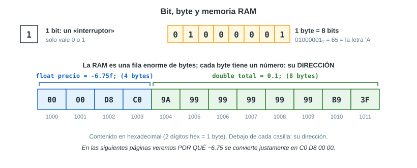

### 1.4 Los bits no tienen significado propio

Un grupo de bits es solo una secuencia de ceros y unos. **El significado lo pone el tipo de dato**, es decir, la regla con la que se interpretan:

- El byte `01000001` es el número **65** si se lee como entero, y la letra **`A`** si se lee como carácter.
- Los 32 bits `11000000110110000000000000000000` (en hexadecimal `C0D80000`) son el entero **−1 059 586 048** si se leen como `int`, y el número real **−6.75** si se leen como `float`.

Por eso, preguntar «cómo se almacena un número real» es preguntar: **¿qué regla se usa para convertir un número real en un patrón de bits, y para volver de los bits al número?** Esa regla es el estándar IEEE 754.

### 1.5 La limitación fundamental

Con 32 bits hay 2³² = **4 294 967 296** patrones distintos; con 64 bits, 2⁶⁴ ≈ 1.8 × 10¹⁹. Son muchísimos, pero son **finitos**. Los números reales, en cambio, son **infinitos**, y no solo hacia lo grande: entre 0 y 1 ya hay infinitos (0.1, 0.01, 0.001…, 1/3, π − 3…).

La conclusión es inevitable: **es imposible guardar todos los números reales de forma exacta**. Cualquier representación con una cantidad fija de bits tiene que:

1. **elegir** un conjunto finito de números que sí se pueden guardar exactos (los **números representables**), y
2. **redondear** cualquier otro número al representable más cercano.

No es un defecto de Java ni de la computadora: es lo mismo que ocurre al escribir 1/3 con cuatro decimales (0.3333). Todo lo que sigue explica **qué números se eligen** como representables y **cómo se redondea** el resto.

## 2. Sistemas de numeración posicional

### 2.1 El sistema decimal

En el sistema decimal (base 10) hay diez dígitos, del 0 al 9, y **cada posición vale 10 veces más que la de su derecha**. A la derecha del punto, cada posición vale **la décima parte** de la anterior:

| Posición | 10² | 10¹ | 10⁰ | **.** | 10⁻¹ | 10⁻² | 10⁻³ |
|---|---|---|---|---|---|---|---|
| Vale | 100 | 10 | 1 | **.** | 0.1 | 0.01 | 0.001 |

> 6.75 = 6 × 10⁰ + 7 × 10⁻¹ + 5 × 10⁻² = 6 + 0.7 + 0.05

### 2.2 El sistema binario

El binario (base 2) funciona igual, pero con **dos dígitos** (0 y 1) y con potencias de **2**: cada posición vale el **doble** de la de su derecha y, a la derecha del punto, cada posición vale **la mitad** de la anterior.

| Posición | 2³ | 2² | 2¹ | 2⁰ | **.** | 2⁻¹ | 2⁻² | 2⁻³ | 2⁻⁴ |
|---|---|---|---|---|---|---|---|---|---|
| Vale | 8 | 4 | 2 | 1 | **.** | 0.5 | 0.25 | 0.125 | 0.0625 |

Para pasar de binario a decimal se **suman los valores de las posiciones que tienen un 1**:

> 110.11₂ = 4 + 2 + 0.5 + 0.25 = **6.75**
>
> 0.101₂ = 0.5 + 0.125 = **0.625**
>
> 10011₂ = 16 + 2 + 1 = **19**

### 2.3 El sistema hexadecimal

Escribir 32 o 64 ceros y unos es incómodo y fácil de equivocar. Por eso se usa el **hexadecimal** (base 16), con 16 dígitos: del 0 al 9 y luego A (10), B (11), C (12), D (13), E (14) y F (15). Como 16 = 2⁴, **cada dígito hexadecimal equivale exactamente a 4 bits**:

| Bits | 0000 | 0001 | 0010 | 0011 | 0100 | 0101 | 0110 | 0111 |
|---|---|---|---|---|---|---|---|---|
| Hex | 0 | 1 | 2 | 3 | 4 | 5 | 6 | 7 |

| Bits | 1000 | 1001 | 1010 | 1011 | 1100 | 1101 | 1110 | 1111 |
|---|---|---|---|---|---|---|---|---|
| Hex | 8 | 9 | A | B | C | D | E | F |

Así, los 32 bits de un `float` se escriben con 8 dígitos hexadecimales: `1100 0000 1101 1000 0000 0000 0000 0000` = `C0D80000`. El hexadecimal **no es otra forma de guardar** el número: es solo una forma abreviada de **escribir** los mismos bits.

## 3. De decimal a binario

### 3.1 La parte entera: divisiones sucesivas

Se divide el número entre 2 y se anota el **resto** (0 o 1); se repite con el cociente hasta llegar a 0. El número binario son los restos **leídos de abajo hacia arriba**:

```calculo
19 / 2 = 9   resto 1   ↑
 9 / 2 = 4   resto 1   │
 4 / 2 = 2   resto 0   │   leídos de abajo hacia arriba:
 2 / 2 = 1   resto 0   │   19 = 10011₂
 1 / 2 = 0   resto 1   │
```

**Por qué funciona:** el resto de dividir entre 2 indica si el número es par (0) o impar (1), y eso es exactamente su **último bit** (el de las unidades). Dividir entre 2 «borra» ese último bit y corre los demás un lugar a la derecha, así que el siguiente resto es el bit siguiente. Por eso el **primer** resto es el bit **menos** significativo y la lectura va de abajo hacia arriba.

### 3.2 La parte fraccionaria: multiplicaciones sucesivas

Se multiplica la parte fraccionaria por 2 y se anota la **parte entera** del resultado (0 o 1); se continúa con la parte fraccionaria que queda, hasta que valga 0. Los bits se leen **de arriba hacia abajo**:

```calculo
0.625 × 2 = 1.25   → 1   │
0.25  × 2 = 0.5    → 0   │   leídos de arriba hacia abajo:
0.5   × 2 = 1.0    → 1   ↓   0.625 = 0.101₂   (queda 0: termina)
```

**Por qué funciona:** multiplicar por 2 un número binario **corre el punto un lugar a la derecha**, igual que multiplicar por 10 en decimal. El dígito que cruza el punto es el primer bit después del punto. Se quita ese bit y se repite con lo que queda.

### 3.3 Un número completo: 6.75

Se convierten por separado la parte entera (6 → 110) y la fraccionaria (0.75 → .11), y se juntan: **6.75 = 110.11₂**.

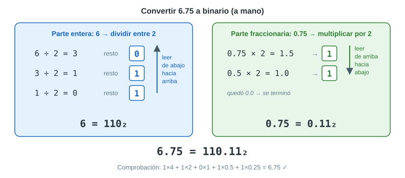

### 3.4 Decimales que no terminan: el caso de 0.1

Con 0.1, la cuenta nunca llega a 0:

```calculo
0.1 × 2 = 0.2   → 0
0.2 × 2 = 0.4   → 0
0.4 × 2 = 0.8   → 0
0.8 × 2 = 1.6   → 1   (queda 0.6)
0.6 × 2 = 1.2   → 1   (queda 0.2)
0.2 × 2 = 0.4   → 0   ← 0.2 otra vez: desde aquí todo se repite
0.4 × 2 = 0.8   → 0
0.8 × 2 = 1.6   → 1
0.6 × 2 = 1.2   → 1
...
0.1 = 0.0 0011 0011 0011 0011 …₂   (el grupo 0011 se repite para siempre)
```

0.1 es un **número periódico** en binario, igual que 1/3 = 0.3333… lo es en decimal. Se repite porque, en cada paso, la parte fraccionaria solo puede ser uno de diez valores (0.0, 0.1, …, 0.9): tarde o temprano uno se repite y, desde ahí, el ciclo vuelve a empezar.

### 3.5 ¿Qué números tienen un binario finito?

Existe una regla exacta:

> **Una fracción tiene un binario finito si y solo si, ya simplificada, su denominador es una potencia de 2** (2, 4, 8, 16…).

- 0.75 = 3/4 → el denominador 4 = 2² → finito: 0.11₂.
- 0.625 = 5/8 → el denominador 8 = 2³ → finito: 0.101₂.
- 0.1 = 1/10 → el denominador 10 = 2 × 5 → **infinito**.

**Por qué:** las posiciones después del punto valen 1/2, 1/4, 1/8…; sumando una cantidad finita de ellas solo se obtienen fracciones con denominador 2ᵏ. El factor 5 del 10 no se puede formar con mitades. Es la misma razón por la que, en decimal, 1/3 es infinito: en decimal solo terminan las fracciones cuyo denominador tiene únicamente los factores 2 y 5 (los factores de 10).

| Número | Como fracción | ¿Binario finito? |
|---|---|---|
| 0.5, 0.25, 0.125 | 1/2, 1/4, 1/8 | Sí |
| 0.75, 0.375, 6.75 | 3/4, 3/8, 27/4 | Sí |
| 4700 y cualquier entero | 4700/1 | Sí |
| 0.1, 0.2, 0.3 | 1/10, 1/5, 3/10 | **No** |
| 4.7, 1.2 | 47/10, 6/5 | **No** |
| 1/3 | 1/3 | **No** (ni en decimal ni en binario) |

Consecuencia importante: **muchos números que en decimal parecen «redondos» (0.1, 0.2, 4.7) son infinitos en binario** y, por lo tanto, ninguna cantidad finita de bits puede guardarlos exactos.

## 4. Cómo se guardan los enteros (y por qué no bastan)

### 4.1 Enteros sin signo

Un entero sin signo se guarda directamente en binario, completado con ceros a la izquierda. Con 8 bits, 19 se guarda como `00010011`. Con n bits se cubren los valores de 0 a 2ⁿ − 1.

### 4.2 Enteros con signo: el complemento a dos

Para los negativos, Java (y casi todas las computadoras) usan el **complemento a dos**: para obtener −x se invierten todos los bits de x y se suma 1.

```calculo
 19          = 00000000 00000000 00000000 00010011
 invertidos  = 11111111 11111111 11111111 11101100
 más 1       = 11111111 11111111 11111111 11101101   = −19
```

El bit de la izquierda indica el signo (1 = negativo). La gran ventaja de este método es que **la suma funciona igual para positivos y negativos**: el mismo circuito suma sin casos especiales. Con 32 bits (un `int`) se cubre de −2 147 483 648 a 2 147 483 647.

### 4.3 Los límites de los enteros

Los enteros se guardan **siempre exactos**, pero:

- **no tienen decimales**: en Java, 7 / 2 da 3 (división entera);
- **tienen un rango limitado**: si una operación se pasa del máximo, el resultado «da la vuelta». En Java, `Integer.MAX_VALUE + 1` da **−2 147 483 648** (desbordamiento u *overflow*).

Los números reales necesitan algo distinto: poder guardar valores **muy grandes** (la distancia de la Tierra al Sol, ≈ 1.5 × 10¹¹ m), **muy pequeños** (la carga del electrón, ≈ 1.6 × 10⁻¹⁹ C) y **con decimales**.

## 5. Primer intento: el punto fijo

La idea más simple sería reservar una cantidad **fija** de bits para la parte entera y otra para la parte fraccionaria, con el punto siempre en el mismo lugar. Por ejemplo, con 8 + 8 bits:

```calculo
6.75 = 110.11₂   →   00000110 . 11000000
                     (8 bits enteros) (8 bits fraccionarios)
```

Con 16 + 16 bits (32 en total), el número más grande sería 65 535.99998… y el paso entre dos números consecutivos sería 2⁻¹⁶ ≈ 0.0000153, **igual en todo el rango**.

El problema es que la precisión es **absoluta**: siempre la misma cantidad de decimales, sea el número grande o pequeño. A los números grandes les faltan dígitos enteros y a los pequeños les faltan decimales: no se podría guardar ni 1.5 × 10¹¹ (demasiado grande) ni 1.6 × 10⁻¹⁹ (se volvería 0). El punto fijo se usa en casos concretos (por ejemplo, guardar dinero en céntimos o en algunos procesadores de señales), pero no sirve como formato general para los reales.

## 6. La idea clave: notación científica en base 2

### 6.1 La notación científica decimal

En ciencias, los números muy grandes o muy pequeños se escriben en **notación científica**:

> 6 750 000 = 6.75 × 10⁶    0.00042 = 4.2 × 10⁻⁴

Un número en notación científica tiene tres partes:

- el **signo** (+ o −);
- la **mantisa** (también llamada **significando**): las **cifras significativas**, escritas con **una sola cifra distinta de cero antes del punto** (6.75; 4.2);
- el **exponente**: la potencia de 10, que indica **cuántos lugares se movió el punto** y, por lo tanto, **qué tan grande** es el número.

La gran ventaja es que **el tamaño y las cifras van por separado**: 6.75 × 10⁶ y 6.75 × 10⁻⁶ tienen las mismas cifras significativas y tamaños muy distintos. La precisión es **relativa**: siempre se guardan las mismas cifras significativas, sea el número grande o pequeño.

### 6.2 Notación científica en binario: normalizar

La computadora hace lo mismo, pero en base 2: escribe el número como **1.xxxx₂ × 2ᵉ**. Pasar un número a esa forma se llama **normalizar**: se mueve el punto hasta que quede **un solo 1 antes de él**, y se compensa con el exponente (cada lugar que el punto se mueve hacia la izquierda suma 1 al exponente; cada lugar hacia la derecha resta 1).

| Número | En binario | Normalizado | Exponente e |
|---|---|---|---|
| 6.75 | 110.11 | 1.1011 × 2² | 2 |
| 1 | 1 | 1.0 × 2⁰ | 0 |
| 0.75 | 0.11 | 1.1 × 2⁻¹ | −1 |
| 0.15625 | 0.00101 | 1.01 × 2⁻³ | −3 |
| 0.1 | 0.000110011… | 1.10011001100… × 2⁻⁴ | −4 |
| 4700 | 1001001011100 | 1.001001011100 × 2¹² | 12 |

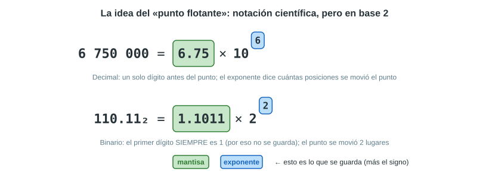

Hay un detalle que el estándar aprovecha: **en binario, la cifra antes del punto siempre es 1**, porque es la única cifra distinta de cero que existe. Lo veremos en la sección 10.3.

### 6.3 Por qué se llama «punto flotante»

En el punto fijo, el punto está siempre en el mismo lugar. Aquí, el lugar real del punto lo decide el exponente: con e = 2 el punto se corre dos lugares a la derecha; con e = −4, cuatro a la izquierda. El punto «flota», y de ahí vienen los nombres **punto flotante** (*floating point*) y el tipo **`float`**.

### 6.4 Las tres piezas que hay que guardar

Para reconstruir cualquier número normalizado bastan tres datos:

1. el **signo**: ¿es positivo o negativo?
2. el **exponente**: ¿cuántos lugares se movió el punto?
3. la **mantisa**: ¿qué bits van después del «1.»?

Eso es exactamente lo que guarda el estándar IEEE 754.

## 7. El estándar IEEE 754

### 7.1 Por qué existe un estándar

Hasta la década de 1980, cada fabricante guardaba los reales a su manera, con distinta precisión, distintos redondeos y distintos errores: el mismo programa podía dar resultados diferentes en cada computadora. En **1985**, el IEEE (Instituto de Ingenieros Eléctricos y Electrónicos) publicó el estándar **IEEE 754**, impulsado por el matemático William Kahan. Se revisó en 2008 y en 2019, y hoy lo siguen prácticamente todos los procesadores y lenguajes: Java, C++, Python, JavaScript, Excel…

El estándar define:

- los **formatos**: cuántos bits tiene cada campo y qué significan;
- el **redondeo**: cómo se elige el número representable cuando el valor exacto no cabe;
- las **operaciones** (+, −, ×, ÷ y raíz cuadrada): el resultado debe ser el valor exacto, **redondeado** según las reglas;
- los **valores especiales**: cero, infinito, NaN, etc.

### 7.2 Los formatos `float` y `double`

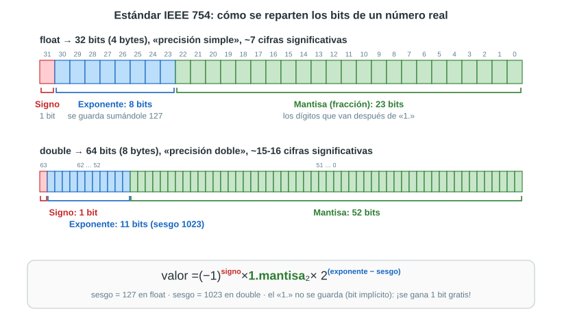

| | `float` (precisión simple) | `double` (precisión doble) |
|---|---|---|
| Tamaño | 32 bits = 4 bytes | 64 bits = 8 bytes |
| Signo | 1 bit (bit 31) | 1 bit (bit 63) |
| Exponente | 8 bits (bits 30 a 23) | 11 bits (bits 62 a 52) |
| Mantisa (fracción) | 23 bits (bits 22 a 0) | 52 bits (bits 51 a 0) |
| Sesgo | 127 | 1023 |

El estándar también define formatos de 16 bits (media precisión, usada en tarjetas gráficas e inteligencia artificial) y de 128 bits (precisión cuádruple), con la misma lógica.

### 7.3 La fórmula del valor

Para los números **normales** —todos, menos los casos especiales de la sección 13—, el valor es:

> **valor = (−1)ˢ × 1.f₂ × 2^(E − sesgo)**

- **s** es el bit de signo;
- **E** es el número entero guardado en el campo de exponente;
- **f** son los bits guardados en el campo de mantisa (la fracción);
- el **sesgo** vale 127 en `float` y 1023 en `double`.

Las tres secciones siguientes explican cada parte en detalle.

## 8. El signo

### 8.1 Qué es y dónde está

Es el bit **de más a la izquierda** (el bit 31 en un `float`, el 63 en un `double`): **0 = positivo, 1 = negativo**. En la fórmula aparece como (−1)ˢ: (−1)⁰ = +1 y (−1)¹ = −1. Es decir, el signo solo **multiplica el valor por +1 o por −1**.

### 8.2 Signo y magnitud: cambiar el signo es cambiar un bit

IEEE 754 usa la representación de **signo y magnitud**: la magnitud (exponente y mantisa) se guarda igual para x y para −x, y solo cambia el bit de signo.

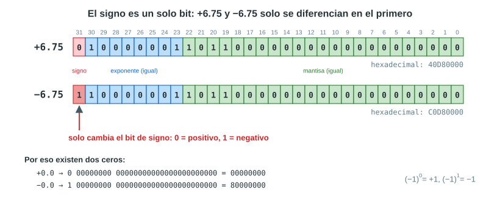

+6.75 es `40D80000` y −6.75 es `C0D80000`: el primer dígito hexadecimal pasa de 4 (`0100`) a C (`1100`), que es justamente el bit de signo.

### 8.3 Consecuencias

- **Cambiar el signo es inmediato:** el procesador solo invierte un bit. Calcular el valor absoluto es poner ese bit en 0.
- **El rango es simétrico:** el número positivo más grande y el negativo más grande tienen la misma magnitud (±3.4 × 10³⁸ en `float`).
- **Existen dos ceros:** +0.0 (`00000000`) y −0.0 (`80000000`). Para las comparaciones son iguales (en Java, `-0.0 == 0.0` es `true`), pero conservan su signo en algunas operaciones: `1.0 / 0.0` da `Infinity` y `1.0 / -0.0` da `-Infinity`. El −0 aparece, por ejemplo, cuando un resultado negativo es tan pequeño que se redondea a cero: así se conserva de qué lado venía.
- **El signo de un producto o de una división se obtiene aparte:** es positivo si los signos son iguales y negativo si son distintos, sin mirar el resto del número.

### 8.4 Diferencia con los enteros

Los enteros usan **complemento a dos** (sección 4.2), donde los bits de −19 no se parecen a los de 19. Los reales usan **signo y magnitud**, donde −6.75 y 6.75 solo se diferencian en un bit. Para los reales es más conveniente, porque el exponente y la mantisa se procesan por separado del signo: para multiplicar, por ejemplo, se multiplican las magnitudes y el signo se decide aparte.

## 9. El exponente y el sesgo

### 9.1 Qué indica el exponente

El exponente e dice **cuántos lugares se movió el punto** al normalizar y, por lo tanto, **el tamaño (el orden de magnitud) del número**:

- e > 0: el número es mayor o igual que 2 (6.75 → e = 2; 4700 → e = 12);
- e = 0: el número está entre 1 y 2 (1.0 → e = 0);
- e < 0: el número es menor que 1 (0.75 → e = −1; 0.1 → e = −4).

Cada vez que el exponente aumenta en 1, el número se **duplica**; cada vez que disminuye en 1, se **divide entre 2**.

### 9.2 El problema: guardar exponentes negativos

El exponente puede ser positivo o negativo, pero en un `float` el campo de exponente son solo 8 bits. Había varias formas de guardar ahí un número negativo:

1. reservar un bit de signo propio para el exponente;
2. usar complemento a dos, como en los enteros;
3. sumarle una constante para que siempre quede positivo: el **sesgo**.

El estándar IEEE 754 eligió la tercera.

### 9.3 Qué es el sesgo

El **sesgo** (en inglés *bias*; también se le llama «representación en exceso») es una **constante fija que se suma al exponente real antes de guardarlo**:

> **E (guardado) = e (real) + sesgo      →      e (real) = E (guardado) − sesgo**

- En `float`, el sesgo es **127**. Un exponente real 2 se guarda como 2 + 127 = **129** = `10000001`. Un exponente real −4 se guarda como −4 + 127 = **123** = `01111011`.
- En `double`, el sesgo es **1023**. El exponente 2 se guarda como 1025 = `10000000001`, y −4 como 1019 = `01111111011`.
- En general, con k bits de exponente: **sesgo = 2^(k−1) − 1** (2⁷ − 1 = 127; 2¹⁰ − 1 = 1023).

Así, el campo siempre contiene un número **sin signo** (de 0 a 255 en `float`), aunque el exponente real sea negativo.

### 9.4 La tabla de equivalencias

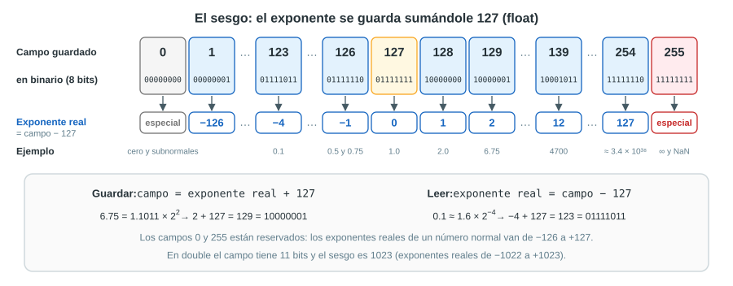

| Campo guardado E | En binario | Exponente real e = E − 127 | Números con ese exponente |
|---|---|---|---|
| 0 | `00000000` | — (especial) | El cero y los subnormales |
| 1 | `00000001` | −126 | 1.18 × 10⁻³⁸, el normal más pequeño |
| 123 | `01111011` | −4 | 0.1 (todos los que están entre 0.0625 y 0.125) |
| 124 | `01111100` | −3 | 0.15625 y 0.2 (entre 0.125 y 0.25) |
| 126 | `01111110` | −1 | 0.5 y 0.75 (entre 0.5 y 1) |
| 127 | `01111111` | 0 | 1.0 y 1.6875 (entre 1 y 2) |
| 128 | `10000000` | 1 | 2.0 y 3.375 (entre 2 y 4) |
| 129 | `10000001` | 2 | 6.75 (entre 4 y 8) |
| 136 | `10001000` | 9 | 1000 (entre 512 y 1024) |
| 139 | `10001011` | 12 | 4700 (entre 4096 y 8192) |
| 254 | `11111110` | 127 | Hasta 3.4 × 10³⁸, el más grande |
| 255 | `11111111` | — (especial) | Infinito y NaN |

### 9.5 Por qué se usa un sesgo

1. **El campo siempre es un número positivo**, que se guarda y se procesa como un entero sin signo común y corriente.
2. **Los números se ordenan igual que sus bits.** El exponente está en los bits más significativos (justo después del signo) y, con el sesgo, un exponente mayor siempre da un campo mayor. Por eso, **entre dos números positivos, el que tiene el patrón de bits mayor es el número mayor**. Por ejemplo, 0.5 = `3F000000` y 2.0 = `40000000`: como enteros, `3F000000` < `40000000`, igual que 0.5 < 2.0. Esto permite comparar reales con los mismos circuitos rápidos que comparan enteros. Con complemento a dos no funcionaría: el exponente −1 se escribiría `11111111` y parecería mayor que el exponente +1 (`00000001`).
3. **El cero queda con todos los bits en cero** (`00000000`), lo más natural.
4. **Los extremos del campo (0 y 255) quedan libres** para los casos especiales (sección 13).

### 9.6 Por qué 127 y no 128

Los campos que se usan para números normales son del 1 al 254 (el 0 y el 255 están reservados). Con un sesgo de 127, los exponentes reales van de **−126 a +127**; con 128, irían de −127 a +126. Se eligió 127 para que el rango sea casi simétrico, pero con un exponente positivo de más: así, el recíproco del número normal más pequeño (1 / 2⁻¹²⁶ = 2¹²⁶) se puede guardar sin desbordarse. En Java, `1 / Float.MIN_NORMAL` da 8.507059E37, un `float` normal.

### 9.7 El exponente fija el rango

Los bits de exponente deciden **qué tan grandes y qué tan pequeños** pueden ser los números:

- **El mayor `float`:** exponente real 127 y mantisa toda en unos: (2 − 2⁻²³) × 2¹²⁷ ≈ **3.4028235 × 10³⁸** (`7F7FFFFF`).
- **El menor `float` normal positivo:** exponente real −126 y mantisa en ceros: 2⁻¹²⁶ ≈ **1.1754944 × 10⁻³⁸** (`00800000`).
- **En `double`:** desde ≈ **2.2250738585072014 × 10⁻³⁰⁸** hasta ≈ **1.7976931348623157 × 10³⁰⁸**.

Más bits de exponente significan más **rango**; por eso el `double`, con 11 bits, llega muchísimo más lejos que el `float`, con 8.

### 9.8 Ejemplos de cálculo del exponente

| Número | Normalizado | e | E en `float` (e + 127) | E en `double` (e + 1023) |
|---|---|---|---|---|
| 6.75 | 1.1011 × 2² | 2 | 129 = `10000001` | 1025 = `10000000001` |
| 1.0 | 1.0 × 2⁰ | 0 | 127 = `01111111` | 1023 = `01111111111` |
| 0.75 | 1.1 × 2⁻¹ | −1 | 126 = `01111110` | 1022 = `01111111110` |
| 0.1 | 1.1001100… × 2⁻⁴ | −4 | 123 = `01111011` | 1019 = `01111111011` |
| 4700 | 1.0010010111 × 2¹² | 12 | 139 = `10001011` | 1035 = `10000001011` |

## 10. La mantisa

### 10.1 Mantisa, significando y fracción

Estos tres nombres se usan para cosas muy parecidas, así que conviene precisarlos:

- El **significando** (o mantisa completa) es el número **1.f** de la forma normalizada; siempre vale entre 1 (incluido) y 2 (sin incluir).
- La **fracción** son los bits **que van después del punto** (f); son los que realmente se guardan en el campo de 23 bits (52 en `double`).
- En español se suele llamar **mantisa** a las dos cosas. En este documento, «la mantisa» es el campo de 23 bits que se guarda, y 1.f es la mantisa completa.

### 10.2 Qué representa

La mantisa guarda **las cifras significativas** del número, sin importar su tamaño: del tamaño se encarga el exponente. Por eso 6.75 (110.11₂), 1.6875 (1.1011₂), 0.421875 (0.011011₂) y 27 (11011₂) tienen **exactamente la misma mantisa** (`1011` seguido de ceros) y solo se diferencian en el exponente (2, 0, −2 y 4). En hexadecimal se nota: 6.75 = `40D80000`, 1.6875 = `3FD80000`, 0.421875 = `3ED80000` y 27 = `41D80000`.

### 10.3 El bit implícito

Al normalizar, **el primer dígito siempre es 1**. Si siempre es 1, guardarlo sería desperdiciar un bit. Por eso **el «1.» no se guarda**: se sobreentiende. Se le llama **bit implícito** (o bit oculto). Gracias a él, los 23 bits guardados dan **24 bits de precisión** (en `double`, 52 + 1 = 53).

Las únicas excepciones son el cero y los números subnormales (sección 13), que se reconocen porque su campo de exponente vale 0; en ellos, el bit implícito vale 0.

### 10.4 El valor de cada bit de la mantisa

Después del «1.», cada bit vale **la mitad que el anterior**:

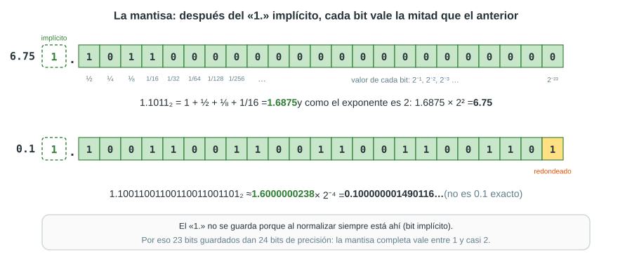

| Bit de la mantisa | 1.º (bit 22) | 2.º (bit 21) | 3.º (bit 20) | 4.º (bit 19) | 5.º (bit 18) | … | 23.º (bit 0) |
|---|---|---|---|---|---|---|---|
| Vale | 2⁻¹ = 0.5 | 2⁻² = 0.25 | 2⁻³ = 0.125 | 2⁻⁴ = 0.0625 | 2⁻⁵ = 0.03125 | … | 2⁻²³ ≈ 0.000000119 |

> **1.f = 1 + b₁ × 2⁻¹ + b₂ × 2⁻² + … + b₂₃ × 2⁻²³**

Por ejemplo, la mantisa de 6.75 es `1011000…0`, así que 1.f = 1 + 0.5 + 0.125 + 0.0625 = **1.6875**, y 1.6875 × 2² = 6.75.

### 10.5 Cómo se obtiene la mantisa

1. Normalizar el número: 1.xxxx × 2ᵉ.
2. Tomar los bits **después del punto** (sin el «1.»).
3. Si son **menos de 23**, completar con **ceros a la derecha**: 1011 → `10110000000000000000000`.
4. Si son **más de 23** (o infinitos, como en 0.1), quedarse con 23 y **redondear** según los bits que se descartan (sección 14).

### 10.6 Ejemplos

| Número | Normalizado | Mantisa guardada (23 bits) | 1.f |
|---|---|---|---|
| 1.0 | 1.0 × 2⁰ | `00000000000000000000000` | 1 |
| 0.75 | 1.1 × 2⁻¹ | `10000000000000000000000` | 1.5 |
| 6.75 | 1.1011 × 2² | `10110000000000000000000` | 1.6875 |
| 10 | 1.01 × 2³ | `01000000000000000000000` | 1.25 |
| 4700 | 1.001001011100 × 2¹² | `00100101110000000000000` | 1.1474609375 |
| 0.1 | 1.10011001100… × 2⁻⁴ | `10011001100110011001101` (redondeada) | ≈ 1.6000000238 |

### 10.7 La mantisa fija la precisión

La cantidad de bits de la mantisa decide **cuántas cifras significativas** se pueden guardar:

- `float`: 24 bits → 2²⁴ = 16 777 216 valores distintos de mantisa → unas **7 cifras decimales** (24 × log₁₀ 2 ≈ 7.22).
- `double`: 53 bits → 2⁵³ ≈ 9 × 10¹⁵ → unas **15 a 16 cifras** (53 × log₁₀ 2 ≈ 15.95).

Dos medidas muy usadas:

- **Épsilon de máquina:** la distancia entre 1.0 y el siguiente número representable: 2⁻²³ ≈ **1.19 × 10⁻⁷** en `float` y 2⁻⁵² ≈ **2.22 × 10⁻¹⁶** en `double`.
- **Enteros exactos:** un `float` guarda exactos todos los enteros hasta 2²⁴ = **16 777 216**; un `double`, hasta 2⁵³ = **9 007 199 254 740 992**. Pasado ese límite ya no alcanzan los bits de la mantisa: **16 777 217 guardado como `float` queda 16 777 216**, y en un `float`, 16 777 216 + 1 sigue dando 16 777 216.

Así como el exponente fija el **rango**, la mantisa fija la **precisión**.

### 10.8 La mantisa no es «la parte decimal»

Es un error común pensar que la mantisa es lo que va después del punto del número original. Para 6.75, la parte decimal es 0.75, pero la mantisa guardada es `1011000…`, que representa el 1.6875 de la forma **normalizada** (1.1011₂ × 2²). La mantisa son **las cifras significativas en binario**, no los decimales del número.

## 11. Codificar un número paso a paso

### 11.1 El procedimiento

1. **Signo:** 0 si el número es positivo, 1 si es negativo (y se sigue trabajando con su valor absoluto).
2. **Binario:** convertir la parte entera y la fraccionaria (sección 3).
3. **Normalizar:** escribirlo como 1.f × 2ᵉ.
4. **Exponente:** E = e + 127 (o + 1023), escrito con 8 bits (u 11).
5. **Mantisa:** los bits de f, completados con ceros o redondeados a 23 bits (o 52).
6. **Juntar** signo | exponente | mantisa y, si se quiere, escribirlo en hexadecimal.

### 11.2 Ejemplo 1: −6.75 (se guarda exacto)

```calculo
1) Signo:        negativo                            → 1
2) Binario:      6.75 = 110.11₂
3) Normalizar:   110.11 = 1.1011 × 2²
4) Exponente:    E = 2 + 127 = 129 = 128 + 1         → 10000001
5) Mantisa:      1011 y 19 ceros                     → 10110000000000000000000
6) Juntar:       1 10000001 10110000000000000000000
   En hex:       1100 0000 1101 1000 0000 0000 0000 0000  →  C0D80000
```

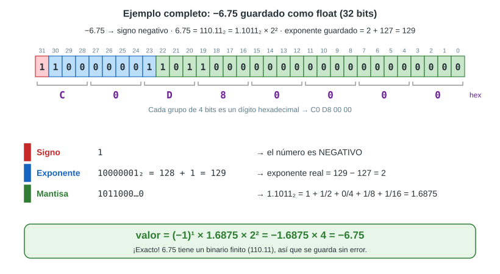

Como 6.75 = 27/4 tiene un binario finito, se guarda **sin ningún error**.

### 11.3 Ejemplo 2: 0.1 (se guarda redondeado)

```calculo
1) Signo:        positivo                                      → 0
2) Binario:      0.000110011001100110011001100110011…₂        (infinito)
3) Normalizar:   1.100110011001100110011001100110011… × 2⁻⁴
4) Exponente:    E = −4 + 127 = 123 = 64+32+16+8+2+1           → 01111011
5) Mantisa:      primeros 23 bits: 10011001100110011001100 | 11001100…
                                   (lo que no cabe ↑)
                 lo descartado (11001100…) es más de la mitad del último bit
                 → se redondea hacia arriba                     → 10011001100110011001101
6) Juntar:       0 01111011 10011001100110011001101
   En hex:       0011 1101 1100 1100 1100 1100 1100 1101       →  3DCCCCCD
```

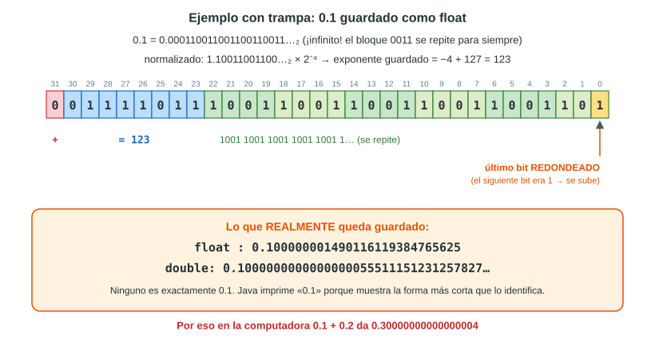

El valor que queda guardado es **0.100000001490116119384765625**: un poco **más** que 0.1, porque se redondeó hacia arriba. El error es de unos 1.49 × 10⁻⁹.

### 11.4 Ejemplo 3: 0.15625 (se guarda exacto)

0.15625 = 1/8 + 1/32 = 0.00101₂ = 1.01 × 2⁻³ → E = −3 + 127 = 124 = `01111100`, mantisa `01000000000000000000000` → `0 01111100 01000000000000000000000` = **`3E200000`**.

### 11.5 Ejemplo 4: 4700 (se guarda exacto)

4700 = 1001001011100₂ = 1.001001011100 × 2¹² → E = 12 + 127 = 139 = `10001011`, mantisa `00100101110000000000000` → `0 10001011 00100101110000000000000` = **`4592E000`**.

### 11.6 Los mismos números en `double`

En `double` el procedimiento es idéntico, con 11 bits de exponente (sesgo 1023) y 52 de mantisa:

| Número | Signo | Exponente (11 bits) | Mantisa (52 bits, en hex) | Los 64 bits en hex |
|---|---|---|---|---|
| −6.75 | 1 | 1025 = `10000000001` | `B000000000000` | `C01B000000000000` |
| 0.1 | 0 | 1019 = `01111111011` | `999999999999A` | `3FB999999999999A` |
| 4700 | 0 | 1035 = `10000001011` | `25C0000000000` | `40B25C0000000000` |

La mantisa de 0.1 en `double` también se redondea hacia arriba (por eso termina en A = `1010` en lugar de 9 = `1001`), pero el error es muchísimo menor: se guarda 0.1000000000000000055511151231257827…, con un error de unos 5.55 × 10⁻¹⁸.

## 12. Decodificar: de los bits al número

### 12.1 El procedimiento

1. Separar los campos: 1 bit de signo, 8 de exponente y 23 de mantisa.
2. Mirar el exponente: si es `00000000` o `11111111`, es un caso especial (sección 13).
3. Calcular el exponente real: e = E − 127.
4. Calcular 1.f sumando los valores de los bits de la mantisa (sección 10.4).
5. Valor = (−1)ˢ × 1.f × 2ᵉ.

### 12.2 Ejemplos

```calculo
41200000 = 0100 0001 0010 0000 0000 0000 0000 0000
         = 0 | 10000010 | 01000000000000000000000
signo 0 (+)    E = 130 → e = 3    1.f = 1 + 1/4 = 1.25
valor = 1.25 × 2³ = 10
```

```calculo
C2C80000 = 1100 0010 1100 1000 0000 0000 0000 0000
         = 1 | 10000101 | 10010000000000000000000
signo 1 (−)    E = 133 → e = 6    1.f = 1 + 1/2 + 1/16 = 1.5625
valor = −1.5625 × 2⁶ = −100
```

```calculo
40490FDB = 0100 0000 0100 1001 0000 1111 1101 1011
         = 0 | 10000000 | 10010010000111111011011
signo 0 (+)    E = 128 → e = 1    1.f ≈ 1.5707963705
valor ≈ 1.5707963705 × 2 = 3.1415927410…   (el float más cercano a π)
```

## 13. Valores especiales

Los dos valores extremos del campo de exponente —todo ceros y todo unos— no siguen la fórmula normal: se reservan para casos especiales.

### 13.1 El cero

Exponente `00000000` y mantisa `000…0`. Con la fórmula normal sería imposible escribir el cero, porque el bit implícito hace que 1.f valga siempre al menos 1; por eso el cero necesita un caso especial. Hay **+0** (`00000000`) y **−0** (`80000000`), como se vio en la sección 8.

### 13.2 Los números subnormales

Exponente `00000000` y mantisa distinta de cero. Para ellos se usa otra fórmula, **sin bit implícito** y con el exponente fijo en −126:

> **valor = (−1)ˢ × 0.f₂ × 2⁻¹²⁶** (en `float`)

Sirven para llenar el hueco entre el 0 y el menor número normal (2⁻¹²⁶ ≈ 1.18 × 10⁻³⁸). Sin ellos, cualquier resultado un poco más pequeño que 2⁻¹²⁶ saltaría de golpe a 0; con ellos, los valores bajan **gradualmente** hacia el cero (*underflow* gradual), aunque van perdiendo cifras significativas, porque los ceros de la izquierda de 0.f ya no aportan precisión.

- El subnormal más pequeño es `00000001` = 2⁻¹⁴⁹ ≈ **1.4 × 10⁻⁴⁵** (`Float.MIN_VALUE` en Java).
- El subnormal más grande es `007FFFFF` ≈ 1.1754942 × 10⁻³⁸, justo debajo del menor normal (`00800000`).
- Por ejemplo, `Float.MIN_NORMAL / 2` da 5.877472 × 10⁻³⁹, que se guarda como el subnormal `00400000`.

En `double`, el subnormal más pequeño es ≈ 4.9 × 10⁻³²⁴ (`Double.MIN_VALUE`).

### 13.3 Infinito

Exponente `11111111` y mantisa `000…0`: **+∞** (`7F800000`) y **−∞** (`FF800000`). Aparece cuando:

- un resultado es demasiado grande para el formato (**desbordamiento u *overflow***): `Float.MAX_VALUE * 2` da `Infinity`;
- se divide un número distinto de cero entre cero: `1.0 / 0` da `Infinity`.

El infinito permite que el cálculo continúe sin detener el programa, y sigue reglas lógicas: ∞ + 1 = ∞ y 1 / ∞ = 0.

### 13.4 NaN («no es un número»)

Exponente `11111111` y mantisa distinta de cero. Es el resultado de operaciones **que no tienen un resultado válido**: `0.0 / 0`, `Math.sqrt(-1)`, ∞ − ∞. En Java, el NaN habitual tiene los bits `7FC00000`.

NaN tiene una propiedad curiosa: **no es igual a nada, ni siquiera a sí mismo**; `NaN == NaN` da `false`. Para saber si un valor es NaN se usa `Double.isNaN(x)` (o `Float.isNaN(x)`). Además, cualquier operación con un NaN da NaN: el error se **propaga** hasta el resultado final, en lugar de quedar escondido.

### 13.5 Resumen

| Exponente | Mantisa | Significado | Valor | Ejemplo (`float`) |
|---|---|---|---|---|
| `00000000` | 0 | Cero (±0) | ±0 | `00000000`, `80000000` |
| `00000000` | ≠ 0 | Subnormal | (−1)ˢ × 0.f × 2⁻¹²⁶ | `00000001` = 1.4 × 10⁻⁴⁵ |
| `00000001` a `11111110` | cualquiera | Normal | (−1)ˢ × 1.f × 2^(E − 127) | `C0D80000` = −6.75 |
| `11111111` | 0 | Infinito (±∞) | ±∞ | `7F800000`, `FF800000` |
| `11111111` | ≠ 0 | NaN | — | `7FC00000` |

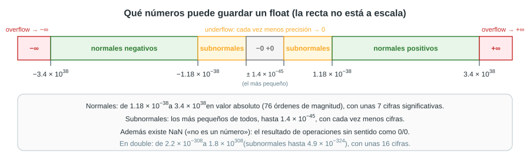

## 14. El redondeo

### 14.1 Por qué hay que redondear

Cuando un número necesita más de 24 bits significativos (o infinitos, como 0.1), no cabe en la mantisa. El estándar exige guardar el número representable que corresponda según la regla de redondeo. Lo mismo vale para el resultado de cada operación: se calcula **como si fuera exacto** y después se redondea **una sola vez**.

### 14.2 Los modos de redondeo

El estándar define cuatro modos:

| Modo | Qué hace |
|---|---|
| **Al más cercano, empates al par** | Elige el valor representable más cercano; si el número está justo en la mitad, elige el que termina en 0. **Es el modo por defecto.** |
| Hacia cero | Corta los bits sobrantes (trunca). |
| Hacia +∞ | Redondea siempre hacia arriba. |
| Hacia −∞ | Redondea siempre hacia abajo. |

Java usa siempre el primero en los cálculos con `float` y `double`. Los otros modos tienen usos especiales; por ejemplo, calcular un intervalo que garantice contener el resultado exacto (redondeando un extremo hacia abajo y el otro hacia arriba).

### 14.3 Redondeo al más cercano, con empates al par

Se miran los bits que quedan fuera de la mantisa:

- si representan **menos de la mitad** del último bit guardado, se descartan (redondeo hacia abajo);
- si representan **más de la mitad**, se suma 1 al último bit (redondeo hacia arriba);
- si representan **exactamente la mitad** (un 1 seguido solo de ceros), se elige el resultado cuyo último bit sea **0**: el «par».

Ejemplos:

- **0.1:** lo descartado empieza con `1100…`, que es más de la mitad: se redondea hacia arriba. Por eso el `float` de 0.1 es un poco **mayor** que 0.1.
- **16 777 217** (= 2²⁴ + 1) necesita 25 bits significativos: un 1, veintitrés ceros y otro 1. Solo caben 24 (el implícito y 23 más), así que el último 1 queda fuera y vale **exactamente** la mitad del último bit guardado: es un empate. Los candidatos son 16 777 216 (mantisa terminada en 0) y 16 777 218 (terminada en 1); se elige **16 777 216**.
- **16 777 219** también es un empate, entre 16 777 218 (mantisa terminada en 1) y 16 777 220 (terminada en 0): queda **16 777 220**.

**¿Por qué «al par»?** Si los empates siempre se redondearan hacia arriba, en un cálculo largo los errores se acumularían siempre en la misma dirección. Eligiendo el par, más o menos la mitad de los empates sube y la otra mitad baja, y en promedio los errores se compensan.

### 14.4 El ULP y el error máximo

Se llama **ULP** (*unit in the last place*, «unidad en el último lugar») a la distancia entre un número representable y el siguiente. Es el valor del último bit de la mantisa, así que depende del exponente: **ULP = 2^(e − 23)** en `float` (2^(e − 52) en `double`).

| Número (`float`) | e | ULP |
|---|---|---|
| 0.1 | −4 | 2⁻²⁷ ≈ 0.0000000075 |
| 1.0 | 0 | 2⁻²³ ≈ 0.000000119 |
| 1 000 000 | 19 | 2⁻⁴ = 0.0625 |
| 16 777 216 | 24 | 2¹ = 2 |

Con el redondeo al más cercano, **el error de redondeo nunca supera medio ULP**.

### 14.5 Error absoluto, error relativo y precisión

- **Error absoluto:** |valor guardado − valor exacto|. Para 0.1 en `float`: 0.100000001490116… − 0.1 ≈ **1.49 × 10⁻⁹**.
- **Error relativo:** el error absoluto dividido entre el valor exacto. Para 0.1: 1.49 × 10⁻⁹ / 0.1 ≈ **1.49 × 10⁻⁸**.

Como la mantisa tiene siempre la misma cantidad de bits, el **error relativo máximo** es el mismo para cualquier número normal: **2⁻²⁴ ≈ 6 × 10⁻⁸** en `float` y **2⁻⁵³ ≈ 1.1 × 10⁻¹⁶** en `double`. Esa es la forma precisa de decir «unas 7 cifras» y «unas 16 cifras».

## 15. Cómo se reparten los números representables

- Para cada exponente hay **2²³ = 8 388 608** valores de mantisa. Entre 1 y 2 hay 8 388 608 `float` igualmente espaciados; entre 2 y 4 hay otros tantos, pero **el doble de separados**; entre 4 y 8, el cuádruple, y así sucesivamente.
- Es decir, la separación (el ULP) **se duplica cada vez que se cruza una potencia de 2**. Justo debajo de 1.0, el `float` anterior está a 2⁻²⁴ ≈ 0.00000006 (es 0.99999994); justo encima, el siguiente está a 2⁻²³ ≈ 0.00000012 (es 1.0000001).
- Resultado: **hay muchísimos números cerca del cero y cada vez menos a medida que crecen**. De todos los `float` positivos finitos, casi la mitad (el 49.8 %) son menores que 1.

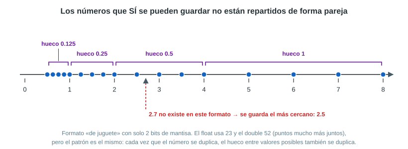

Esto es precisamente la **precisión relativa** de la notación científica: el error es proporcional al tamaño del número. Con números grandes se pierden decimales y, con números enormes, incluso unidades: entre 16 777 216 y 33 554 432, un `float` solo puede guardar los números **pares**.

## 16. `float` y `double` frente a frente

| | `float` | `double` |
|---|---|---|
| Bits (signo + exponente + mantisa) | 32 (1 + 8 + 23) | 64 (1 + 11 + 52) |
| Sesgo | 127 | 1023 |
| Exponentes reales de los normales | −126 a +127 | −1022 a +1023 |
| Bits de precisión (con el implícito) | 24 | 53 |
| Cifras decimales confiables | ≈ 7 | ≈ 15–16 |
| Mayor valor | ≈ 3.4028235 × 10³⁸ | ≈ 1.7976931348623157 × 10³⁰⁸ |
| Menor normal positivo | ≈ 1.1754944 × 10⁻³⁸ | ≈ 2.2250738585072014 × 10⁻³⁰⁸ |
| Menor subnormal positivo | ≈ 1.4 × 10⁻⁴⁵ | ≈ 4.9 × 10⁻³²⁴ |
| Épsilon (ULP de 1.0) | 2⁻²³ ≈ 1.19 × 10⁻⁷ | 2⁻⁵² ≈ 2.22 × 10⁻¹⁶ |
| Enteros exactos hasta | 2²⁴ = 16 777 216 | 2⁵³ = 9 007 199 254 740 992 |
| 0.1 se guarda como | 0.100000001490116… | 0.1000000000000000055511… |
| Literal en Java | `6.75f` | `6.75` |
| Uso típico | Gráficos, sensores, grandes volúmenes de datos | **El tipo por defecto** en Java y C++ |

## 17. Las operaciones y por qué aparecen los errores

### 17.1 La suma: alinear los exponentes

Para sumar dos números en punto flotante, primero se igualan los exponentes **corriendo el punto del número más pequeño**; después se suman las mantisas, se normaliza y se redondea:

```calculo
  1.5  = 1.1₂  × 2⁰
+ 0.25 = 1.0₂  × 2⁻²  =  0.01₂ × 2⁰      (el punto se corre 2 lugares)
  ─────────────────────
         1.11₂ × 2⁰  =  1.75   ✔ (exacto)
```

El problema aparece cuando los números tienen tamaños muy distintos: al alinear, los bits del pequeño se salen de los 24 bits y se pierden. En `float`, **1.0 + 0.00000001 da exactamente 1.0**: 10⁻⁸ es menor que medio ULP de 1.0 (≈ 6 × 10⁻⁸), así que desaparece al redondear. Por la misma razón, en un `float`, 16 777 216 + 1 da 16 777 216.

### 17.2 El caso 0.1 + 0.2, explicado

En `double`:

| | Valor que realmente queda guardado |
|---|---|
| 0.1 | 0.1000000000000000055511151231257827… (un poco **más** que 0.1) |
| 0.2 | 0.2000000000000000111022302462515654… (un poco **más** que 0.2) |
| Suma exacta de esos dos valores | 0.3000000000000000166533453693773481… |
| Resultado guardado (redondeado) | 0.3000000000000000444089209850062616… → se imprime **0.30000000000000004** |
| El número 0.3 escrito directamente | 0.2999999999999999888977697537484345… (un poco **menos** que 0.3) |

Los dos sumandos ya tenían un pequeño error hacia arriba. Su suma exacta cae **justo a la mitad** entre dos `double` vecinos: 0.29999999999999998889… y 0.30000000000000004441…. Es un empate, y el redondeo al par elige el de arriba (su mantisa termina en 0; la del de abajo, que es justamente el `double` de 0.3, termina en 1). Por eso `0.1 + 0.2` y `0.3` quedan a **un ULP** de distancia (5.55 × 10⁻¹⁷) y `0.1 + 0.2 == 0.3` da `false`. En hexadecimal: `3FD3333333333334` frente a `3FD3333333333333`.

### 17.3 Los errores se acumulan

Cada operación puede agregar hasta medio ULP de error, y en una cadena de operaciones esos errores se suman. Sumar 0.1 diez veces da **0.9999999999999999**, no 1.0. Por eso un ciclo como `for (double x = 0; x != 1.0; x += 0.1)` **nunca termina**: x pasa de 0.9999999999999999 a 1.0999999999999999 sin tocar nunca el 1.0 exacto.

### 17.4 Restar números muy parecidos: la cancelación

Al restar dos números casi iguales, las cifras iguales se cancelan y solo quedan las últimas, que son justamente las que tenían el error de redondeo. En `float`, 1.0000001 − 1.0 da **1.1920929 × 10⁻⁷** en lugar de 1 × 10⁻⁷: un error del 19 %, porque 1.0000001 no se puede guardar exacto (se guarda como 1.00000011920928955078125).

### 17.5 La multiplicación: el sesgo aparece otra vez

Para multiplicar, se **multiplican las mantisas** y se **suman los exponentes**. Pero los exponentes guardados ya llevan el sesgo incluido, así que al sumarlos hay que **restar un sesgo** (si no, quedaría sumado dos veces):

> **E (resultado) = E (a) + E (b) − 127**

```calculo
6.75 × 0.5
  mantisas:    1.6875 × 1.0 = 1.6875
  exponentes:  129 + 126 − 127 = 128        (e = 2 + (−1) = 1)
  resultado:   1.6875 × 2¹ = 3.375          → 0 10000000 10110000000000000000000
```

Si el producto de las mantisas llega a 2 o más, se vuelve a normalizar: 1.5 × 1.5 = 2.25 = 10.01₂ = 1.001₂ × 2¹, y el exponente sube en 1. El signo se decide aparte: + si los signos son iguales, − si son distintos.

### 17.6 El orden de las operaciones importa

En matemáticas, (a + b) + c = a + (b + c). Con redondeo, no siempre: en `double`, **(0.1 + 0.2) + 0.3 = 0.6000000000000001**, pero **0.1 + (0.2 + 0.3) = 0.6**, porque cada orden redondea en momentos distintos. Por eso dos programas que suman los mismos números en distinto orden pueden dar resultados un poco diferentes.

### 17.7 Convertir a entero trunca

Al convertir un real a entero, Java **corta** los decimales; no redondea. Combinado con el error de representación, puede dar sorpresas: 4.35 × 100 da 434.99999999999994, así que **`(int) (4.35 * 100)` da 434**, no 435. Para redondear se usa `Math.round(4.35 * 100)`, que sí da 435.

## 18. El orden de los bytes en la RAM

Un `float` ocupa 4 bytes seguidos, pero hay dos maneras de ordenarlos:

- **big-endian:** primero el byte más significativo, en el mismo orden en que se escribe: `C0 D8 00 00`;
- **little-endian:** primero el byte menos significativo: `00 00 D8 C0`.

Los procesadores Intel y AMD de las PC, y la mayoría de los celulares (ARM), son **little-endian**: en la dirección más baja queda el byte menos significativo.

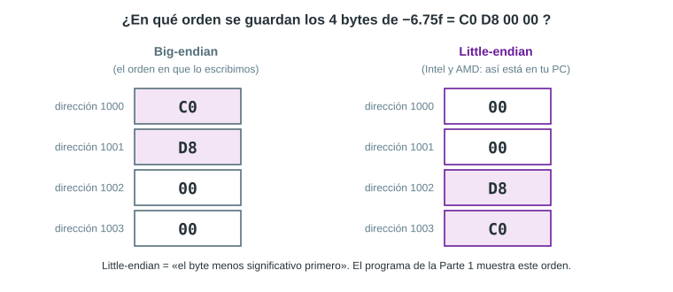

Java oculta este detalle: en un programa siempre se trabaja con el número completo. El orden solo importa cuando se leen o escriben bytes uno por uno, por ejemplo en archivos binarios o en comunicaciones por red (que usan big-endian). Java permite elegir el orden con la clase `ByteBuffer`: con `ByteOrder.LITTLE_ENDIAN`, −6.75f produce los bytes `00 00 D8 C0`, y con `ByteOrder.BIG_ENDIAN`, `C0 D8 00 00`.

## 19. Los números reales en Java

### 19.1 Tipos y literales

- `double` es el tipo real **por defecto**: el literal `6.75` es un `double`.
- Para un `float` se agrega una `f`: `6.75f`. Escribir `float x = 6.75;` da un error de compilación (*possible lossy conversion from double to float*, «posible pérdida de precisión»): hay que escribir `6.75f` o convertir con `(float) 6.75`.
- También se puede usar notación científica: `4.7e3` es 4700.0 y `1.6e-19` es 1.6 × 10⁻¹⁹.

### 19.2 Cómo los muestra Java

`System.out.println` muestra el número decimal **más corto que identifica exactamente al valor guardado**. Por eso 0.1 se ve como «0.1» aunque el valor guardado sea 0.1000000000000000055…: «0.1» es la forma más corta de nombrar ese valor. Cuando el resultado de una operación no es el valor guardado más cercano a un decimal corto, aparecen todas las cifras: 0.30000000000000004.

Además, los números muy grandes (desde 10⁷) o muy pequeños (menores que 10⁻³) se muestran en notación científica: `1.0E7`, `4.7E8`, `1.0E-4` (que significa 1.0 × 10⁻⁴).

### 19.3 Herramientas para ver lo que hay en la memoria

| Método | Qué hace | Ejemplo |
|---|---|---|
| `Float.floatToIntBits(f)` | Devuelve los 32 bits del `float` dentro de un `int` | `-6.75f` → bits `C0D80000` |
| `Float.intBitsToFloat(i)` | Lo inverso: de los bits al `float` | `0x40490FDB` → 3.1415927 |
| `Double.doubleToLongBits(d)` | Los 64 bits de un `double` | `0.1` → `3FB999999999999A` |
| `Integer.toBinaryString(i)`, `Integer.toHexString(i)` | Escriben un entero en binario o en hexadecimal | |
| `new BigDecimal(x)` | Muestra el valor guardado **exacto**, con todos sus decimales | `0.1f` → 0.100000001490116119384765625 |
| `Math.ulp(x)` | El ULP de x | `Math.ulp(1.0f)` → 1.1920929E-7 |
| `Math.nextUp(x)` | El siguiente número representable | `Math.nextUp(1.0f)` → 1.0000001 |
| `Math.getExponent(x)` | El exponente real e | `Math.getExponent(0.1f)` → −4 |
| `Float.MAX_VALUE`, `Float.MIN_NORMAL`, `Float.MIN_VALUE` | Los límites del formato | 3.4028235E38, 1.1754944E-38, 1.4E-45 |

### 19.4 Un programa para comprobarlo

Este programa (clase `Main`, se puede ejecutar en NetBeans o en un compilador en línea) muestra varios de los hechos de este documento:

```java
import java.math.BigDecimal;

public class Main
{
    // Muestra los 32 bits de un float separados en: signo | exponente | mantisa
    static void verBits(float f)
    {
        int bits = Float.floatToIntBits(f);   // los 32 bits tal como estan en la memoria
        String b = String.format("%32s", Integer.toBinaryString(bits)).replace(' ', '0');
        System.out.println("   " + f + " -> " + b.substring(0, 1) + " | " + b.substring(1, 9)
                           + " | " + b.substring(9) + "   hex: "
                           + Integer.toHexString(bits).toUpperCase());
    }

    public static void main(String[] args)
    {
        System.out.println("1) 0.1 + 0.2 = " + (0.1 + 0.2));
        System.out.println("   0.1 + 0.2 == 0.3 ? " + (0.1 + 0.2 == 0.3));

        System.out.println("2) Los bits de un float (signo | exponente | mantisa):");
        verBits(-6.75f);
        verBits(0.1f);

        System.out.println("3) Lo que REALMENTE queda guardado:");
        System.out.println("   0.1 como float : " + new BigDecimal(0.1f));
        System.out.println("   0.1 como double: " + new BigDecimal(0.1));

        double suma = 0;
        for(int i = 1; i <= 10; i++)
            suma = suma + 0.1;
        System.out.println("4) 0.1 sumado 10 veces = " + suma);

        float grande = 16777217;
        System.out.println("5) 16777217 guardado como float = " + (int) grande);

        System.out.println("6) 1.0 / 0 = " + (1.0 / 0) + "    0.0 / 0 = " + (0.0 / 0));

        System.out.println("7) Comparar con tolerancia: |(0.1 + 0.2) - 0.3| < 1e-9 ? "
                           + (Math.abs((0.1 + 0.2) - 0.3) < 1e-9));
    }
}
```

Salida real:

```text
1) 0.1 + 0.2 = 0.30000000000000004
   0.1 + 0.2 == 0.3 ? false
2) Los bits de un float (signo | exponente | mantisa):
   -6.75 -> 1 | 10000001 | 10110000000000000000000   hex: C0D80000
   0.1 -> 0 | 01111011 | 10011001100110011001101   hex: 3DCCCCCD
3) Lo que REALMENTE queda guardado:
   0.1 como float : 0.100000001490116119384765625
   0.1 como double: 0.1000000000000000055511151231257827021181583404541015625
4) 0.1 sumado 10 veces = 0.9999999999999999
5) 16777217 guardado como float = 16777216
6) 1.0 / 0 = Infinity    0.0 / 0 = NaN
7) Comparar con tolerancia: |(0.1 + 0.2) - 0.3| < 1e-9 ? true
```

`Float.floatToIntBits(f)` entrega los 32 bits exactos del `float` y el método `verBits` los separa en signo, exponente y mantisa; `new BigDecimal(0.1f)` muestra el valor guardado completo, sin el redondeo que hace Java al imprimir.

## 20. Consecuencias prácticas

1. **No comparar reales con `==`.** Se compara con una tolerancia: `Math.abs(a - b) < 1e-9`. Para números muy grandes o muy pequeños conviene una tolerancia **relativa**: `Math.abs(a - b) <= 1e-9 * Math.max(Math.abs(a), Math.abs(b))`.
2. **Usar `double` por defecto.** El `float` solo tiene unas 7 cifras, y los errores aparecen enseguida.
3. **No usar `float` ni `double` para el dinero.** Se usan céntimos en un entero (`long`) o la clase `BigDecimal`, que guarda decimales exactos: `new BigDecimal("0.1").add(new BigDecimal("0.2"))` da exactamente 0.3. Ojo: hay que crearlo a partir del **texto** `"0.1"`, porque `new BigDecimal(0.1)` recibe el `double` ya redondeado y guarda 0.1000000000000000055511151231257827….
4. **No controlar un ciclo con `!=` sobre reales** (sección 17.3): usar un contador entero o una condición con `<`.
5. **Preferir dividir entre un entero a multiplicar por un decimal no exacto:** 12 × 0.1 da 1.2000000000000002, mientras que 12 / 10.0 da 1.2 (el `double` más cercano a 1.2). Es lo que ocurre al calcular el valor de una resistencia con la banda dorada, que multiplica por 0.1.
6. **Redondear explícitamente** antes de convertir a entero o de mostrar un resultado: `Math.round(x)` o `String.format("%.2f", x)`, que para 0.1 + 0.2 muestra `0.30` (o `0,30`, según la configuración regional de la computadora).

## 21. Resumen

1. La memoria solo guarda bits. Con una cantidad fija de bits solo se pueden guardar exactos algunos números: el resto se **redondea**.
2. Muchos decimales «simples» (0.1, 0.2, 4.7) son **infinitos en binario**: solo son finitas las fracciones cuyo denominador es una potencia de 2.
3. Los reales se guardan en **notación científica binaria normalizada**, 1.f × 2ᵉ, según el estándar **IEEE 754**.
4. **Signo:** 1 bit (0 = +, 1 = −), en signo y magnitud: x y −x solo se diferencian en ese bit. Por eso existen +0 y −0.
5. **Exponente:** 8 bits (11 en `double`) guardados con **sesgo** 127 (1023): E = e + 127. Así el campo nunca es negativo, los números se ordenan igual que sus bits y quedan libres los valores especiales. El exponente fija el **rango**.
6. **Mantisa:** 23 bits (52) con las cifras que van después del «1.», que no se guarda (**bit implícito**). La mantisa fija la **precisión**: unas 7 cifras en `float` y unas 16 en `double`.
7. Los exponentes extremos se reservan para el **cero, los subnormales, el infinito y NaN**.
8. El redondeo es **al más cercano, con empates al par**; el error nunca supera medio ULP, y el ULP crece con el tamaño del número.
9. Por todo esto, 0.1 + 0.2 da 0.30000000000000004, los errores se acumulan, el orden de las operaciones importa y los reales **no se comparan con `==`**.

## 22. Glosario

| Término | Significado |
|---|---|
| Bit | Dígito binario: 0 o 1 |
| Bit implícito (u oculto) | El «1.» inicial de la mantisa normalizada, que no se guarda |
| Byte | 8 bits |
| Cancelación | Pérdida de cifras significativas al restar números casi iguales |
| Complemento a dos | Forma de guardar enteros negativos: invertir los bits y sumar 1 |
| Desbordamiento (*overflow*) | Resultado demasiado grande para el formato; en los reales da ±∞ |
| Épsilon de máquina | Distancia entre 1.0 y el siguiente número representable |
| Exponente | Potencia de 2 que indica cuántos lugares se movió el punto, es decir, el tamaño del número |
| Fracción | Los bits de la mantisa que se guardan (los que van después del «1.») |
| IEEE 754 | Estándar internacional para guardar números reales y operar con ellos |
| Little-endian / big-endian | Orden de los bytes en la memoria: primero el menos significativo / el más significativo |
| Mantisa (significando) | Las cifras significativas del número normalizado: 1.f |
| NaN | «No es un número»: resultado de operaciones inválidas como 0/0 |
| Normalizar | Escribir el número como 1.f × 2ᵉ, con un solo 1 antes del punto |
| Punto fijo | Formato con una cantidad fija de bits para la parte entera y para la fraccionaria |
| Punto flotante | Formato tipo notación científica: el exponente decide dónde va el punto |
| Redondeo al par | Regla de desempate: elegir el valor cuyo último bit es 0 |
| Sesgo (*bias*) | Constante (127 o 1023) que se suma al exponente para guardarlo sin signo |
| Signo y magnitud | Representación en la que un bit indica el signo y el resto, el valor absoluto |
| Subdesbordamiento (*underflow*) | Resultado más pequeño que el menor número normal |
| Subnormal | Número muy pequeño, con exponente guardado 0 y sin bit implícito |
| ULP | Distancia entre un número representable y el siguiente |

## 23. Ejercicios resueltos

1. **Codificar 0.5 en `float`.** 0.5 = 0.1₂ = 1.0 × 2⁻¹ → signo 0, E = −1 + 127 = 126 = `01111110`, mantisa en ceros → `0 01111110 00000000000000000000000` = **`3F000000`**.
2. **Codificar −0.75.** 0.75 = 0.11₂ = 1.1 × 2⁻¹ → signo 1, E = 126, mantisa `1000…0` → `1 01111110 10000000000000000000000` = **`BF400000`**.
3. **Codificar 1000.** 1000 = 1111101000₂ = 1.111101 × 2⁹ → E = 9 + 127 = 136 = `10001000`, mantisa `11110100000000000000000` → **`447A0000`**.
4. **Codificar 0.2.** 0.2 = 0.001100110011…₂ = 1.100110011… × 2⁻³ → E = 124 = `01111100`. Como 0.2 = 2 × 0.1, la mantisa es la misma que la de 0.1, con el mismo redondeo hacia arriba → **`3E4CCCCD`**, que guarda 0.20000000298023223876953125.
5. **Decodificar `3F200000`.** `0 01111110 01000000000000000000000` → e = 126 − 127 = −1; 1.f = 1.25 → 1.25 × 2⁻¹ = **0.625**.
6. **Decodificar `3EC00000`.** `0 01111101 10000000000000000000000` → e = 125 − 127 = −2; 1.f = 1.5 → 1.5 × 2⁻² = **0.375**.
7. **¿Qué exponente guardado tiene un `float` entre 1 y 2? ¿Y uno entre 0.5 y 1?** Entre 1 y 2, e = 0 → E = **127**. Entre 0.5 y 1, e = −1 → E = **126**.
8. **¿Por qué el `float` de 0.1 es mayor que 0.1?** Porque al cortar la mantisa en 23 bits, lo descartado (`1100…`) era más de la mitad del último bit, y se redondeó hacia arriba.
9. **¿Cuál es el exponente real del mayor `float`?** Su campo es 254 → e = 254 − 127 = **127**; con la mantisa toda en unos vale (2 − 2⁻²³) × 2¹²⁷ ≈ 3.4 × 10³⁸.
10. **¿Por qué `0.1f + 0.2f == 0.3f` da `true`, si en `double` `0.1 + 0.2 == 0.3` da `false`?** En `float`, los errores de redondeo de la suma se compensan y el resultado cae justo en el mismo `float` que 0.3f; en `double`, cae en el vecino. Que dé `true` es una casualidad: por eso no se debe confiar en `==` con reales.
