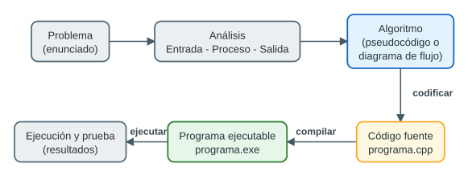
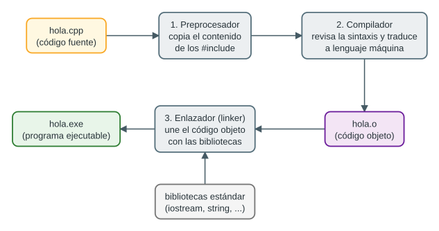
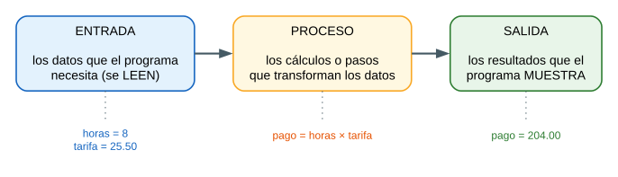
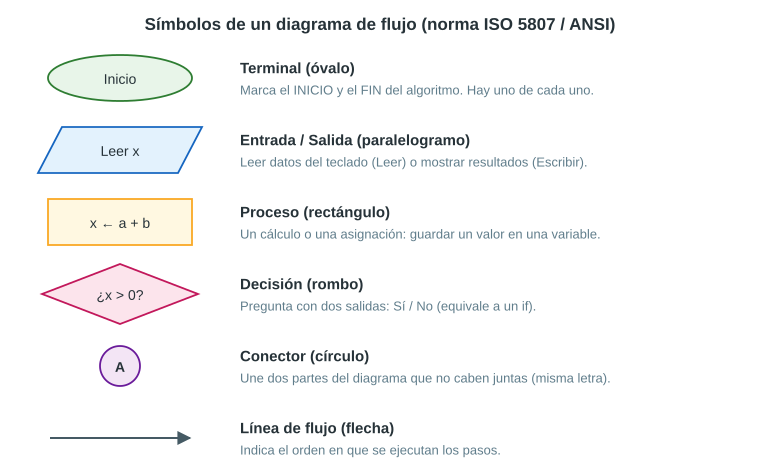
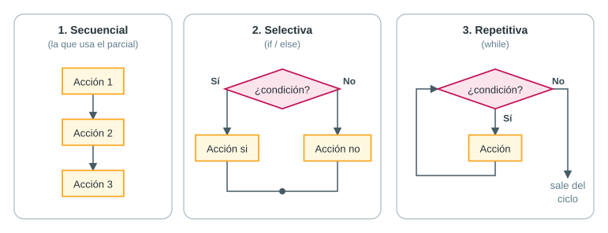
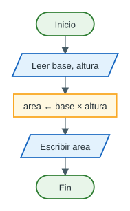

# Parte I — Fundamentos: computadoras, algoritmos y lenguajes

## 1. ¿Qué es una computadora y qué es un programa?

Una **computadora** es una máquina que **procesa datos siguiendo instrucciones**. No «piensa»: hace exactamente lo que le indicamos, muy rápido y sin equivocarse en las cuentas. Sus partes principales son:

| Parte | Qué hace | Analogía (una cocina) |
|---|---|---|
| **CPU** (procesador) | Ejecuta las instrucciones y hace los cálculos | El cocinero |
| **Memoria RAM** | Guarda los datos y el programa *mientras* se ejecuta. Se borra al apagar | La mesa de trabajo |
| **Almacenamiento** (disco, SSD) | Guarda los archivos de forma permanente | La alacena |
| **Dispositivos de entrada** (teclado, mouse) | Permiten ingresar datos | El cliente que hace el pedido |
| **Dispositivos de salida** (pantalla, impresora) | Muestran los resultados | El plato servido |

Un **programa** es un conjunto de instrucciones que la computadora sigue, una tras otra, para resolver una tarea: calcular un sueldo, mostrar una nota, procesar un código, etc.

### La computadora solo entiende ceros y unos

Por dentro, todo (números, letras, imágenes, programas) se guarda como **bits**. Un bit es la unidad mínima de información y solo puede valer **0 o 1** (como un interruptor apagado o encendido). Ocho bits forman un **byte**. Por ejemplo, la letra `A` se guarda como el byte `01000001`.

Escribir programas directamente en ceros y unos sería casi imposible. Por eso se inventaron los **lenguajes de programación**: nos dejan escribir instrucciones parecidas al lenguaje humano, y luego un programa traductor las convierte a ceros y unos.

## 2. Algoritmo, código fuente y programa ejecutable

Estos tres conceptos son la primera pregunta del *checklist* del parcial. Es fundamental no confundirlos.

### 2.1 Algoritmo

Un **algoritmo** es una **secuencia finita, ordenada y precisa de pasos** para resolver un problema.

Sus características son:

- **Preciso**: cada paso dice exactamente qué hacer, sin ambigüedades.
- **Definido (determinista)**: con los mismos datos, siempre da el mismo resultado.
- **Finito**: termina en algún momento.
- Tiene **entrada** (datos), **proceso** (pasos) y **salida** (resultado).

Un algoritmo **no depende de ningún lenguaje de programación**: se puede escribir en español, en pseudocódigo o como diagrama de flujo.

Ejemplo cotidiano — *preparar un vaso de limonada*:

1. Exprimir 2 limones en un vaso.
2. Agregar 2 cucharadas de azúcar.
3. Llenar el vaso con agua.
4. Mover hasta disolver el azúcar.
5. Servir.

Ejemplo de computación — *calcular el promedio de 3 notas*:

1. Pedir las tres notas: `n1`, `n2`, `n3`.
2. Calcular `promedio = (n1 + n2 + n3) / 3`.
3. Mostrar el promedio.

### 2.2 Código fuente

El **código fuente** es el algoritmo **escrito en un lenguaje de programación** (en nuestro caso, C++), respetando sus reglas. Es un archivo de texto que una persona puede leer y modificar; en C++ tiene la extensión **`.cpp`** (por ejemplo, `promedio.cpp`).

### 2.3 Programa ejecutable

El **programa ejecutable** es el resultado de **traducir (compilar)** el código fuente a lenguaje máquina (ceros y unos). Es el archivo que la computadora puede ejecutar directamente; en Windows tiene la extensión **`.exe`** (por ejemplo, `promedio.exe`). Ya no se puede leer como texto.

| | Algoritmo | Código fuente | Programa ejecutable |
|---|---|---|---|
| **¿Qué es?** | La idea: los pasos para resolver el problema | Esos pasos escritos en C++ | El código traducido a lenguaje máquina |
| **¿Quién lo entiende?** | Cualquier persona | Programadores (y el compilador) | Solo la computadora |
| **¿Cómo se ve?** | Lista de pasos, pseudocódigo o diagrama de flujo | Texto: `cout << "Hola";` | Binario: `10110000 01100001 …` |
| **Ejemplo de archivo** | Una hoja de papel | `promedio.cpp` | `promedio.exe` |
| **¿Depende del lenguaje?** | No | Sí (C++) | Sí (y del sistema operativo) |



> [!IMPORTANT]
> **Respuesta modelo para el examen:** el *algoritmo* es la secuencia de pasos para resolver el problema (independiente del lenguaje); el *código fuente* es ese algoritmo escrito en un lenguaje de programación, como C++ (archivo `.cpp`); y el *programa ejecutable* es el código fuente traducido por el compilador a lenguaje máquina (archivo `.exe`), listo para que la computadora lo ejecute.

## 3. Lenguajes de programación

### 3.1 ¿Qué es un lenguaje de programación?

Es un **lenguaje formal**, con reglas estrictas, que sirve para escribir instrucciones que una computadora pueda ejecutar. Como todo lenguaje, tiene dos aspectos:

- **Sintaxis**: las reglas de *escritura* (cómo se escribe). Ejemplo: en C++ cada instrucción termina en punto y coma `;` y los textos van entre comillas dobles.
- **Semántica**: el *significado* (qué hace cada instrucción). Ejemplo: `x = 5;` significa «guardar el valor 5 en la variable `x`».

Una frase puede tener buena sintaxis y aun así ser incorrecta en su significado: `promedio = n1 + n2 + n3 / 3;` está bien escrita, pero calcula otra cosa (ver *precedencia* en la Parte II).

### 3.2 Niveles de los lenguajes

| Nivel | Ejemplo | Ventajas | Desventajas |
|---|---|---|---|
| **Lenguaje máquina** | `10110000 01100001` | La CPU lo entiende directamente | Prácticamente ilegible para personas |
| **Bajo nivel** (ensamblador) | `MOV AL, 61h` | Control total del hardware, muy rápido | Difícil; cambia según el procesador |
| **Alto nivel** | C++, Java, Python | Fácil de leer y escribir; funciona en distintas computadoras | Necesita ser traducido |

**C++ es un lenguaje de alto nivel**, pero también permite trabajar muy cerca del hardware (memoria, bits); por eso a veces se le llama «de nivel medio». Es muy usado en ingeniería electrónica (microcontroladores, sistemas embebidos), videojuegos, sistemas operativos y navegadores.

### 3.3 Traductores: compilador e intérprete

Como la computadora solo entiende lenguaje máquina, el código de alto nivel debe ser **traducido**. Hay dos formas:

| | Compilador | Intérprete |
|---|---|---|
| **Cómo traduce** | Todo el programa de una vez, **antes** de ejecutarlo | Línea por línea, **mientras** lo ejecuta |
| **Resultado** | Un archivo ejecutable (`.exe`) | No genera ejecutable |
| **Velocidad** | Muy rápido al ejecutar | Más lento |
| **Errores de escritura** | Se detectan todos al compilar | Aparecen cuando se llega a esa línea |
| **Lenguajes** | C, C++, Go, Rust | Python, JavaScript |

**C++ es un lenguaje compilado.** (Java es un caso intermedio: se compila a *bytecode* y luego lo ejecuta una máquina virtual).

### 3.4 Paradigmas de programación

Un **paradigma** es un *estilo* de programar:

- **Programación estructurada (imperativa)**: el programa es una secuencia de instrucciones que se ejecutan en orden. Es lo que haremos en el parcial.
- **Programación orientada a objetos (POO)**: el programa se organiza en **clases** y **objetos** que agrupan datos y acciones. Es la base del diagrama UML del ejercicio 9.

C++ es **multiparadigma**: permite ambos estilos.

### 3.5 Un poco de historia de C++

- **1972**: Dennis Ritchie crea el lenguaje **C** en los Laboratorios Bell.
- **1979–1985**: Bjarne Stroustrup crea **C++** como «C con clases» (C más programación orientada a objetos). El nombre viene del operador `++`, que significa «sumar uno»: *C++ es «un paso más» que C*.
- Hay versiones estándar que lo actualizan: C++98, C++11, C++14, C++17, C++20, C++23.

### 3.6 ¿Cómo se convierte un `.cpp` en un `.exe`? (compilación)

Cuando presionas «Compilar» en tu entorno (Dev-C++, Code::Blocks, etc.), ocurren tres etapas:



1. **Preprocesador**: lee las líneas que empiezan con `#` (como `#include <iostream>`) y copia en tu programa el contenido de esas bibliotecas.
2. **Compilador**: revisa que no haya errores de sintaxis y traduce el código a lenguaje máquina. Si encuentra un error (por ejemplo, falta un `;`), **se detiene y no genera el ejecutable**.
3. **Enlazador** (*linker*): une tu código traducido con el código de las bibliotecas (por ejemplo, el que hace funcionar a `cout`) y produce el **programa ejecutable**.

A todo el proceso, en el día a día, se le llama simplemente «compilar».

### 3.7 Tipos de errores

| Tipo de error | Cuándo aparece | Ejemplo | Quién lo detecta |
|---|---|---|---|
| **De sintaxis** (de compilación) | Al compilar | Olvidar un `;`, escribir `Cout` en lugar de `cout`, no cerrar una comilla | El compilador: muestra el error y no crea el `.exe` |
| **De ejecución** | Mientras el programa corre | Pedir `substr(50, 3)` a un texto de 10 letras; dividir un entero entre 0 | El programa se detiene («se cae») |
| **Lógico** | Nunca «avisa» | Usar `a / b` con enteros esperando decimales; escribir mal una fórmula | Solo tú, probando el programa (prueba de escritorio) |

> [!WARNING]
> Los errores **lógicos** son los más peligrosos: el programa compila, corre y muestra un resultado… **equivocado**. Por eso siempre hay que probar con datos cuyo resultado ya conoces.

## 4. Metodología para resolver un problema

Antes de escribir código, un buen programador sigue estos pasos:

1. **Entender el problema**: leer el enunciado con calma. ¿Qué me dan? ¿Qué me piden?
2. **Analizar**: identificar entradas, proceso y salidas (E-P-S) y los tipos de datos.
3. **Diseñar el algoritmo**: escribir el pseudocódigo o dibujar el diagrama de flujo.
4. **Codificar**: traducir el algoritmo a C++.
5. **Probar**: hacer la prueba de escritorio y ejecutar el programa con datos conocidos.
6. **Documentar**: agregar comentarios que expliquen el código.

### 4.1 Análisis Entrada – Proceso – Salida (E-P-S)

Casi todos los programas del curso tienen la misma forma: **reciben datos, los procesan y muestran resultados**.



Para identificar cada parte, hazte estas preguntas:

| Parte | Pregunta clave | Pistas en el enunciado |
|---|---|---|
| **Entrada** | ¿Qué datos necesita el programa que **no conoce** de antemano? | «se ingresa», «el usuario escribe», «el programa recibe», «se solicita» |
| **Proceso** | ¿Qué **cálculos** o transformaciones hay que hacer? | Fórmulas, «calcular», «extraer», «reemplazar» |
| **Salida** | ¿Qué hay que **mostrar**? | «mostrar», «imprimir», «el resultado esperado es» |

Es buena práctica presentar el análisis en una tabla que incluya el **tipo de dato** de cada variable y **por qué** se eligió:

| Variable | Rol | Tipo | Justificación |
|---|---|---|---|
| `horas` | Entrada | `int` | Las horas se cuentan en números enteros (8) |
| `tarifa` | Entrada | `double` | El pago por hora tiene decimales (25.50) |
| `pago` | Salida | `double` | Resulta de multiplicar por un número con decimales |

## 5. Pseudocódigo

### 5.1 ¿Qué es?

El **pseudocódigo** es una forma de escribir un algoritmo con **frases cortas en español, estructuradas como un programa**, pero **sin las reglas estrictas** de un lenguaje real (no lleva `;`, ni `<<`, ni llaves). Sirve para pensar la solución antes de programar y es independiente del lenguaje: el mismo pseudocódigo se puede traducir a C++, Java o Python.

### 5.2 Palabras y símbolos que usaremos

Usaremos el estilo de **PSeInt**, muy común en las universidades peruanas:

| Pseudocódigo | Significado | Equivalente en C++ |
|---|---|---|
| `Algoritmo Nombre` … `FinAlgoritmo` | Inicio y fin del algoritmo | `int main() {` … `return 0; }` |
| `Definir edad Como Entero` | Declarar una variable entera | `int edad;` |
| `Definir nota Como Real` | Variable con decimales | `double nota;` |
| `Definir nombre Como Cadena` | Variable de texto | `string nombre;` |
| `Definir inicial Como Caracter` | Un solo carácter | `char inicial;` |
| `Definir aprobado Como Logico` | Verdadero / falso | `bool aprobado;` |
| `Leer edad` | Pedir un dato al usuario | `cin >> edad;` |
| `Leer nombre` (con espacios) | Pedir una línea de texto | `getline(cin, nombre);` |
| `Escribir "Total: ", total` | Mostrar en pantalla | `cout << "Total: " << total;` |
| `total ← precio * cantidad` | Asignación (guardar el resultado) | `total = precio * cantidad;` |
| `// comentario` | Nota para quien lee | `// comentario` |
| `Si cond Entonces … SiNo … FinSi` | Decisión (*no se usa en el parcial*) | `if (cond) { … } else { … }` |
| `Mientras cond Hacer … FinMientras` | Repetición (*no se usa en el parcial*) | `while (cond) { … }` |

Para trabajar con textos usaremos estas funciones (escritas igual que en C++ para no confundirnos):

| Pseudocódigo | Qué devuelve | C++ |
|---|---|---|
| `longitud(texto)` | Cantidad de caracteres | `texto.length()` |
| `buscar(texto, "@")` | Posición donde aparece `"@"` | `texto.find("@")` |
| `subcadena(texto, inicio, cantidad)` | Un pedazo del texto | `texto.substr(inicio, cantidad)` |
| `reemplazar(texto, inicio, cantidad, nuevo)` | El texto con un pedazo cambiado | `texto.replace(inicio, cantidad, nuevo)` |

> [!NOTE]
> Si practicas en PSeInt, ten cuidado: su función `Subcadena(texto, desde, hasta)` pide la posición **final**, no la **cantidad** de caracteres como `substr` de C++. En el examen, escribe el pseudocódigo con la idea de `substr` (inicio y cantidad) y aclara qué significa cada número.

### 5.3 Reglas de un buen pseudocódigo

1. Una instrucción por línea.
2. Declarar las variables con su tipo al inicio.
3. Usar nombres significativos (`precioUnitario`, no `p`).
4. Sangrar (dejar espacios a la izquierda) el contenido entre `Algoritmo` y `FinAlgoritmo`.
5. No mezclar detalles de C++ (`;`, `<<`, `cout`).

### 5.4 Ejemplo completo: área de un rectángulo

**Pseudocódigo:**

```pseudo
Algoritmo AreaRectangulo
    Definir base, altura, area Como Real
    Escribir "Ingrese la base: "
    Leer base
    Escribir "Ingrese la altura: "
    Leer altura
    area ← base * altura
    Escribir "El area es: ", area
FinAlgoritmo
```

**El mismo algoritmo en C++:**

```cpp
#include <iostream>
using namespace std;

int main() {
    double base, altura, area;
    cout << "Ingrese la base: ";
    cin >> base;
    cout << "Ingrese la altura: ";
    cin >> altura;
    area = base * altura;
    cout << "El area es: " << area << endl;
    return 0;
}
```

Fíjate en que **cada línea del pseudocódigo se convierte en una línea de C++**. Esa es la gran ventaja de hacer primero el pseudocódigo: después solo hay que «traducir».

## 6. Diagramas de flujo

### 6.1 ¿Qué es?

Un **diagrama de flujo** es la **representación gráfica de un algoritmo**: cada tipo de paso se dibuja con una figura distinta y las flechas indican el orden en que se ejecutan.

### 6.2 Símbolos



> [!NOTE]
> Algunos profesores usan un símbolo distinto para la salida por pantalla (una figura con forma de monitor) o para la impresión (una hoja con borde ondulado). El paralelogramo para **leer y escribir** es la forma estándar y siempre es aceptada. Lo importante es escribir dentro **«Leer …»** o **«Escribir …»**.

### 6.3 Reglas para dibujarlo bien

1. Tiene **un solo Inicio y un solo Fin**.
2. Se dibuja **de arriba hacia abajo** (y de izquierda a derecha).
3. Las líneas de flujo son **rectas** (horizontales o verticales) y terminan en **flecha**.
4. Las líneas **no deben cruzarse**; si es necesario, se usan conectores.
5. Cada símbolo tiene **una sola flecha de salida**, excepto la decisión, que tiene **dos** (Sí / No).
6. El texto dentro de cada símbolo es **breve y claro**.
7. Todo lo que se usa (variables) debe haberse leído o calculado antes.

### 6.4 Las tres estructuras básicas

Cualquier algoritmo, por complejo que sea, se arma combinando solo tres estructuras:



1. **Secuencial**: los pasos se ejecutan uno tras otro, en orden. **Todos los ejercicios del parcial usan solo esta estructura** (la hoja dice «No es necesario utilizar `if`, `switch`, `for`, `while` ni `do-while`»).
2. **Selectiva**: se hace una pregunta y, según la respuesta, se toma un camino u otro (`if`).
3. **Repetitiva**: un grupo de pasos se repite mientras se cumpla una condición (`while`, `for`).

### 6.5 Ejemplo: área de un rectángulo



### 6.6 Del diagrama al código

| Símbolo | Lo que dice dentro | Se traduce a C++ como |
|---|---|---|
| Terminal | Inicio / Fin | `int main() {` … `return 0; }` |
| Entrada | `Leer base` | `cin >> base;` |
| Proceso | `area ← base × altura` | `area = base * altura;` |
| Salida | `Escribir area` | `cout << area;` |

## 7. Prueba de escritorio

Una **prueba de escritorio** (también llamada *traza*) consiste en **ejecutar el algoritmo a mano**, con datos de prueba, anotando en una tabla **el valor de cada variable después de cada instrucción**. Sirve para encontrar errores lógicos *antes* de usar la computadora, y es exactamente lo que pide el ejercicio 10.

**Cómo hacerla:**

1. Elige datos de prueba cuyo resultado conozcas (o puedas calcular a mano).
2. Haz una tabla: una columna por variable y una para lo que se muestra en pantalla.
3. Recorre el algoritmo instrucción por instrucción y anota los cambios.
4. Las variables que todavía no tienen valor se marcan con `?` (en C++ contienen «basura»).

**Ejemplo** con el área del rectángulo, para `base = 5` y `altura = 3`:

| Paso | Instrucción | `base` | `altura` | `area` | Pantalla |
|---|---|---|---|---|---|
| 1 | `Definir base, altura, area` | ? | ? | ? | |
| 2 | `Leer base` | 5 | ? | ? | |
| 3 | `Leer altura` | 5 | 3 | ? | |
| 4 | `area ← base * altura` | 5 | 3 | 15 | |
| 5 | `Escribir "El area es: ", area` | 5 | 3 | 15 | `El area es: 15` |

Si el resultado de la tabla coincide con lo esperado (5 × 3 = 15), el algoritmo es correcto para ese caso.

## 8. UML básico: el diagrama de clases

### 8.1 ¿Qué es UML?

**UML** (*Unified Modeling Language*, Lenguaje Unificado de Modelado) es un **lenguaje gráfico estándar** para dibujar el diseño de un programa, así como un arquitecto dibuja los planos de una casa antes de construirla. UML tiene muchos tipos de diagramas; en el curso usamos el **diagrama de clases**.

### 8.2 Clase y objeto

- Una **clase** es un **molde** o plantilla que describe cómo será un tipo de cosa: qué **datos** tiene y qué **acciones** puede hacer. Ejemplo: la clase `Estudiante`.
- Un **objeto** es un **ejemplar concreto** creado a partir de la clase, con sus propios valores. Ejemplo: el estudiante «Ana Torres, código 202601234, nota 15.75».

Analogía: la clase es el **plano** de una casa; los objetos son las **casas construidas** con ese plano. Todas tienen la misma forma, pero cada una tiene su propio color y sus propios dueños.

### 8.3 Partes de un diagrama de clases

Una clase se dibuja como un rectángulo dividido en **tres compartimentos**:

```uml
┌──────────────────────────────┐
│          Estudiante          │   1) Nombre de la clase
├──────────────────────────────┤
│ - codigo : string            │
│ - nombre : string            │   2) Atributos (los DATOS)
│ - nota : double              │
├──────────────────────────────┤
│ + mostrarDatos() : void      │   3) Operaciones o métodos
│ + estaAprobado() : bool      │      (lo que SABE HACER)
└──────────────────────────────┘
```

- **Atributo**: `visibilidad nombre : tipo` → `- nota : double`
- **Operación**: `visibilidad nombre(parámetros) : tipo_de_retorno` → `+ estaAprobado() : bool`
- **Visibilidad**:

| Símbolo | Nombre | Significado | En C++ |
|---|---|---|---|
| `+` | Público | Se puede usar desde fuera de la clase | `public:` |
| `-` | Privado | Solo la propia clase puede usarlo | `private:` |
| `#` | Protegido | La clase y sus «clases hijas» | `protected:` |

- **Tipo de retorno**: lo que la operación devuelve. `void` significa «no devuelve nada» (por ejemplo, solo muestra datos en pantalla).

> [!TIP]
> Regla práctica que casi siempre se usa: **atributos privados (`-`)** y **operaciones públicas (`+`)**. Así nadie puede cambiar los datos «a escondidas»; solo a través de las operaciones de la clase.

### 8.4 Del diagrama UML al código C++

| En el diagrama UML | En C++ |
|---|---|
| Nombre de la clase `Producto` | `class Producto { … };` |
| `- precio : double` | dentro de `private:` → `double precio;` |
| `+ calcularValorStock() : double` | dentro de `public:` → `double calcularValorStock() { … }` |
| Un objeto `p1 : Producto` | `Producto p1(…);` en `main` |

Todo esto se explica con código en la sección 16 (Parte II) y se aplica en el ejercicio 9.
