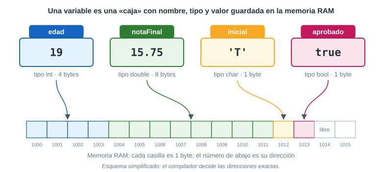
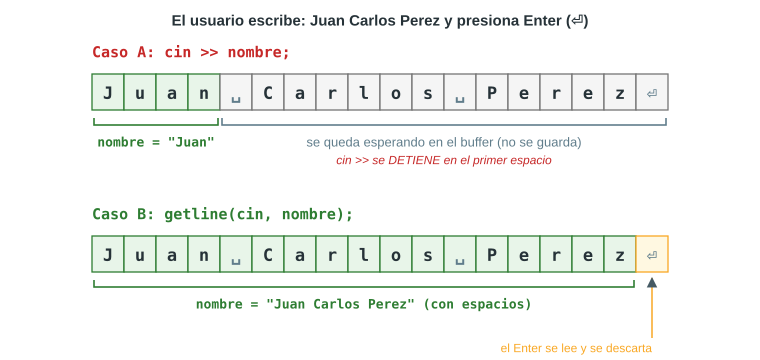
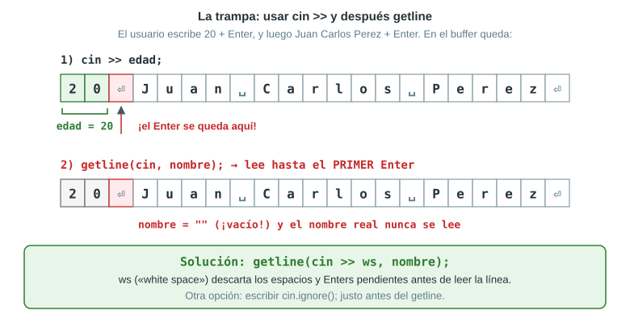
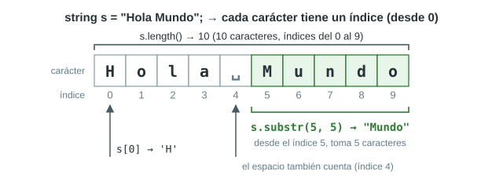

# Parte II — C++ desde cero

## 9. Tu primer programa en C++

```cpp
#include <iostream>
using namespace std;

int main() {
    cout << "Hola, mundo" << endl;
    return 0;
}
```

Al ejecutarlo, en la pantalla aparece:

```text
Hola, mundo
```

Veamos qué significa cada línea:

| Línea | Qué hace |
|---|---|
| `#include <iostream>` | Le dice al preprocesador que incluya la biblioteca **iostream** (*input/output stream*), que trae `cin` y `cout`. Las líneas con `#` **no llevan `;`**. |
| `using namespace std;` | Permite escribir `cout` en lugar de `std::cout`. Todo lo de la biblioteca estándar vive en el «espacio de nombres» `std`. |
| `int main() {` | Es la **función principal**: el programa **siempre empieza a ejecutarse aquí**. `int` indica que, al terminar, devuelve un número entero al sistema. |
| `cout << "Hola, mundo" << endl;` | Muestra el texto en pantalla. `<<` «envía» lo que está a su derecha hacia la pantalla. `endl` produce un salto de línea. |
| `return 0;` | Termina `main` y avisa al sistema que todo salió bien (0 = sin errores). |
| `}` | Cierra el bloque de `main`. |

### Reglas básicas de escritura

- **Cada instrucción termina en punto y coma** `;` (salvo las líneas `#include` y las que abren o cierran llaves).
- C++ **distingue mayúsculas de minúsculas**: `cout` ≠ `Cout` ≠ `COUT`. Lo mismo con las variables: `nota` y `Nota` son distintas.
- Los textos van entre **comillas dobles**: `"Hola"`.
- Las **llaves** `{ }` agrupan instrucciones en un bloque.
- **Comentarios**: el compilador los ignora; sirven para explicar el código.
  - De una línea: `// esto es un comentario`
  - De varias líneas: `/* esto también */`
- Los espacios y la sangría no le importan al compilador, pero **sí a quien lee**: ordena tu código.

### Plantilla para todos los ejercicios del parcial

Todos los programas del parcial siguen el mismo esqueleto. Apréndetelo:

```cpp
#include <iostream>   // cin, cout
#include <string>     // string, getline (si se usan textos)
#include <iomanip>    // fixed, setprecision (si se piden decimales)
using namespace std;

int main() {
    // 1. Declarar las variables (con el tipo adecuado)

    // 2. ENTRADA: pedir los datos (cout + cin / getline)

    // 3. PROCESO: hacer los cálculos

    // 4. SALIDA: mostrar los resultados (cout)

    return 0;
}
```

## 10. Variables y tipos de datos

### 10.1 ¿Qué es una variable?

Una **variable** es un **espacio en la memoria RAM** donde se guarda un dato que puede cambiar durante la ejecución. Imagínala como una **caja con etiqueta**:

- la **etiqueta** es el *nombre* de la variable (`edad`),
- el **tamaño y la forma** de la caja dependen del *tipo* (`int`),
- lo que hay **dentro** es el *valor* (`19`).



### 10.2 Declarar, inicializar y asignar

```cpp
int edad;          // DECLARAR: se crea la caja (todavía tiene "basura")
edad = 18;         // ASIGNAR: se guarda un valor
int nota = 15;     // DECLARAR + INICIALIZAR en una sola línea
edad = edad + 1;   // se lee el valor actual (18), se le suma 1 y se guarda: 19
```

- El signo `=` **no** es la igualdad de matemática: significa **«guarda en la variable de la izquierda el resultado de la derecha»**. Por eso `edad = edad + 1;` tiene sentido en programación.
- Una variable declarada pero **no inicializada** contiene un valor impredecible («basura»). Nunca la uses antes de darle un valor.
- Se pueden declarar varias variables del mismo tipo en una línea: `double subtotal, descuento, total;`

### 10.3 Reglas para los nombres (identificadores)

| Regla | Válido | Inválido |
|---|---|---|
| Solo letras, dígitos y guion bajo `_` | `nota_final`, `nota1` | `nota-final`, `nota@` |
| No puede empezar con un dígito | `nota1` | `1nota` |
| Sin espacios | `notaFinal` | `nota final` |
| No usar palabras reservadas | `total` | `int`, `double`, `return` |
| Evitar tildes y la ñ | `anio`, `codigo` | `año`, `código` |

Además:

- **Mayúsculas importan**: `Precio` y `precio` son variables distintas.
- Usa **nombres significativos**: `precioUnitario` en vez de `p` (la hoja lo pide: «Utilice nombres de variables significativos»).
- Estilo recomendado: **camelCase** (`precioUnitario`, `notaFinal`). Las constantes suelen ir en MAYÚSCULAS (`IGV`).

### 10.4 Tipos de datos fundamentales

| Tipo | Qué guarda | Ejemplos de valores | Tamaño típico | Rango aproximado |
|---|---|---|---|---|
| `int` | Números **enteros** | `19`, `-5`, `2026` | 4 bytes | −2 147 483 648 a 2 147 483 647 |
| `double` | Números **reales** (con decimales), ~15 cifras de precisión | `15.75`, `25.50`, `-0.5` | 8 bytes | ±1.7 × 10³⁰⁸ |
| `float` | Reales con **menos** precisión (~7 cifras) | `3.14f` | 4 bytes | ±3.4 × 10³⁸ |
| `char` | **Un solo carácter** | `'A'`, `'7'`, `'@'` | 1 byte | 256 valores |
| `bool` | **Verdadero o falso** | `true`, `false` | 1 byte | 2 valores |
| `string` | **Texto** (cadena de caracteres) | `"Juan Perez"` | Variable | Lo que quepa en memoria |

`string` no es un tipo «primitivo» del lenguaje: viene de la biblioteca estándar y necesita `#include <string>`. Otros tipos que existen: `long long` (enteros muy grandes), `short` (enteros pequeños), `unsigned int` (enteros sin signo).

### 10.5 ¿Cómo elegir el tipo correcto?

Hazte estas preguntas, en este orden:

1. ¿Es **texto** (nombres, direcciones, palabras)? → `string`. ¿Es **un único carácter**? → `char`.
2. ¿Es un número con el que **no se hacen cálculos** (DNI, código, teléfono, código de matrícula)? → `string`. Puede empezar con 0, puede tener letras o guiones, y no tiene sentido sumarlo.
3. ¿Es una **cantidad entera** (edad, unidades, años de antigüedad)? → `int`.
4. ¿Puede tener **decimales** (precio, nota, sueldo, porcentaje, medida)? → `double`.
5. ¿Es **sí/no**, **verdadero/falso**? → `bool`.

> [!WARNING]
> En C++, un número entero que empieza con `0` se interpreta en **base 8 (octal)**: `int x = 0145;` guarda **101**, ¡no 145! Es otra razón para guardar códigos como `"0145"` en un `string`.

### 10.6 Literales: cómo se escriben los valores

| Literal | Tipo | Comentario |
|---|---|---|
| `25` | `int` | Sin punto decimal |
| `25.0`, `25.50`, `2.5e3` | `double` | Con punto decimal (`2.5e3` = 2.5 × 10³ = 2500) |
| `25.0f` | `float` | Con `f` al final |
| `'A'` | `char` | **Comillas simples**, un solo carácter |
| `"A"`, `"Hola"` | texto | **Comillas dobles** |
| `true`, `false` | `bool` | En minúsculas |

> [!CAUTION]
> `char letra = "A";` es un **error** (comillas dobles para un `char`), y `'Hola'` también (comillas simples para varias letras). Recuerda: **simples → un carácter; dobles → texto**. En los decimales se usa **punto**, nunca coma: `25.50`, no `25,50`.

### 10.7 Constantes

Si un valor **no debe cambiar nunca**, se declara como constante con `const`:

```cpp
const double IGV = 0.18;    // impuesto del 18 %
const int MESES = 12;
// IGV = 0.20;   // ERROR de compilación: una constante no se puede modificar
```

### 10.8 ¿Cuánta memoria ocupa cada tipo?

El operador `sizeof` devuelve cuántos bytes ocupa un tipo. Esto es lo que muestra el programa del ejercicio 1:

```text
--- Bytes que ocupa cada tipo en memoria ---
int    : 4 bytes
double : 8 bytes
char   : 1 byte
bool   : 1 byte
```

## 11. Entrada y salida de datos

### 11.1 Mostrar datos: `cout <<`

`cout` (*console output*) envía datos a la pantalla. Se pueden encadenar varios `<<`:

```cpp
int edad = 19;
cout << "Tengo " << edad << " anios" << endl;   // Tengo 19 anios
```

Secuencias de escape útiles dentro de un texto:

| Secuencia | Significado |
|---|---|
| `\n` | Salto de línea (igual que `endl`) |
| `\t` | Tabulación |
| `\"` | Comillas dobles dentro de un texto |
| `\\` | Una barra invertida |

`endl` y `"\n"` hacen casi lo mismo (saltar de línea); usa el que prefieras.

### 11.2 Leer datos: `cin >>`

`cin` (*console input*) lee lo que el usuario escribe y lo guarda en una variable, convirtiéndolo al tipo de esa variable:

```cpp
int horas;
double tarifa;
cout << "Horas trabajadas: ";
cin >> horas;              // el usuario escribe 8 y presiona Enter
cout << "Pago por hora: ";
cin >> tarifa;             // el usuario escribe 25.50
```

Se pueden leer varios datos en una sola instrucción: `cin >> horas >> tarifa;` (el usuario los separa con espacios o Enter).

> [!IMPORTANT]
> `cin >>` **lee hasta el primer espacio en blanco** (espacio, tabulación o Enter). Sirve para números y para palabras sueltas, pero **no para textos con espacios** como un nombre completo.

### 11.3 Leer textos con espacios: `getline`

`getline(cin, variable);` lee **toda la línea**, incluidos los espacios, hasta que el usuario presiona Enter. Necesita `#include <string>`.

```cpp
string nombre;
cout << "Ingrese nombre completo: ";
getline(cin, nombre);      // "Juan Carlos Perez" completo
```



### 11.4 La trampa de mezclar `cin >>` y `getline`

Cuando presionas Enter, ese Enter también es un carácter (`'\n'`) y queda guardado en una «sala de espera» llamada **buffer de entrada**. `cin >>` lee el número pero **deja el Enter en el buffer**. Si después viene un `getline`, este encuentra el Enter pendiente, cree que la línea ya terminó y **lee un texto vacío**.



Hay tres soluciones:

| Solución | Código | Cuándo usarla |
|---|---|---|
| 1. `ws` (recomendada) | `getline(cin >> ws, nombre);` | Siempre que un `getline` venga después de un `cin >>` |
| 2. `cin.ignore()` | `cin.ignore();` y luego `getline(cin, nombre);` | Ignora un carácter (el Enter) |
| 3. Cambiar el orden | Leer primero todos los textos con `getline` y al final los números con `cin >>` | Cuando el enunciado lo permite (lo hacemos en los ejercicios 8 y 10) |

**Resumen: ¿cuál uso?**

| Dato a leer | Instrucción |
|---|---|
| Número (`int`, `double`) | `cin >> variable;` |
| Una sola palabra o código sin espacios | `cin >> variable;` |
| Texto que puede tener espacios (nombre completo, producto, dirección) | `getline(cin, variable);` |

## 12. Operadores y expresiones

Una **expresión** es una combinación de valores, variables y operadores que produce un resultado: `precio * cantidad`, `a + b * c`.

### 12.1 Operadores aritméticos

| Operador | Operación | Ejemplo con enteros | Ejemplo con reales |
|---|---|---|---|
| `+` | Suma | `7 + 2` → `9` | `7.5 + 2` → `9.5` |
| `-` | Resta | `7 - 2` → `5` | `7.5 - 2` → `5.5` |
| `*` | Multiplicación | `7 * 2` → `14` | `7.5 * 2` → `15` |
| `/` | División | `7 / 2` → **`3`** | `7.0 / 2` → `3.5` |
| `%` | Módulo (resto) | `7 % 2` → `1` | *(no se usa con reales)* |

### 12.2 La división entera (¡muy importante!)

Cuando **los dos operandos son enteros**, `/` hace **división entera**: calcula el cociente y **descarta los decimales** (no redondea, *corta*).

| Expresión | Resultado | ¿Por qué? |
|---|---|---|
| `7 / 2` | `3` | 3.5 → se corta el .5 |
| `10 / 4` | `2` | 2.5 → se corta el .5 |
| `1 / 2` | `0` | 0.5 → se corta todo |
| `-7 / 2` | `-3` | Se corta hacia el cero |
| `7.0 / 2` | `3.5` | Hay un `double`: división real |

> [!CAUTION]
> Una fórmula como `porcentaje / 100` **da 0** si `porcentaje` es `int` y vale menos de 100 (por ejemplo, `10 / 100` → `0`). Usa `porcentaje / 100.0` o declara `porcentaje` como `double`.

### 12.3 El operador módulo `%`

`a % b` devuelve el **resto** de la división entera de `a` entre `b`. Solo funciona con enteros.

| Expresión | Resultado | Lectura |
|---|---|---|
| `8 % 3` | `2` | 8 = 3 × 2 + **2** |
| `7 % 2` | `1` | 7 es impar |
| `10 % 2` | `0` | 10 es par |
| `-7 % 3` | `-1` | El signo sigue al dividendo |
| `2026 % 10` | `6` | El último dígito de un número |

### 12.4 Asignación y operadores compuestos

| Escrito así | Equivale a | Si `k` valía 10, queda |
|---|---|---|
| `k = 5;` | — | `5` |
| `k += 5;` | `k = k + 5;` | `15` |
| `k -= 3;` | `k = k - 3;` | `7` |
| `k *= 2;` | `k = k * 2;` | `20` |
| `k /= 4;` | `k = k / 4;` | `2` |
| `k++;` | `k = k + 1;` | `11` |
| `k--;` | `k = k - 1;` | `9` |

### 12.5 Operadores relacionales y lógicos (solo para reconocerlos)

Comparan valores y devuelven `true` o `false`. En el parcial casi no se usan (no hay `if`), pero aparecen en todos los programas con decisiones:

- Relacionales: `==` (igual), `!=` (distinto), `<`, `>`, `<=`, `>=`.
- Lógicos: `&&` (y), `||` (o), `!` (no).

Ojo: `=` **asigna**; `==` **compara**.

### 12.6 Precedencia y asociatividad

Cuando una expresión tiene varios operadores, C++ no la evalúa de izquierda a derecha «porque sí»: sigue una **jerarquía** llamada **precedencia**, igual que en matemática («primero multiplicaciones, luego sumas»).

| Prioridad | Operadores | Asociatividad (si hay empate) |
|---|---|---|
| 1 (la más alta) | `( )` paréntesis | — |
| 2 | Unarios: `-x`, `!`, `++`, `--`, `static_cast<…>()` | Derecha a izquierda |
| 3 | `*`  `/`  `%` | **Izquierda a derecha** |
| 4 | `+`  `-` | **Izquierda a derecha** |
| 5 | `<<`  `>>` (también los de `cout` y `cin`) | Izquierda a derecha |
| 6 | `<`  `<=`  `>`  `>=` | Izquierda a derecha |
| 7 | `==`  `!=` | Izquierda a derecha |
| 8 | `&&` | Izquierda a derecha |
| 9 | `\|\|` | Izquierda a derecha |
| 10 (la más baja) | `=`  `+=`  `-=`  `*=`  `/=`  `%=` | Derecha a izquierda |

- **Precedencia**: decide *qué operador va primero* cuando son distintos (`*` antes que `+`).
- **Asociatividad**: decide *el orden cuando tienen la misma precedencia* (`/` y `*` → de izquierda a derecha).

**Método para evaluar paso a paso** — ejemplo: `2 + 3 * 4 - 6 / 2`

1. Primero `*` y `/`, de izquierda a derecha: `3 * 4 = 12` y `6 / 2 = 3` → queda `2 + 12 - 3`.
2. Luego `+` y `-`, de izquierda a derecha: `2 + 12 = 14`, `14 - 3 = 11`.
3. Resultado: **11**.

> [!TIP]
> Cuando tengas dudas, **usa paréntesis**: no cambian el resultado si ya respetan la precedencia, y hacen el código más fácil de leer. `a + (b * c)` se entiende mejor que `a + b * c`.

**Un detalle con `cout`:** `cout << a + b;` funciona porque `+` tiene mayor precedencia que `<<` (primero se suma y luego se muestra). En cambio, `cout << a < b;` da error de compilación: hay que escribir `cout << (a < b);`.

## 13. Conversión de tipos

### 13.1 Conversión implícita (automática)

C++ convierte tipos automáticamente en dos situaciones:

**a) En una operación con tipos mezclados**, el tipo «menor» se convierte al «mayor»: `int` con `double` → todo se hace en `double`.

```cpp
int horas = 8;
double tarifa = 25.50;
double pago = horas * tarifa;    // 8 se convierte en 8.0 → 204.0
```

**b) Al asignar**, el valor se convierte al tipo de la variable que lo recibe:

```cpp
int n = 9.99;      // n vale 9   (se CORTAN los decimales, no se redondea)
double m = 5;      // m vale 5.0
```

> [!IMPORTANT]
> **La regla de oro:** C++ calcula primero el lado derecho **con los tipos que tiene ese lado** y recién después convierte el resultado al tipo de la variable. El tipo de la variable de la izquierda **no influye** en cómo se calcula:
>
> `double x = 10 / 4;` → primero `10 / 4` entre enteros = `2`, luego se guarda `2.0`. ¡Los decimales ya se perdieron!

### 13.2 Conversión explícita: `static_cast`

Cuando queremos convertir **a propósito**, usamos `static_cast<tipo>(valor)`:

```cpp
int a = 7, b = 2;
double r1 = static_cast<double>(a) / b;   // 7.0 / 2 = 3.5   (correcto)
double r2 = (double)a / b;                // 3.5  (forma antigua, estilo C)
double r3 = static_cast<double>(a / b);   // 3.0  (¡tarde! primero 7/2 = 3)
double r4 = a / 2.0;                      // 3.5  (basta un literal double)
```

- `static_cast<double>(a)` **no cambia la variable `a`** (sigue siendo `int` y sigue valiendo 7): produce una **copia temporal** de su valor convertida a `double`, solo para esa expresión.
- Se prefiere `static_cast` a `(double)a` porque es más visible, más fácil de buscar en el código y el compilador revisa que la conversión tenga sentido.
- La posición del `static_cast` importa: hay que convertir **antes** de dividir (`r1`), no después (`r3`).

Resultados reales de esos ejemplos:

```text
static_cast<double>(a) / b = 3.5
(double)a / b               = 3.5
static_cast<double>(a / b) = 3
a / 2.0                    = 3.5
```

## 14. Formato de salida con `<iomanip>`

Por defecto, `cout` muestra los `double` con **hasta 6 cifras significativas** y **sin ceros innecesarios**. Para controlar los decimales se usa la biblioteca `<iomanip>`:

| Manipulador | Efecto | ¿Dura? |
|---|---|---|
| `fixed` | Notación normal (no científica), con número fijo de decimales | Sí, hasta que se cambie |
| `setprecision(n)` | Junto con `fixed`: muestra **exactamente n decimales** | Sí |
| `setw(n)` | Reserva `n` espacios para **el siguiente** dato | **No**: solo afecta al siguiente |
| `left` / `right` | Alinea a la izquierda / derecha dentro de `setw` | Sí |

```cpp
#include <iostream>
#include <iomanip>
using namespace std;

int main() {
    double a = 2.0, b = 204.0, c = 3.14159265, d = 1573.425, e = 1234567.0;

    cout << "Sin formato : " << a << "  " << b << "  " << c << "  " << d << "  " << e << endl;

    cout << fixed << setprecision(2);
    cout << "fixed + 2   : " << a << "  " << b << "  " << c << "  " << d << "  " << e << endl;

    cout << "[" << setw(8) << 3.5 << "]" << endl;
    cout << "[" << left << setw(8) << 3.5 << "]" << endl;
    return 0;
}
```

Salida real:

```text
Sin formato : 2  204  3.14159  1573.42  1.23457e+06
fixed + 2   : 2.00  204.00  3.14  1573.42  1234567.00
[    3.50]
[3.50    ]
```

Observa que:

- Sin formato, `2.0` se muestra como `2` y `1234567.0` en notación científica (`1.23457e+06` = 1.23457 × 10⁶).
- Con `fixed << setprecision(2)` **todos** los números siguientes salen con 2 decimales; se escribe **una sola vez**.
- `1573.425` se muestra como `1573.42`, no `1573.43`. No es un error de C++: la computadora no puede guardar exactamente 1573.425 en binario y guarda 1573.4249999999999…, que redondeado a 2 decimales da `.42`. Lo veremos en el ejercicio 8.

## 15. Cadenas de caracteres: `string`

### 15.1 Crear, leer y mostrar textos

```cpp
#include <string>
...
string carrera = "Ingenieria Electronica";   // inicializar
string nombre;                               // vacío
getline(cin, nombre);                        // leer con espacios
cout << nombre << " estudia " << carrera << endl;
```

### 15.2 Índices: la posición de cada carácter

Cada carácter de un `string` ocupa una posición numerada llamada **índice**, que **empieza en 0**. El último índice es siempre `longitud − 1`. Los espacios y los símbolos también cuentan.



### 15.3 Funciones principales

| Función | Qué hace | Ejemplo con `s = "Hola Mundo"` | Resultado |
|---|---|---|---|
| `s.length()` o `s.size()` | Cantidad de caracteres | `s.length()` | `10` |
| `s[i]` o `s.at(i)` | El carácter de la posición `i` | `s[0]`, `s.at(5)` | `'H'`, `'M'` |
| `s.find(texto)` | Posición de la **primera** aparición | `s.find("Mundo")` | `5` |
| `s.find(texto, desde)` | Busca a partir de la posición `desde` | `s.find('o', 2)` | `9` |
| `s.substr(inicio, cantidad)` | Copia `cantidad` caracteres desde `inicio` | `s.substr(5, 5)` | `"Mundo"` |
| `s.substr(inicio)` | Copia desde `inicio` **hasta el final** | `s.substr(5)` | `"Mundo"` |
| `s.replace(inicio, cantidad, nuevo)` | **Modifica** `s`: borra `cantidad` caracteres desde `inicio` y pone `nuevo` | `s.replace(0, 4, "Chau")` | `s` pasa a ser `"Chau Mundo"` |
| `s + t` | Une (concatena) textos | `s + "!"` | `"Hola Mundo!"` |
| `s.insert(pos, texto)` | Inserta texto en una posición | `s.insert(4, ",")` | `"Hola, Mundo"` |
| `s.erase(inicio, cantidad)` | Borra caracteres | `s.erase(4, 6)` | `"Hola"` |
| `s.empty()` | ¿Está vacío? | `s.empty()` | `false` (se muestra `0`) |
| `to_string(n)` | Número → texto | `to_string(2026)` | `"2026"` |
| `stoi(t)`, `stod(t)` | Texto → `int` / `double` | `stoi("0145") + 1` | `146` |

Detalles que suelen preguntarse:

- **Si `find` no encuentra el texto**, devuelve la constante `string::npos` (un número enorme: en una computadora de 64 bits se muestra como `18446744073709551615`). Para saber si encontró algo se compara: `s.find("xyz") == string::npos`.
- `find` devuelve un valor de tipo `size_t` (entero sin signo). En el curso es común guardarlo en un `int` (`int pos = s.find("@");`) y funciona bien con textos normales.
- Si en `substr` la **cantidad** se pasa del final, simplemente copia hasta el final: `s.substr(7, 50)` → `"ndo"`.
- Si el **inicio** está fuera del texto, el programa **se cae** (error de ejecución `out_of_range`): `"Hola".substr(10, 2)` termina con el mensaje `basic_string::substr: __pos (which is 10) > this->size() (which is 4)`.
- `replace`, `insert` y `erase` **modifican la variable original**. Si necesitas conservar el original, trabaja sobre una copia: `string copia = s;`.

### 15.4 Fórmulas útiles con `find` y `substr`

Si `p` es la posición de un separador (por ejemplo, la `@` de un correo o un guion):

| Quiero… | Fórmula |
|---|---|
| Todo lo que está **antes** del separador | `s.substr(0, p)` (desde 0, tantos caracteres como `p`) |
| Todo lo que está **después** del separador | `s.substr(p + 1)` |
| Lo que hay **entre** dos posiciones `i` y `j` (sin incluirlas) | `s.substr(i + 1, j - i - 1)` |
| Los **últimos** `n` caracteres | `s.substr(s.length() - n)` |
| Cuántas letras tiene una palabra que voy a reemplazar | `string("universidad").length()` → `11` |

> [!TIP]
> Antes de escribir un `substr`, **dibuja el texto con sus índices debajo** (como en las figuras de esta guía). En el examen, eso te evita casi todos los errores de «me salió una letra de más o de menos».

## 16. Agrupar datos: `struct` y `class`

### 16.1 `struct`: un «paquete» de datos

Un `struct` agrupa varias variables relacionadas bajo un solo nombre. Así, en lugar de tener `codigo1`, `nombre1`, `precio1`… tenemos un único **Producto** con todos sus datos.

```cpp
struct Producto {
    string codigo;
    string nombre;
    double precio;
    int    stock;
};   // ¡ojo con el punto y coma al final!

int main() {
    Producto p;                 // p es una variable (objeto) de tipo Producto
    p.codigo = "PRD-0012";      // con el punto (.) se accede a cada dato
    p.precio = 45.90;
    cout << p.codigo << endl;
}
```

### 16.2 `class`: datos privados + operaciones públicas

Una `class` es como un `struct`, pero pensada para la programación orientada a objetos: normalmente sus **atributos son privados** y se trabaja con ellos mediante **métodos** (funciones que pertenecen a la clase).

```cpp
class Producto {
private:                        // "-" en UML
    double precio;
    int    stock;
public:                         // "+" en UML
    Producto(double p, int s) { // constructor: da los valores iniciales
        precio = p;
        stock = s;
    }
    double calcularValorStock() {   // método (operación)
        return precio * stock;      // return: el valor que devuelve
    }
};
```

- `private:` → solo los métodos de la clase pueden usar esos datos.
- `public:` → se pueden usar desde `main`.
- El **constructor** es un método especial con el mismo nombre de la clase; se ejecuta automáticamente al crear el objeto.
- `return` indica el valor que el método devuelve; `void` significa que no devuelve nada.

### 16.3 Crear objetos y usar sus métodos

```cpp
Producto p1(45.90, 30);                       // se crea el objeto (llama al constructor)
cout << p1.calcularValorStock() << endl;      // 1377
```

### 16.4 Diferencia entre `struct` y `class`

| | `struct` | `class` |
|---|---|---|
| Visibilidad por defecto | Todo **público** | Todo **privado** |
| Uso típico | Agrupar datos simples | Objetos con datos protegidos y métodos |
| ¿Puede tener métodos? | Sí | Sí |

En la práctica, la **única diferencia técnica** es la visibilidad por defecto. Para el ejercicio 9, la versión «simplificada» que pide el enunciado es un `struct`; la traducción fiel del diagrama UML (con `-` y `+`) es una `class`. Ambas se resuelven en la Parte III.
