# Parte III — Los 10 ejercicios resueltos paso a paso

> [!TIP]
> Antes de leer cada solución, **intenta resolver el ejercicio tú solo, en papel**. Después compara. Equivocarse primero y luego entender por qué es la forma más rápida de aprender.

## Ejercicio 1 — Tipos de datos y variables

**Nivel:** Básico · **Objetivo:** reforzar `string`, `int`, `double`, `bool` y `char`.

**Enunciado.** Para cada dato, indicar el tipo de dato C++ más apropiado y luego declarar las variables: nombre completo de un estudiante; edad; nota final con decimales; código de matrícula como `"202601234"`; estado de aprobación (verdadero/falso); inicial del apellido.

### Qué se evalúa

Que sepas **elegir el tipo según la naturaleza del dato** (texto, entero, real, lógico, un carácter) y **justificar** la elección. Repasa las secciones 10.4 y 10.5 de la Parte II.

### Solución: tipo de cada dato

| Dato | Tipo C++ | Justificación | Ejemplo |
|---|---|---|---|
| Nombre completo | `string` | Es texto y tiene espacios (se lee con `getline`) | `"Ana Lucia Torres Vega"` |
| Edad | `int` | Es un número entero: no tiene decimales | `19` |
| Nota final con decimales | `double` | Es un número real; `double` es el tipo estándar para decimales en C++ y tiene más precisión que `float` | `15.75` |
| Código de matrícula `"202601234"` | `string` | Aunque solo tiene dígitos, es un **identificador**: no se suma ni se promedia, puede tener ceros a la izquierda y se procesa por partes con `substr` | `"202601234"` |
| Estado de aprobación | `bool` | Solo tiene dos valores posibles: verdadero o falso | `true` |
| Inicial del apellido | `char` | Es un único carácter (va entre comillas simples) | `'T'` |

### Declaración de las variables en C++

```cpp
string nombreCompleto  = "Ana Lucia Torres Vega";
int    edad            = 19;
double notaFinal       = 15.75;
string codigoMatricula = "202601234";
bool   aprobado        = true;
char   inicialApellido = 'T';
```

En pseudocódigo, las mismas declaraciones serían:

```pseudo
Definir nombreCompleto, codigoMatricula Como Cadena
Definir edad Como Entero
Definir notaFinal Como Real
Definir aprobado Como Logico
Definir inicialApellido Como Caracter
```

### Programa completo para comprobarlo

Archivo: [`codigo/ej01_tipos_de_datos.cpp`](../codigo/ej01_tipos_de_datos.cpp)

```cpp
// =============================================================
// Ejercicio 1 - Tipos de datos y variables          (Nivel: Basico)
// Objetivo: elegir el tipo de dato C++ adecuado para cada dato
//           y declarar las variables correspondientes.
// =============================================================
// Nota: en los codigos evitamos tildes y la letra enie para que
// el texto se vea bien en cualquier consola (Windows, Linux, etc.).

#include <iostream>
#include <string>      // necesario para poder usar el tipo string
using namespace std;

int main() {
    // ---------- Declaracion + inicializacion ----------
    string nombreCompleto  = "Ana Lucia Torres Vega"; // texto (puede tener espacios)
    int    edad            = 19;                      // numero entero, sin decimales
    double notaFinal       = 15.75;                   // numero real (con decimales)
    string codigoMatricula = "202601234";             // es un CODIGO: se guarda como texto
    bool   aprobado        = true;                    // solo puede ser true o false
    char   inicialApellido = 'T';                     // UN solo caracter, comillas simples

    // ---------- Mostramos los valores para comprobar ----------
    cout << "Nombre completo : " << nombreCompleto << endl;
    cout << "Edad            : " << edad << endl;
    cout << "Nota final      : " << notaFinal << endl;
    cout << "Codigo matricula: " << codigoMatricula << endl;
    cout << "Aprobado        : " << aprobado << "   (cout muestra 1 = true, 0 = false)" << endl;
    cout << "Aprobado (texto): " << boolalpha << aprobado << endl;  // boolalpha -> true/false
    cout << "Inicial apellido: " << inicialApellido << endl;

    // ---------- Extra: bytes que ocupa cada tipo (sizeof) ----------
    cout << endl << "--- Bytes que ocupa cada tipo en memoria ---" << endl;
    cout << "int    : " << sizeof(int)    << " bytes" << endl;
    cout << "double : " << sizeof(double) << " bytes" << endl;
    cout << "char   : " << sizeof(char)   << " byte"  << endl;
    cout << "bool   : " << sizeof(bool)   << " byte"  << endl;

    return 0;
}
```

**Ejecución real:**

```text
Nombre completo : Ana Lucia Torres Vega
Edad            : 19
Nota final      : 15.75
Codigo matricula: 202601234
Aprobado        : 1   (cout muestra 1 = true, 0 = false)
Aprobado (texto): true
Inicial apellido: T

--- Bytes que ocupa cada tipo en memoria ---
int    : 4 bytes
double : 8 bytes
char   : 1 byte
bool   : 1 byte
```

Observa que `cout` muestra un `bool` como `1` (verdadero) o `0` (falso). Para que muestre la palabra `true`/`false` se usa el manipulador `boolalpha`.

### ¿Por qué el código de matrícula NO es `int`?

Es la pregunta trampa del ejercicio. Aunque `202601234` «parece» un número (y hasta cabría en un `int`), es un **código**:

- No tiene sentido sumarlo, restarlo ni sacarle promedio.
- Podría empezar con ceros (`"001234"`) y en un `int` se perderían; peor aún, escrito como `int x = 001234;` C++ lo leería en **octal**.
- Lo normal es procesarlo por partes, por ejemplo, el año de ingreso: `codigoMatricula.substr(0, 4)` → `"2026"`. Eso solo se puede hacer con un `string`.

**Regla general:** DNI, teléfono, código de alumno, código de producto, número de cuenta → `string`.

### Errores frecuentes

| Código incorrecto | Qué pasa | Correcto |
|---|---|---|
| `int notaFinal = 15.75;` | Compila, pero guarda **15**: se pierden los decimales | `double notaFinal = 15.75;` |
| `char inicial = "T";` | **Error de compilación**: `"T"` es un texto, no un carácter | `char inicial = 'T';` |
| `string nombre = 'Ana';` | **Error**: comillas simples para varias letras | `string nombre = "Ana";` |
| `string codigo = 202601234;` | **Error de compilación**: un número no se convierte solo a `string` | `string codigo = "202601234";` |
| `bool aprobado = verdadero;` | **Error**: en C++ se escribe en inglés | `bool aprobado = true;` |
| Usar `string` sin `#include <string>` | Puede no compilar en algunos compiladores | Incluir `<string>` siempre |

### Practica: ¿qué tipo usarías?

| Dato | Tipo | Dato | Tipo |
|---|---|---|---|
| DNI `"07654321"` | `string` | Precio de un producto | `double` |
| Cantidad de hijos | `int` | ¿Tiene beca? | `bool` |
| Sexo (`'M'`/`'F'`) | `char` | Correo electrónico | `string` |
| Temperatura en °C | `double` | Año de nacimiento | `int` |

## Ejercicio 2 — Entrada, proceso y salida

**Nivel:** Básico · **Objetivo:** practicar la estructura básica de un programa.

**Enunciado.** Una empresa desea calcular el pago de un trabajador con los datos *Horas trabajadas: 8* y *Pago por hora: 25.50*. Se pide identificar entradas, proceso y salida, elaborar el pseudocódigo e implementar la solución en C++. Fórmula: **Pago = Horas × Tarifa**.

### Análisis Entrada – Proceso – Salida

| | Variable | Tipo | Justificación |
|---|---|---|---|
| **Entrada** | `horas` | `int` | Las horas trabajadas se cuentan en números enteros (8) |
| **Entrada** | `tarifa` | `double` | El pago por hora tiene decimales (25.50) |
| **Proceso** | `pago ← horas × tarifa` | — | La fórmula del enunciado |
| **Salida** | `pago` | `double` | `int × double` da un `double`; es dinero (2 decimales) |

> [!NOTE]
> Si la empresa registrara fracciones de hora (por ejemplo, 7.5 horas), `horas` debería ser `double`. Con los datos del enunciado, `int` es la elección natural; cualquiera de las dos es válida **si la justificas**.

### Pseudocódigo

```pseudo
Algoritmo CalcularPago
    Definir horas Como Entero
    Definir tarifa, pago Como Real
    Escribir "Horas trabajadas: "
    Leer horas
    Escribir "Pago por hora: "
    Leer tarifa
    pago ← horas * tarifa
    Escribir "Pago total: S/ ", pago
FinAlgoritmo
```

### Diagrama de flujo

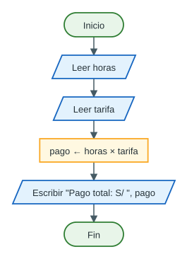

### Código C++

Archivo: [`codigo/ej02_pago_trabajador.cpp`](../codigo/ej02_pago_trabajador.cpp)

```cpp
// =============================================================
// Ejercicio 2 - Entrada, proceso y salida           (Nivel: Basico)
// Calcula el pago de un trabajador:  Pago = Horas x Tarifa
// -------------------------------------------------------------
// ENTRADA : horas trabajadas (int), pago por hora (double)
// PROCESO : pago = horas * tarifa
// SALIDA  : pago total (double, con 2 decimales)
// =============================================================

#include <iostream>
#include <iomanip>     // para fixed y setprecision (formato de decimales)
using namespace std;

int main() {
    // 1) Declaracion de variables
    int    horas;      // horas trabajadas (numero entero)
    double tarifa;     // pago por hora en soles (tiene decimales: 25.50)
    double pago;       // resultado: pago total

    // 2) ENTRADA: pedimos los datos al usuario
    cout << "Horas trabajadas: ";
    cin >> horas;
    cout << "Pago por hora: ";
    cin >> tarifa;

    // 3) PROCESO: aplicamos la formula
    pago = horas * tarifa;          // int * double -> el resultado es double

    // 4) SALIDA: mostramos el resultado con 2 decimales
    cout << fixed << setprecision(2);
    cout << "Pago total: S/ " << pago << endl;

    return 0;
}
```

**Ejecución real** (lo escrito después de cada pregunta lo tecleó el usuario):

```text
Horas trabajadas: 8
Pago por hora: 25.50
Pago total: S/ 204.00
```

### Prueba de escritorio

| Paso | Instrucción | `horas` | `tarifa` | `pago` | Pantalla |
|---|---|---|---|---|---|
| 1 | Declaración | ? | ? | ? | |
| 2 | `cin >> horas;` | 8 | ? | ? | `Horas trabajadas: 8` |
| 3 | `cin >> tarifa;` | 8 | 25.50 | ? | `Pago por hora: 25.50` |
| 4 | `pago = horas * tarifa;` | 8 | 25.50 | 204.00 | |
| 5 | `cout << … << pago;` | 8 | 25.50 | 204.00 | `Pago total: S/ 204.00` |

Verificación a mano: 8 × 25.50 = 204.00 ✔

### Errores frecuentes

| Error | Qué pasa |
|---|---|
| Calcular `pago` **antes** de leer los datos | Se multiplica «basura»: el resultado no tiene sentido. El orden es **leer → calcular → mostrar** |
| Declarar `pago` como `int` | Con 7 horas a 25.50 se guardaría 178 en lugar de 178.50 |
| Olvidar `#include <iomanip>` | `setprecision` no compila |
| Escribir `25,50` (con coma) al ejecutar | `cin` lee solo `25` y se detiene en la coma: el programa muestra **S/ 200.00**. En la consola, los decimales van con **punto** |
| Escribir `7.5` cuando `horas` es `int` | `cin` guarda 7 y el `.5` sobrante lo toma la siguiente lectura: ¡el programa **ni siquiera pregunta** la tarifa y muestra S/ 3.50! |

Así se ve el último error en una ejecución real:

```text
Horas trabajadas: 7.5
Pago por hora: Pago total: S/ 3.50
```

## Ejercicio 3 — Trazado de expresiones

**Nivel:** Medio · **Objetivo:** comprender la división entera y la conversión de tipos.

**Enunciado.** Analiza el código y responde: 1) ¿Cuál es el valor de `x`? 2) ¿Cuál es el valor de `y`? 3) ¿Por qué los resultados son diferentes? 4) ¿Qué función cumple `static_cast<double>`?

```cpp
int a = 10;
int b = 4;

double x = a / b;
double y = static_cast<double>(a) / b;

cout << x << endl;
cout << y << endl;
```

### Respuestas

1. **`x` vale 2** (guardado como `2.0`; en pantalla se ve `2`).
2. **`y` vale 2.5**.
3. **Porque en `x` se dividen dos enteros.** `a / b` es `int / int`, así que C++ hace **división entera**: 10 / 4 = 2 y el `.5` se descarta. Recién después ese `2` se convierte a `double` (2.0) para guardarlo en `x`; los decimales ya se habían perdido. En `y`, primero se convierte `a` a `double` (10.0), así que la operación es `double / int`; C++ convierte también `b` a 4.0 y hace **división real**: 10.0 / 4.0 = 2.5.
4. **`static_cast<double>` convierte explícitamente un valor al tipo `double`** para esa expresión. No cambia la variable `a` (sigue siendo `int` y sigue valiendo 10): crea una copia temporal de su valor como `double`. Sirve para forzar una división real entre variables enteras.

### Paso a paso

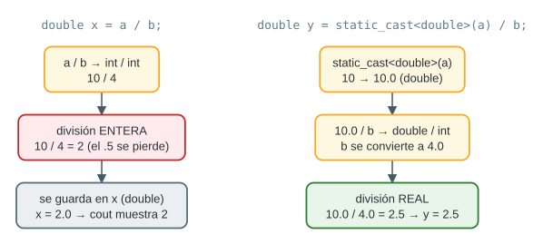

| Línea | Operación | Tipos | Resultado de la operación | Valor guardado |
|---|---|---|---|---|
| `double x = a / b;` | `10 / 4` | `int / int` | `2` (división entera) | `x = 2.0` |
| `double y = static_cast<double>(a) / b;` | `10.0 / 4` | `double / int` → `double / double` | `2.5` (división real) | `y = 2.5` |

> [!NOTE]
> ¿Por qué se imprime `2` y no `2.0`? Porque `cout`, por defecto, **no muestra los ceros decimales innecesarios**. El valor guardado sí es 2.0. Con `cout << fixed << setprecision(1) << x;` se vería `2.0`.

### Programa completo con variantes

Archivo: [`codigo/ej03_division_entera.cpp`](../codigo/ej03_division_entera.cpp)

```cpp
// =============================================================
// Ejercicio 3 - Trazado de expresiones              (Nivel: Medio)
// Objetivo: comprender la division entera y la conversion de tipos.
// =============================================================

#include <iostream>
#include <iomanip>
using namespace std;

int main() {
    // ---------- Codigo del enunciado ----------
    int a = 10;
    int b = 4;

    double x = a / b;                       // int / int -> division ENTERA: 10 / 4 = 2
                                            // (el .5 se pierde ANTES de guardar en x)
    double y = static_cast<double>(a) / b;  // double / int -> division REAL: 10.0 / 4 = 2.5

    cout << x << endl;    // muestra 2   (cout no muestra el ".0" por defecto)
    cout << y << endl;    // muestra 2.5

    // ---------- Extra: variantes que suelen aparecer en examen ----------
    cout << endl << "--- Variantes ---" << endl;
    cout << "a % b                       = " << a % b << endl;                       // 2 (resto)
    cout << "a / 4.0                     = " << a / 4.0 << endl;                     // 2.5
    cout << "static_cast<double>(a / b)  = " << static_cast<double>(a / b) << endl;  // 2 (tarde!)
    cout << "1.0 * a / b                 = " << 1.0 * a / b << endl;                 // 2.5

    // Con fixed y setprecision(1) se ve el decimal aunque sea .0
    cout << fixed << setprecision(1);
    cout << "x con 1 decimal             = " << x << endl;                           // 2.0
    cout << "y con 1 decimal             = " << y << endl;                           // 2.5

    return 0;
}
```

**Ejecución real:**

```text
2
2.5

--- Variantes ---
a % b                       = 2
a / 4.0                     = 2.5
static_cast<double>(a / b)  = 2
1.0 * a / b                 = 2.5
x con 1 decimal             = 2.0
y con 1 decimal             = 2.5
```

### Trampas de examen

> [!CAUTION]
> `static_cast<double>(a / b)` **no arregla nada**: primero se calcula `a / b` entre enteros (= 2) y recién después se convierte el 2 a 2.0. Hay que convertir **antes** de dividir: `static_cast<double>(a) / b`.

| Expresión | Resultado | Explicación |
|---|---|---|
| `a / b` | `2` | entero / entero |
| `a % b` | `2` | resto de 10 entre 4 |
| `a / 4.0` | `2.5` | `4.0` es `double` → división real |
| `1.0 * a / b` | `2.5` | `1.0 * a` ya es `double` (10.0) |
| `static_cast<double>(a / b)` | `2` | se convierte después de dividir: tarde |
| `int z = 7.9;` | `7` | al guardar un real en un `int` se cortan los decimales |
| `double w = 1 / 3;` | `0` | 1 / 3 entre enteros = 0 |

## Ejercicio 4 — Precedencia de operadores

**Nivel:** Medio · **Objetivo:** reforzar precedencia y asociatividad.

**Enunciado.** Con `int a = 8; int b = 3; int c = 2;` determina el resultado de: A) `a + b * c` B) `(a + b) * c` C) `a % b + c` D) `a / b * c`. Después, modifica cada expresión con paréntesis para dejar explícito el orden de evaluación.

### Recordatorio de las reglas

1. Primero lo que está entre **paréntesis**.
2. Luego `*`, `/` y `%` (tienen **la misma** precedencia → se resuelven **de izquierda a derecha**).
3. Al final `+` y `-` (también de izquierda a derecha).
4. Como las tres variables son `int`, **toda división es entera**.

### Solución paso a paso

**A) `a + b * c`**

- `*` tiene más precedencia que `+`: primero `b * c = 3 * 2 = 6`.
- Luego `a + 6 = 8 + 6 = 14`.
- **Resultado: 14** · Con paréntesis: **`a + (b * c)`**

**B) `(a + b) * c`**

- Los paréntesis obligan a sumar primero: `a + b = 8 + 3 = 11`.
- Luego `11 * c = 11 * 2 = 22`.
- **Resultado: 22** · Ya tiene los paréntesis necesarios: **`(a + b) * c`**

**C) `a % b + c`**

- `%` tiene más precedencia que `+`: primero `a % b = 8 % 3 = 2` (8 = 3 × 2 + **2**).
- Luego `2 + c = 2 + 2 = 4`.
- **Resultado: 4** · Con paréntesis: **`(a % b) + c`**

**D) `a / b * c`**

- `/` y `*` tienen la **misma** precedencia → se aplica la **asociatividad de izquierda a derecha**.
- Primero `a / b = 8 / 3 = 2` (división entera: 2.666… → 2).
- Luego `2 * c = 2 * 2 = 4`.
- **Resultado: 4** · Con paréntesis: **`(a / b) * c`**

| Expresión | Orden explícito | Cálculo | Resultado |
|---|---|---|---|
| A) `a + b * c` | `a + (b * c)` | 8 + 6 | **14** |
| B) `(a + b) * c` | `(a + b) * c` | 11 × 2 | **22** |
| C) `a % b + c` | `(a % b) + c` | 2 + 2 | **4** |
| D) `a / b * c` | `(a / b) * c` | 2 × 2 | **4** |

### Árboles de evaluación

Cada expresión se puede dibujar como un árbol: **las hojas son los valores y se resuelve de abajo hacia arriba**. El operador que queda en la raíz es el **último** que se aplica.

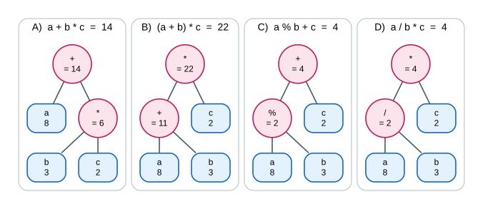

### ¿Por qué importa la asociatividad? (expresión D)

Si alguien evaluara D de derecha a izquierda, haría `a / (b * c) = 8 / 6 = 1`, que es **otro resultado**. En C++, operadores de igual precedencia se evalúan de **izquierda a derecha**, por eso D da **4** y no 1.

Además, si fueran números reales: `8.0 / 3 * 2 = 5.33333` (no 4). En el ejercicio da 4 porque los tres son `int`.

### Programa de comprobación

Archivo: [`codigo/ej04_precedencia.cpp`](../codigo/ej04_precedencia.cpp)

```cpp
// =============================================================
// Ejercicio 4 - Precedencia de operadores           (Nivel: Medio)
// Objetivo: reforzar precedencia y asociatividad.
// Regla: primero ( ), luego * / %  (de izquierda a derecha),
//        y al final + -            (de izquierda a derecha).
// =============================================================

#include <iostream>
using namespace std;

int main() {
    int a = 8;
    int b = 3;
    int c = 2;

    // ---------- Expresiones tal como las da el enunciado ----------
    cout << "A) a + b * c   = " << a + b * c   << endl;   // 8 + 6      = 14
    cout << "B) (a + b) * c = " << (a + b) * c << endl;   // 11 * 2     = 22
    cout << "C) a % b + c   = " << a % b + c   << endl;   // 2 + 2      = 4
    cout << "D) a / b * c   = " << a / b * c   << endl;   // 2 * 2      = 4

    // ---------- Las mismas, con parentesis explicitos ----------
    cout << endl;
    cout << "A) a + (b * c) = " << a + (b * c) << endl;   // 14
    cout << "B) (a + b) * c = " << (a + b) * c << endl;   // 22 (ya tenia parentesis)
    cout << "C) (a % b) + c = " << (a % b) + c << endl;   // 4
    cout << "D) (a / b) * c = " << (a / b) * c << endl;   // 4

    // ---------- Si agrupamos distinto, el resultado cambia ----------
    cout << endl;
    cout << "a / (b * c)    = " << a / (b * c) << endl;   // 8 / 6 = 1
    cout << "a % (b + c)    = " << a % (b + c) << endl;   // 8 % 5 = 3

    return 0;
}
```

**Ejecución real:**

```text
A) a + b * c   = 14
B) (a + b) * c = 22
C) a % b + c   = 4
D) a / b * c   = 4

A) a + (b * c) = 14
B) (a + b) * c = 22
C) (a % b) + c = 4
D) (a / b) * c = 4

a / (b * c)    = 1
a % (b + c)    = 3
```

### Practica más (con `a = 8, b = 3, c = 2`)

| Expresión | Resultado | Por qué |
|---|---|---|
| `a - b - c` | `3` | De izquierda a derecha: (8 − 3) − 2 |
| `a - (b - c)` | `7` | 8 − 1 |
| `a * b % c` | `0` | (8 × 3) % 2 = 24 % 2 |
| `a + b % c` | `9` | 8 + (3 % 2) = 8 + 1 |
| `-a % b` | `-2` | (−8) % 3: el signo sigue al dividendo |
| `a / c / c` | `2` | (8 / 2) / 2 |

## Ejercicio 5 — Debugging de entrada con string

**Nivel:** Medio · **Objetivo:** diferenciar `cin` y `getline()`.

**Enunciado.** Analiza el programa. Si el usuario escribe `Juan Carlos Perez`: 5) ¿Qué mostrará el programa? 6) ¿Cuál es el problema? 7) Corrige el código. 8) Explica por qué `getline()` es más apropiado en este caso. *(La numeración 5 a 8 es la de la hoja original).*

Archivo: [`codigo/ej05a_original_con_error.cpp`](../codigo/ej05a_original_con_error.cpp)

```cpp
// =============================================================
// Ejercicio 5 - Debugging de entrada con string     (Nivel: Medio)
// VERSION ORIGINAL (CON ERROR), tal como aparece en el enunciado.
// Si el usuario escribe: Juan Carlos Perez
// el programa muestra solo:  Cliente: Juan
// Motivo: "cin >>" deja de leer en el primer espacio en blanco.
// =============================================================

#include <iostream>
#include <string>
using namespace std;

int main() {
    string nombre;

    cout << "Ingrese nombre completo: ";
    cin >> nombre;                    // <-- PROBLEMA: lee solo hasta el primer espacio

    cout << "Cliente: " << nombre;
    return 0;
}
```

### 5) ¿Qué mostrará el programa?

```text
Ingrese nombre completo: Juan Carlos Perez
Cliente: Juan
```

Solo muestra **`Cliente: Juan`**.

### 6) ¿Cuál es el problema?

`cin >> nombre` **lee únicamente hasta el primer espacio en blanco**. Para `cin >>`, el espacio es un separador de datos. Por eso guarda solo `"Juan"`; el resto (`" Carlos Perez"` y el Enter) **se queda esperando en el buffer de entrada** sin que nadie lo lea.


Lo que queda en el buffer no desaparece: si después hubiera otro `cin >>`, **lo tomaría sin esperar al usuario**. Ejecución real de un programa que, tras pedir el nombre con `cin >>`, pide la ciudad:

```text
Ingrese nombre completo: Juan Carlos Perez
Ingrese ciudad: Cliente: Juan | Ciudad: Carlos
```

¡El programa nunca dejó escribir la ciudad: usó `"Carlos"`, que había quedado en el buffer!

### 7) Código corregido

Basta con cambiar **una línea**: `cin >> nombre;` por `getline(cin, nombre);`.

Archivo: [`codigo/ej05b_corregido_getline.cpp`](../codigo/ej05b_corregido_getline.cpp)

```cpp
// =============================================================
// Ejercicio 5 - Debugging de entrada con string     (Nivel: Medio)
// VERSION CORREGIDA: usamos getline() para leer la linea completa.
// Si el usuario escribe: Juan Carlos Perez
// el programa muestra:   Cliente: Juan Carlos Perez
// =============================================================

#include <iostream>
#include <string>
using namespace std;

int main() {
    string nombre;

    cout << "Ingrese nombre completo: ";
    getline(cin, nombre);             // lee TODO hasta que el usuario presiona Enter

    cout << "Cliente: " << nombre << endl;
    return 0;
}
```

**Ejecución real:**

```text
Ingrese nombre completo: Juan Carlos Perez
Cliente: Juan Carlos Perez
```

### 8) ¿Por qué `getline()` es más apropiado?

Porque un **nombre completo contiene espacios**. `getline(cin, nombre)` lee **toda la línea** —letras, espacios y símbolos— hasta que el usuario presiona Enter, y descarta ese Enter. En cambio, `cin >>` está pensado para leer datos separados por espacios (números o palabras sueltas). Regla práctica: **si el texto puede tener espacios, usa `getline`**.

### Pseudocódigo y diagrama de flujo (versión corregida)

```pseudo
Algoritmo MostrarCliente
    Definir nombre Como Cadena
    Escribir "Ingrese nombre completo: "
    Leer nombre        // la línea completa, con espacios
    Escribir "Cliente: ", nombre
FinAlgoritmo
```

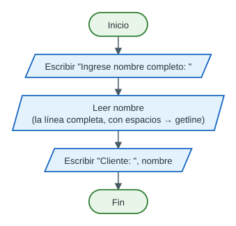

### Extra: la trampa de mezclar `cin >>` con `getline`

En el examen es muy común que se pida primero un número y luego un texto. Si se lee el número con `cin >>` y después el texto con `getline`, **el texto sale vacío**, porque `getline` encuentra el Enter que dejó `cin >>`:

```cpp
cout << "Cantidad: ";
cin >> cantidad;                 // el usuario escribe 2 y Enter: el Enter queda pendiente
cout << "Nombre del cliente: ";
getline(cin, cliente);           // toma ese Enter: cliente queda VACIO
cout << "Cliente: [" << cliente << "]" << endl;
```

Ejecución real (el programa ni siquiera deja escribir el nombre):

```text
Cantidad: 2
Nombre del cliente: Cliente: []
```


La solución es descartar ese Enter con `ws` antes de leer la línea:

Archivo: [`codigo/ej05c_extra_cin_y_getline.cpp`](../codigo/ej05c_extra_cin_y_getline.cpp)

```cpp
// =============================================================
// Ejercicio 5 - EXTRA: la trampa de mezclar "cin >>" con getline()
// -------------------------------------------------------------
// Despues de "cin >> edad;" el Enter (el caracter '\n') se queda
// esperando en el buffer de entrada. Un getline() que venga despues
// lo encuentra y "lee" una linea VACIA.
// Solucion: getline(cin >> ws, nombre);   (ws salta espacios y Enter)
//           o bien:  cin.ignore();  antes del getline.
// =============================================================

#include <iostream>
#include <string>
using namespace std;

int main() {
    int edad;
    string nombre;

    cout << "Ingrese su edad: ";
    cin >> edad;                      // lee el numero, pero deja el '\n' en el buffer

    cout << "Ingrese nombre completo: ";
    getline(cin >> ws, nombre);       // "cin >> ws" descarta el '\n' pendiente

    cout << "Cliente: " << nombre << " (" << edad << " anios)" << endl;
    return 0;
}
```

**Ejecución real:**

```text
Ingrese su edad: 20
Ingrese nombre completo: Juan Carlos Perez
Cliente: Juan Carlos Perez (20 anios)
```

| | `cin >> variable` | `getline(cin, variable)` |
|---|---|---|
| Lee hasta… | El primer espacio, tabulación o Enter | El Enter (fin de la línea) |
| ¿Incluye espacios? | No | Sí |
| ¿Qué pasa con el Enter? | Lo **deja** en el buffer | Lo **lee y lo descarta** |
| Ideal para | Números y palabras sueltas | Nombres, direcciones, frases |
| Tipos | `int`, `double`, `char`, `string`… | Solo `string` |

## Ejercicio 6 — Procesamiento de código con substr()

**Nivel:** Medio · **Objetivo:** trabajar índices y subcadenas.

**Enunciado.** Un código universitario tiene el formato `FIEE-2026-0145`, donde FIEE = facultad, 2026 = año y 0145 = correlativo. Desarrolla un programa que extraiga y muestre cada componente usando `substr()`. Salida esperada: `Facultad: FIEE`, `Año: 2026`, `Correlativo: 0145`. Además, responde: ¿qué devuelve `codigo.substr(5,4)`?

### Clave: dibujar el texto con sus índices

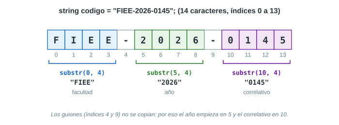

- El texto tiene **14 caracteres**, con índices del **0 al 13**.
- Los guiones están en las posiciones **4** y **9**.
- Cada parte empieza **una posición después** de un guion.

Recuerda: `substr(inicio, cantidad)` → **desde** `inicio`, **toma** `cantidad` caracteres.

| Parte | Empieza en | Cantidad | Instrucción | Resultado |
|---|---|---|---|---|
| Facultad | 0 | 4 | `codigo.substr(0, 4)` | `"FIEE"` |
| Año | 5 | 4 | `codigo.substr(5, 4)` | `"2026"` |
| Correlativo | 10 | 4 | `codigo.substr(10, 4)` | `"0145"` |

### Respuesta directa: ¿qué devuelve `codigo.substr(5,4)`?

Devuelve **`"2026"`**: los 4 caracteres que empiezan en el índice 5 (`'2'`, `'0'`, `'2'`, `'6'`). Es el **año**. Ojo: devuelve un **texto** (`string`), no un número.

### Análisis E-P-S

| | Variable | Tipo | Justificación |
|---|---|---|---|
| **Entrada** | `codigo` | `string` | Tiene letras, números y guiones |
| **Proceso** | `facultad`, `anio`, `correlativo` | `string` | Son pedazos de un texto (`substr` devuelve `string`). El correlativo `"0145"` conserva su cero a la izquierda |
| **Salida** | las tres partes | — | Se muestran con su etiqueta |

### Pseudocódigo

```pseudo
Algoritmo ProcesarCodigo
    Definir codigo, facultad, anio, correlativo Como Cadena
    Escribir "Ingrese el codigo universitario: "
    Leer codigo
    facultad    ← subcadena(codigo, 0, 4)
    anio        ← subcadena(codigo, 5, 4)
    correlativo ← subcadena(codigo, 10, 4)
    Escribir "Facultad: ", facultad
    Escribir "Año: ", anio
    Escribir "Correlativo: ", correlativo
FinAlgoritmo
```

### Diagrama de flujo

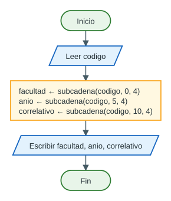

### Código C++

Archivo: [`codigo/ej06_substr_codigo.cpp`](../codigo/ej06_substr_codigo.cpp)

```cpp
// =============================================================
// Ejercicio 6 - Procesamiento de codigo con substr() (Nivel: Medio)
// Codigo universitario con formato:  FIEE-2026-0145
//   FIEE = facultad, 2026 = anio, 0145 = correlativo
// -------------------------------------------------------------
// Indices de cada caracter (se empieza a contar desde 0):
//   F  I  E  E  -  2  0  2  6  -  0  1  4  5
//   0  1  2  3  4  5  6  7  8  9  10 11 12 13
// substr(inicio, cantidad) copia "cantidad" caracteres desde "inicio".
// =============================================================

#include <iostream>
#include <string>
using namespace std;

int main() {
    string codigo;

    // ENTRADA (el codigo no tiene espacios, por eso basta con cin >>)
    cout << "Ingrese el codigo universitario (ej. FIEE-2026-0145): ";
    cin >> codigo;

    // PROCESO: extraemos cada parte con substr(inicio, cantidad)
    string facultad    = codigo.substr(0, 4);    // desde el indice 0, 4 caracteres
    string anio        = codigo.substr(5, 4);    // desde el indice 5, 4 caracteres
    string correlativo = codigo.substr(10, 4);   // desde el indice 10, 4 caracteres

    // SALIDA
    cout << "Facultad: "    << facultad    << endl;
    cout << "Anio: "        << anio        << endl;   // en papel se escribe con enie
    cout << "Correlativo: " << correlativo << endl;

    // Pregunta del enunciado: que devuelve codigo.substr(5,4)?
    cout << "codigo.substr(5,4) devuelve: " << codigo.substr(5, 4) << endl;

    return 0;
}
```

**Ejecución real:**

```text
Ingrese el codigo universitario (ej. FIEE-2026-0145): FIEE-2026-0145
Facultad: FIEE
Anio: 2026
Correlativo: 0145
codigo.substr(5,4) devuelve: 2026
```

> [!NOTE]
> Aquí se usó `cin >> codigo` porque el código **no tiene espacios**. Con `getline(cin, codigo)` también funcionaría. Y el mismo programa sirve para cualquier código con el mismo formato: con `FISI-2025-1234` muestra `FISI`, `2025` y `1234`.

### Prueba de escritorio

| Paso | Instrucción | `codigo` | `facultad` | `anio` | `correlativo` |
|---|---|---|---|---|---|
| 1 | `cin >> codigo;` | `"FIEE-2026-0145"` | ? | ? | ? |
| 2 | `facultad = codigo.substr(0, 4);` | igual | `"FIEE"` | ? | ? |
| 3 | `anio = codigo.substr(5, 4);` | igual | `"FIEE"` | `"2026"` | ? |
| 4 | `correlativo = codigo.substr(10, 4);` | igual | `"FIEE"` | `"2026"` | `"0145"` |
| 5 | Mostrar | | | | Pantalla: `Facultad: FIEE`, `Anio: 2026`, `Correlativo: 0145` |

### Errores frecuentes

| Escribir… | Da… | El error |
|---|---|---|
| `codigo.substr(5, 9)` | `"2026-0145"` | Pensar que el 2.º número es la posición **final**. ¡Es la **cantidad**! |
| `codigo.substr(4, 4)` | `"-202"` | Contar desde 1 en lugar de desde 0 (o incluir el guion) |
| `codigo.substr(10)` | `"0145"` | No es un error: sin 2.º número copia hasta el final. Correcto aquí porque el correlativo está al final |
| Guardar el correlativo en un `int` | `145` | Se pierde el cero a la izquierda |

### Para ir más allá

- **Últimos 4 caracteres**, sin contar posiciones: `codigo.substr(codigo.length() - 4)` → `"0145"`.
- **Convertir el año a número** para hacer cálculos: `stoi(anio) + 1` → `2027`.
- **Versión flexible con `find`** (funciona aunque la facultad tenga otra cantidad de letras):

```cpp
int g1 = codigo.find("-");              // primer guion: 4
int g2 = codigo.find("-", g1 + 1);      // segundo guion: 9 (busca desde g1 + 1)
string facultad    = codigo.substr(0, g1);               // "FIEE"
string anio        = codigo.substr(g1 + 1, g2 - g1 - 1); // "2026"
string correlativo = codigo.substr(g2 + 1);              // "0145"
```

## Ejercicio 7 — Búsqueda y reemplazo en strings

**Nivel:** Medio-alto · **Objetivo:** usar `length()`, `find()`, `substr()` y `replace()`.

**Enunciado.** Dada la cadena `string correo = "alumno@universidad.edu.pe";` 9) determina la longitud; 10) encuentra la posición de `@`; 11) extrae el nombre de usuario; 12) extrae el dominio; 13) reemplaza `"universidad"` por `"unmsm"`. Resultado esperado aproximado: `Usuario: alumno`, `Dominio: universidad.edu.pe`, `Nuevo correo: alumno@unmsm.edu.pe`.

### El texto con sus índices

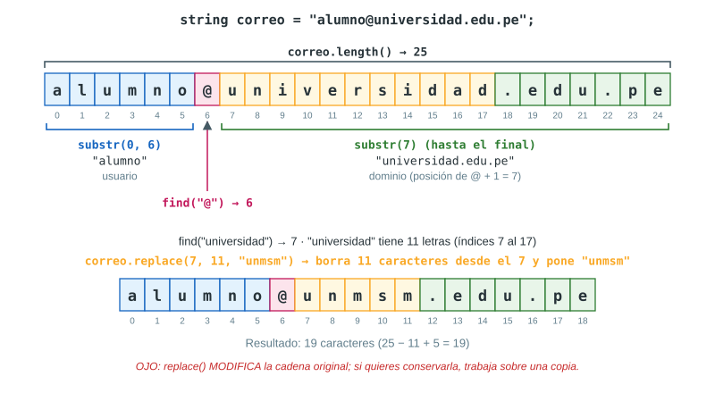

### Solución paso a paso

**9) Longitud.** `correo.length()` → **25**. Contando: `alumno` (6) + `@` (1) + `universidad` (11) + `.edu.pe` (7) = 25. Los índices van del 0 al 24.

**10) Posición de `@`.** `correo.find("@")` → **6**. Los índices 0 a 5 son `a-l-u-m-n-o`, así que la `@` está en el índice 6.

**11) Usuario.** Es todo lo que está **antes** de la `@`: `correo.substr(0, 6)` → **`"alumno"`**.

- ¿Por qué la cantidad es 6? Porque la `@` está en el índice 6, y **antes** de ella hay exactamente 6 caracteres (índices 0 a 5). En general: `correo.substr(0, posArroba)`.

**12) Dominio.** Es todo lo que está **después** de la `@`: empieza en `posArroba + 1 = 7` y va hasta el final: `correo.substr(7)` → **`"universidad.edu.pe"`** (18 caracteres).

**13) Reemplazo.** `replace(inicio, cantidad, nuevo)` borra `cantidad` caracteres desde `inicio` y pone `nuevo` en su lugar:

- `"universidad"` empieza en el índice **7** (`correo.find("universidad")` → 7) y tiene **11** letras.
- `correo.replace(7, 11, "unmsm")` → **`"alumno@unmsm.edu.pe"`** (19 caracteres: 25 − 11 + 5).

> [!WARNING]
> `replace` **modifica la variable original**. Si después necesitas el correo antiguo, primero haz una copia (`string nuevoCorreo = correo;`) y reemplaza en la copia. Así lo hace el programa de abajo.

### Pseudocódigo

```pseudo
Algoritmo ProcesarCorreo
    Definir correo, usuario, dominio, nuevoCorreo Como Cadena
    Definir longitudCorreo, posArroba, posPalabra Como Entero
    correo ← "alumno@universidad.edu.pe"
    longitudCorreo ← longitud(correo)
    posArroba ← buscar(correo, "@")
    usuario ← subcadena(correo, 0, posArroba)
    dominio ← subcadena(correo, posArroba + 1, hasta el final)
    nuevoCorreo ← correo
    posPalabra ← buscar(nuevoCorreo, "universidad")
    nuevoCorreo ← reemplazar(nuevoCorreo, posPalabra, 11, "unmsm")
    Escribir "Longitud: ", longitudCorreo
    Escribir "Posicion de @: ", posArroba
    Escribir "Usuario: ", usuario
    Escribir "Dominio: ", dominio
    Escribir "Nuevo correo: ", nuevoCorreo
FinAlgoritmo
```

### Diagrama de flujo

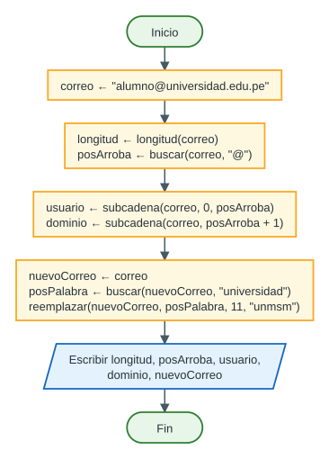

### Código C++

Archivo: [`codigo/ej07_correo.cpp`](../codigo/ej07_correo.cpp)

```cpp
// =============================================================
// Ejercicio 7 - Busqueda y reemplazo en strings  (Nivel: Medio-alto)
// Objetivo: usar length(), find(), substr() y replace().
// -------------------------------------------------------------
//   a l u m n o @ u n i v  e  r  s  i  d  a  d  .  e  d  u  .  p  e
//   0 1 2 3 4 5 6 7 8 9 10 11 12 13 14 15 16 17 18 19 20 21 22 23 24
// =============================================================

#include <iostream>
#include <string>
using namespace std;

int main() {
    string correo = "alumno@universidad.edu.pe";

    // 1) Longitud: cantidad total de caracteres
    int longitud = correo.length();                  // 25

    // 2) Posicion (indice) donde esta la @
    int posArroba = correo.find("@");                // 6

    // 3) Usuario: todo lo que esta ANTES de la @
    //    (desde el indice 0, tantos caracteres como indica posArroba)
    string usuario = correo.substr(0, posArroba);    // "alumno"

    // 4) Dominio: todo lo que esta DESPUES de la @
    //    (sin segundo parametro, substr copia hasta el final)
    string dominio = correo.substr(posArroba + 1);   // "universidad.edu.pe"

    // 5) Reemplazar "universidad" por "unmsm"
    //    replace(inicio, cuantos_borrar, texto_nuevo) MODIFICA la cadena,
    //    por eso trabajamos sobre una copia y conservamos el original.
    string nuevoCorreo = correo;
    int posPalabra = nuevoCorreo.find("universidad");   // 7
    nuevoCorreo.replace(posPalabra, 11, "unmsm");        // 11 = letras de "universidad"

    // SALIDA
    cout << "Correo original: " << correo      << endl;
    cout << "Longitud: "        << longitud    << endl;
    cout << "Posicion de @: "   << posArroba   << endl;
    cout << "Usuario: "         << usuario     << endl;
    cout << "Dominio: "         << dominio     << endl;
    cout << "Nuevo correo: "    << nuevoCorreo << endl;

    return 0;
}
```

**Ejecución real:**

```text
Correo original: alumno@universidad.edu.pe
Longitud: 25
Posicion de @: 6
Usuario: alumno
Dominio: universidad.edu.pe
Nuevo correo: alumno@unmsm.edu.pe
```

### Prueba de escritorio

| Paso | Instrucción | Variable que cambia | Valor |
|---|---|---|---|
| 1 | `correo = "alumno@universidad.edu.pe"` | `correo` | `"alumno@universidad.edu.pe"` |
| 2 | `longitud = correo.length()` | `longitud` | `25` |
| 3 | `posArroba = correo.find("@")` | `posArroba` | `6` |
| 4 | `usuario = correo.substr(0, 6)` | `usuario` | `"alumno"` |
| 5 | `dominio = correo.substr(7)` | `dominio` | `"universidad.edu.pe"` |
| 6 | `nuevoCorreo = correo` | `nuevoCorreo` | `"alumno@universidad.edu.pe"` |
| 7 | `posPalabra = nuevoCorreo.find("universidad")` | `posPalabra` | `7` |
| 8 | `nuevoCorreo.replace(7, 11, "unmsm")` | `nuevoCorreo` | `"alumno@unmsm.edu.pe"` |

### Errores frecuentes

| Código | Resultado | Problema |
|---|---|---|
| `correo.substr(posArroba)` | `"@universidad.edu.pe"` | Incluye la `@`: falta el `+ 1` |
| `correo.substr(0, posArroba + 1)` | `"alumno@"` | Se lleva la `@` con el usuario |
| `correo.replace(7, 5, "unmsm")` | `"alumno@unmsmrsidad.edu.pe"` | La cantidad debe ser la longitud de lo que se **borra** (11), no de lo que se pone (5) |
| `correo.replace("universidad", "unmsm")` | No compila | `replace` pide posición y cantidad, no el texto viejo |

> [!TIP]
> Para no contar letras a mano: `string viejo = "universidad";` y luego `nuevoCorreo.replace(nuevoCorreo.find(viejo), viejo.length(), "unmsm");`. Así el programa funciona aunque cambie la palabra.

### ¿Funciona con otro correo?

Sí, porque usamos `find` en lugar de números fijos. Con `"maria.lopez@universidad.edu.pe"` el mismo programa obtiene `maria.lopez`, `universidad.edu.pe` y `maria.lopez@unmsm.edu.pe`. Solo el 6 y el 7 de los comentarios cambiarían.

## Ejercicio 8 — Problema comercial integrado

**Nivel:** Medio-alto · **Objetivo:** integrar variables, expresiones y formato de salida.

**Enunciado.** Una tienda solicita: producto, precio unitario, cantidad y porcentaje de descuento. Debe calcular **Subtotal = Precio × Cantidad**, **Descuento = Subtotal × (Porcentaje / 100)** y **Total = Subtotal − Descuento**. Datos: Producto: Monitor, Precio: 850.50, Cantidad: 2, Descuento: 7.5. Se pide: 14) identificar Entrada–Proceso–Salida; 15) elaborar pseudocódigo; 16) escribir el programa en C++; 17) mostrar la salida con dos decimales.

### 14) Análisis Entrada – Proceso – Salida

| | Variable | Tipo | Justificación |
|---|---|---|---|
| **Entrada** | `producto` | `string` | Es texto y puede tener espacios («Monitor LG 24») → `getline` |
| **Entrada** | `precio` | `double` | Dinero con decimales (850.50) |
| **Entrada** | `cantidad` | `int` | Unidades enteras (2) |
| **Entrada** | `porcentaje` | `double` | Puede tener decimales (7.5) |
| **Proceso** | `subtotal ← precio × cantidad` | `double` | |
| **Proceso** | `descuento ← subtotal × (porcentaje / 100)` | `double` | |
| **Proceso** | `total ← subtotal − descuento` | `double` | |
| **Salida** | `subtotal`, `descuento`, `total` | `double` | Con 2 decimales (`fixed` + `setprecision(2)`) |

> [!CAUTION]
> Si `porcentaje` fuera `int` (por ejemplo, 10), la expresión `porcentaje / 100` sería **división entera** y daría **0**: ¡el descuento siempre sería cero! Por eso `porcentaje` es `double` (o se escribe `porcentaje / 100.0`).

### 15) Pseudocódigo

```pseudo
Algoritmo VentaConDescuento
    Definir producto Como Cadena
    Definir precio, porcentaje, subtotal, descuento, total Como Real
    Definir cantidad Como Entero
    Escribir "Producto: "
    Leer producto
    Escribir "Precio: "
    Leer precio
    Escribir "Cantidad: "
    Leer cantidad
    Escribir "Descuento (%): "
    Leer porcentaje
    subtotal  ← precio * cantidad
    descuento ← subtotal * (porcentaje / 100)
    total     ← subtotal - descuento
    Escribir "Subtotal: ", subtotal          // con 2 decimales
    Escribir "Descuento: ", descuento
    Escribir "Total: ", total
FinAlgoritmo
```

### Diagrama de flujo

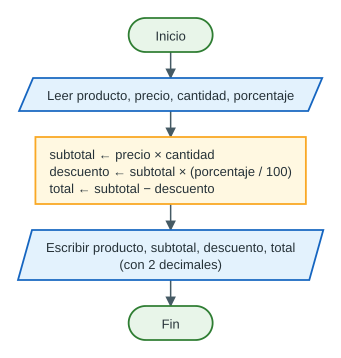

### 16) Código C++

Archivo: [`codigo/ej08_tienda_descuento.cpp`](../codigo/ej08_tienda_descuento.cpp)

```cpp
// =============================================================
// Ejercicio 8 - Problema comercial integrado      (Nivel: Medio-alto)
// -------------------------------------------------------------
// ENTRADA : producto (string), precio unitario (double),
//           cantidad (int), porcentaje de descuento (double)
// PROCESO : subtotal  = precio * cantidad
//           descuento = subtotal * (porcentaje / 100)
//           total     = subtotal - descuento
// SALIDA  : subtotal, descuento y total con 2 decimales
// =============================================================

#include <iostream>
#include <iomanip>     // fixed, setprecision
#include <string>      // string, getline
using namespace std;

int main() {
    // ---------- Declaracion de variables ----------
    string producto;       // nombre del producto (puede tener espacios)
    double precio;         // precio unitario (con decimales)
    int    cantidad;       // unidades compradas (entero)
    double porcentaje;     // % de descuento (puede ser 7.5)
    double subtotal, descuento, total;

    // ---------- ENTRADA ----------
    cout << "Producto: ";
    getline(cin, producto);        // primero el texto (getline), luego los numeros (cin)
    cout << "Precio: ";
    cin >> precio;
    cout << "Cantidad: ";
    cin >> cantidad;
    cout << "Descuento (%): ";
    cin >> porcentaje;

    // ---------- PROCESO ----------
    subtotal  = precio * cantidad;
    descuento = subtotal * (porcentaje / 100);   // 7.5 / 100 = 0.075
    total     = subtotal - descuento;

    // ---------- SALIDA ----------
    cout << fixed << setprecision(2);            // desde aqui: 2 decimales
    cout << endl;
    cout << "========= DETALLE DE LA COMPRA =========" << endl;
    cout << "Producto       : " << producto << endl;
    cout << "Precio unitario: S/ " << precio << endl;
    cout << "Cantidad       : " << cantidad << endl;
    cout << "Descuento      : " << porcentaje << " %" << endl;
    cout << "----------------------------------------" << endl;
    cout << "Subtotal       : S/ " << subtotal << endl;
    cout << "Monto descuento: S/ " << descuento << endl;
    cout << "TOTAL A PAGAR  : S/ " << total << endl;

    return 0;
}
```

### 17) Salida con dos decimales (ejecución real)

```text
Producto: Monitor
Precio: 850.50
Cantidad: 2
Descuento (%): 7.5

========= DETALLE DE LA COMPRA =========
Producto       : Monitor
Precio unitario: S/ 850.50
Cantidad       : 2
Descuento      : 7.50 %
----------------------------------------
Subtotal       : S/ 1701.00
Monto descuento: S/ 127.57
TOTAL A PAGAR  : S/ 1573.42
```

### Prueba de escritorio (con los valores exactos)

| Paso | Instrucción | Cálculo | Resultado exacto |
|---|---|---|---|
| 1 | Leer datos | — | `producto = "Monitor"`, `precio = 850.50`, `cantidad = 2`, `porcentaje = 7.5` |
| 2 | `subtotal = precio * cantidad` | 850.50 × 2 | **1701.00** |
| 3 | `descuento = subtotal * (porcentaje / 100)` | 1701.00 × 0.075 | **127.575** |
| 4 | `total = subtotal - descuento` | 1701.00 − 127.575 | **1573.425** |

### ¿Por qué sale 127.57 y no 127.58?

Si redondeamos a mano, 127.575 → 127.58 y 1573.425 → 1573.43. Pero el programa muestra **127.57** y **1573.42**. No es un error del programa:

1. La computadora guarda los `double` en **binario**, y muchos decimales (como 0.075) **no tienen una representación binaria exacta**, igual que 1/3 no tiene una representación decimal exacta (0.3333…).
2. Por eso, en memoria, el descuento queda como **127.57499999999998863…** y el total como **1573.42499999999995452…**: un poquito **menos** que el valor exacto.
3. `setprecision(2)` redondea **ese** valor guardado, y como está por debajo de la mitad, redondea hacia abajo.

Si en el examen te piden «la salida esperada», puedes escribir los valores de la prueba de escritorio (127.575 y 1573.425) y aclarar que con dos decimales el programa muestra 127.57 y 1573.42 por la representación binaria. En programas comerciales reales se trabaja con céntimos enteros o con tipos decimales especiales para evitar este efecto.

> [!NOTE]
> Este fenómeno es justamente el tema de «cómo se almacena un número real en la memoria» (estándar IEEE 754).

### Errores frecuentes

| Error | Consecuencia |
|---|---|
| `int porcentaje;` y luego `porcentaje / 100` | Descuento = 0 para cualquier porcentaje menor que 100 |
| Leer `producto` con `cin >>` | «Monitor LG 24» se corta en «Monitor» y el resto desordena las siguientes lecturas |
| Leer primero los números y luego el producto con `getline` (sin `ws`) | `producto` queda vacío (trampa del ejercicio 5) |
| Olvidar `fixed` | `setprecision(2)` significaría «2 cifras significativas»: `1701` se mostraría como `1.7e+03` |
| Escribir `cout << setprecision(2)` en cada línea | No es un error, pero es innecesario: el formato se queda activo |

## Ejercicio 9 — UML básico + C++

**Nivel:** Avanzado · **Objetivo:** relacionar el modelamiento UML con la implementación.

**Enunciado.** Se desea representar la entidad **Producto** con los datos código, nombre, precio y stock, y las operaciones `mostrarDatos()` y `calcularValorStock()`. Se pide: 18) construir un diagrama de clase UML básico; 19) identificar atributos y operaciones; 20) proponer los tipos C++ adecuados; 21) escribir una versión simplificada de la estructura en C++ (`string codigo; string nombre; double precio; int stock;`).

### 18) Diagrama de clases UML

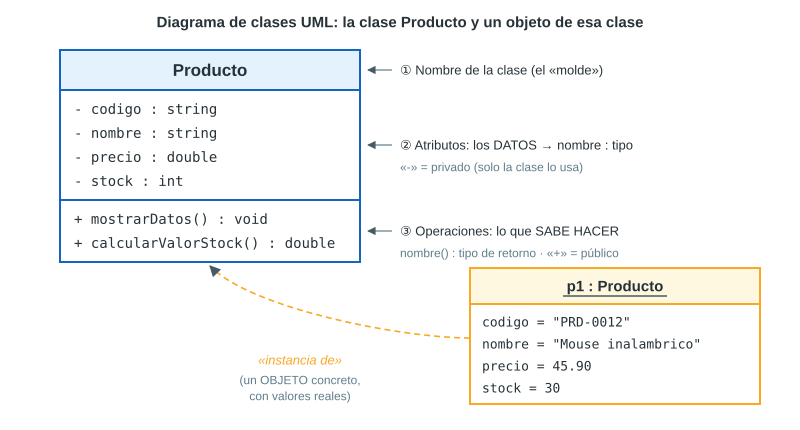

En texto (como podrías dibujarlo en el examen):

```uml
┌───────────────────────────────────┐
│             Producto              │
├───────────────────────────────────┤
│ - codigo : string                 │
│ - nombre : string                 │
│ - precio : double                 │
│ - stock : int                     │
├───────────────────────────────────┤
│ + mostrarDatos() : void           │
│ + calcularValorStock() : double   │
└───────────────────────────────────┘
```

### 19) Atributos y operaciones

| Tipo de miembro | Nombre | Qué representa |
|---|---|---|
| Atributo | `codigo` | Identificador del producto (ej. `"PRD-0012"`) |
| Atributo | `nombre` | Descripción (ej. `"Mouse inalambrico"`) |
| Atributo | `precio` | Precio unitario en soles |
| Atributo | `stock` | Unidades disponibles en almacén |
| Operación | `mostrarDatos()` | Muestra en pantalla los datos del producto; **no devuelve** nada (`void`) |
| Operación | `calcularValorStock()` | Calcula y **devuelve** el valor total del inventario: `precio × stock` (`double`) |

### 20) Tipos C++ propuestos

| Miembro | Tipo | Justificación |
|---|---|---|
| `codigo` | `string` | Es un identificador: puede tener letras, guiones y ceros a la izquierda |
| `nombre` | `string` | Es texto |
| `precio` | `double` | Dinero con decimales |
| `stock` | `int` | Se cuentan unidades enteras |
| `mostrarDatos()` | `void` | Solo muestra; no devuelve un valor |
| `calcularValorStock()` | `double` | `double × int` da `double` |

### 21) Versión simplificada en C++ (`struct`)

Es la «estructura» que pide el enunciado: agrupa los cuatro datos. Le añadimos las dos operaciones para que el programa esté completo.

Archivo: [`codigo/ej09a_producto_struct.cpp`](../codigo/ej09a_producto_struct.cpp)

```cpp
// =============================================================
// Ejercicio 9 - UML basico + C++                    (Nivel: Avanzado)
// VERSION SIMPLIFICADA (struct): la "estructura" que pide el enunciado.
// -------------------------------------------------------------
// Un struct agrupa varios datos relacionados bajo un mismo nombre.
// Aqui ademas le agregamos las dos operaciones del diagrama UML.
// =============================================================

#include <iostream>
#include <iomanip>
#include <string>
using namespace std;

struct Producto {
    // ---- Atributos (datos) ----
    string codigo;     // texto: puede tener letras y ceros a la izquierda
    string nombre;     // texto
    double precio;     // real: tiene decimales
    int    stock;      // entero: unidades disponibles

    // ---- Operaciones (funciones que pertenecen al struct) ----
    void mostrarDatos() {
        cout << "Codigo : " << codigo << endl;
        cout << "Nombre : " << nombre << endl;
        cout << "Precio : S/ " << precio << endl;
        cout << "Stock  : " << stock << " unidades" << endl;
    }

    double calcularValorStock() {
        return precio * stock;        // valor de todas las unidades en almacen
    }
};

int main() {
    cout << fixed << setprecision(2);

    Producto p;                       // p es un OBJETO (una variable) de tipo Producto
    p.codigo = "PRD-0012";            // con el punto (.) accedemos a cada atributo
    p.nombre = "Mouse inalambrico";
    p.precio = 45.90;
    p.stock  = 30;

    p.mostrarDatos();                 // llamamos a la operacion
    cout << "Valor del stock: S/ " << p.calcularValorStock() << endl;

    return 0;
}
```

**Ejecución real:**

```text
Codigo : PRD-0012
Nombre : Mouse inalambrico
Precio : S/ 45.90
Stock  : 30 unidades
Valor del stock: S/ 1377.00
```

### Versión completa: traducción fiel del UML (`class`)

En el diagrama, los atributos tienen `-` (privados) y las operaciones `+` (públicas). Eso se traduce con `private:` y `public:`. Como los atributos son privados, `main` no puede asignarlos directamente: se usa un **constructor**.

Archivo: [`codigo/ej09b_producto_clase.cpp`](../codigo/ej09b_producto_clase.cpp)

```cpp
// =============================================================
// Ejercicio 9 - UML basico + C++                    (Nivel: Avanzado)
// VERSION COMPLETA (class): traduccion fiel del diagrama UML.
// -------------------------------------------------------------
//   UML                                C++
//   - atributo  (privado)       ->     private:
//   + operacion (publica)       ->     public:
//   - precio : double           ->     double precio;
//   + calcularValorStock(): double ->  double calcularValorStock()
// =============================================================

#include <iostream>
#include <iomanip>
#include <string>
using namespace std;

class Producto {
private:                        // "-" en UML: solo la propia clase los usa
    string codigo;
    string nombre;
    double precio;
    int    stock;

public:                         // "+" en UML: se pueden usar desde main
    // Constructor: se ejecuta al crear el objeto y le da sus valores iniciales
    Producto(string c, string n, double p, int s) {
        codigo = c;
        nombre = n;
        precio = p;
        stock  = s;
    }

    void mostrarDatos() {
        cout << "Codigo : " << codigo << endl;
        cout << "Nombre : " << nombre << endl;
        cout << "Precio : S/ " << precio << endl;
        cout << "Stock  : " << stock << " unidades" << endl;
    }

    double calcularValorStock() {
        return precio * stock;
    }
};

int main() {
    cout << fixed << setprecision(2);

    // Creamos un objeto de la clase Producto (se llama al constructor)
    Producto p1("PRD-0012", "Mouse inalambrico", 45.90, 30);

    p1.mostrarDatos();
    cout << "Valor del stock: S/ " << p1.calcularValorStock() << endl;

    // p1.precio = 10;   // ERROR de compilacion: precio es private

    return 0;
}
```

La ejecución muestra exactamente lo mismo que la versión `struct` (valor del stock: 45.90 × 30 = **S/ 1377.00**).

### Diagrama de flujo

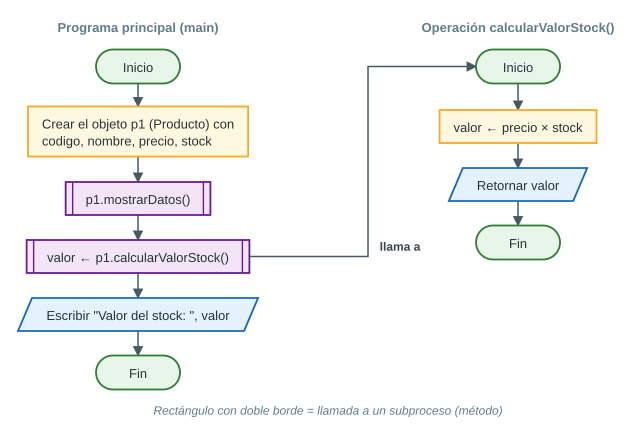

Pseudocódigo de la operación:

```pseudo
Funcion valor ← calcularValorStock()
    valor ← precio * stock
FinFuncion
```

### Correspondencia UML ↔ C++

| En el diagrama | En el código |
|---|---|
| Rectángulo con el nombre `Producto` | `class Producto { … };` |
| `- codigo : string` | `private:` … `string codigo;` |
| `+ mostrarDatos() : void` | `public:` … `void mostrarDatos() { … }` |
| `+ calcularValorStock() : double` | `double calcularValorStock() { return precio * stock; }` |
| Objeto `p1 : Producto` | `Producto p1("PRD-0012", …);` |

### Errores frecuentes

- Olvidar el **punto y coma** después de la llave de cierre: `};`
- Llamar a un método **sin paréntesis**: `p1.mostrarDatos;` da **error de compilación** (*invalid use of non-static member function*). Debe ser `p1.mostrarDatos();`
- Intentar `p1.precio = 10;` cuando `precio` es `private` → **error de compilación** (es lo que el UML quiere proteger).
- Poner `int` como tipo de retorno de `calcularValorStock()`: se perderían los decimales.

## Ejercicio 10 — Caso integrador de preparación

**Nivel:** Avanzado · **Objetivo:** integrar diseño, strings, expresiones y programación básica en C++.

**Enunciado.** Una tienda registra una venta con un código de estructura `TEC-2026-0087-LIM` (TEC = categoría, 2026 = año, 0087 = operación, LIM = sede). El programa recibe además: nombre del cliente, nombre del producto, precio unitario, cantidad y porcentaje de descuento.

- **Parte A** — Procesamiento de la cadena: obtener categoría, año, número de operación y sede con `substr()`.
- **Parte B** — Cálculos: Subtotal = Precio × Cantidad; MontoDescuento = Subtotal × (PorcentajeDescuento / 100); Total = Subtotal − MontoDescuento.
- **Parte C** — Salida: un «RESUMEN DE VENTA» con todos los datos.
- **Restricción:** sin `if`, `switch`, `for`, `while` ni `do-while`.
- **Entregables:** 22) Entrada–Proceso–Salida; 23) Pseudocódigo; 24) Código C++; 25) Prueba de escritorio; 26) Explicación breve de `substr()`.

### El código de venta con sus índices

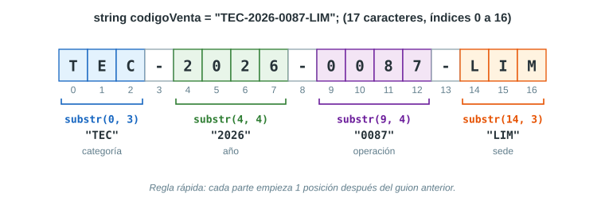

| Parte | Empieza en | Cantidad | Instrucción | Resultado |
|---|---|---|---|---|
| Categoría | 0 | 3 | `codigoVenta.substr(0, 3)` | `"TEC"` |
| Año | 4 | 4 | `codigoVenta.substr(4, 4)` | `"2026"` |
| Operación | 9 | 4 | `codigoVenta.substr(9, 4)` | `"0087"` |
| Sede | 14 | 3 | `codigoVenta.substr(14, 3)` | `"LIM"` |

### 22) Entrada – Proceso – Salida

| | Variable | Tipo | Justificación |
|---|---|---|---|
| **Entrada** | `codigoVenta` | `string` | Letras, números y guiones |
| **Entrada** | `cliente` | `string` | Nombre con espacios → `getline` |
| **Entrada** | `producto` | `string` | Nombre con espacios → `getline` |
| **Entrada** | `precioUnitario` | `double` | Dinero con decimales |
| **Entrada** | `cantidad` | `int` | Unidades enteras |
| **Entrada** | `porcentajeDescuento` | `double` | Puede tener decimales; evita la división entera |
| **Proceso A** | `categoria`, `anio`, `operacion`, `sede` | `string` | Subcadenas del código (`substr` devuelve `string`; `"0087"` conserva sus ceros) |
| **Proceso B** | `subtotal`, `montoDescuento`, `total` | `double` | Resultados de operaciones con `double` |
| **Salida** | Todo lo anterior | — | Resumen con 2 decimales en los montos |

### 23) Pseudocódigo

```pseudo
Algoritmo ResumenDeVenta
    Definir codigoVenta, cliente, producto Como Cadena
    Definir categoria, anio, operacion, sede Como Cadena
    Definir precioUnitario, porcentajeDescuento Como Real
    Definir subtotal, montoDescuento, total Como Real
    Definir cantidad Como Entero

    // ENTRADA
    Leer codigoVenta
    Leer cliente
    Leer producto
    Leer precioUnitario
    Leer cantidad
    Leer porcentajeDescuento

    // PARTE A: procesamiento de la cadena
    categoria ← subcadena(codigoVenta, 0, 3)
    anio      ← subcadena(codigoVenta, 4, 4)
    operacion ← subcadena(codigoVenta, 9, 4)
    sede      ← subcadena(codigoVenta, 14, 3)

    // PARTE B: calculos
    subtotal       ← precioUnitario * cantidad
    montoDescuento ← subtotal * (porcentajeDescuento / 100)
    total          ← subtotal - montoDescuento

    // PARTE C: salida
    Escribir "============ RESUMEN DE VENTA ============"
    Escribir "Cliente: ", cliente
    Escribir "Producto: ", producto
    Escribir "Categoría: ", categoria
    Escribir "Año: ", anio
    Escribir "Operación: ", operacion
    Escribir "Sede: ", sede
    Escribir "Precio unitario: ", precioUnitario
    Escribir "Cantidad: ", cantidad
    Escribir "Subtotal: ", subtotal
    Escribir "Descuento: ", montoDescuento
    Escribir "TOTAL: ", total
FinAlgoritmo
```

### Diagrama de flujo

Es un diagrama **solo secuencial**: no hay rombos de decisión ni flechas que regresen, como exige la restricción.

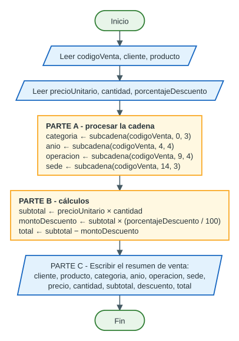

### 24) Código C++

Archivo: [`codigo/ej10_caso_integrador.cpp`](../codigo/ej10_caso_integrador.cpp)

```cpp
// =============================================================
// Ejercicio 10 - Caso integrador de preparacion     (Nivel: Avanzado)
// Restriccion: SIN if, switch, for, while ni do-while (solo secuencia).
// -------------------------------------------------------------
// Codigo de venta:  TEC-2026-0087-LIM
//   T  E  C  -  2  0  2  6  -  0  0  8  7  -  L  I  M
//   0  1  2  3  4  5  6  7  8  9  10 11 12 13 14 15 16
//   categoria = substr(0, 3)   -> "TEC"
//   anio      = substr(4, 4)   -> "2026"
//   operacion = substr(9, 4)   -> "0087"
//   sede      = substr(14, 3)  -> "LIM"
// =============================================================

#include <iostream>
#include <iomanip>     // fixed, setprecision
#include <string>      // string, getline, substr
using namespace std;

int main() {
    // ================= DECLARACION DE VARIABLES =================
    string codigoVenta, cliente, producto;
    double precioUnitario, porcentajeDescuento;
    int    cantidad;

    // ======================== ENTRADA ===========================
    // Primero leemos TODOS los textos con getline y al final los numeros
    // con cin >>. Asi evitamos la trampa del '\n' que deja cin >>.
    cout << "Codigo de venta (ej. TEC-2026-0087-LIM): ";
    getline(cin, codigoVenta);
    cout << "Nombre del cliente: ";
    getline(cin, cliente);
    cout << "Nombre del producto: ";
    getline(cin, producto);
    cout << "Precio unitario: ";
    cin >> precioUnitario;
    cout << "Cantidad: ";
    cin >> cantidad;
    cout << "Porcentaje de descuento: ";
    cin >> porcentajeDescuento;

    // ======================== PROCESO ===========================
    // Parte A - Procesamiento de la cadena con substr(inicio, cantidad)
    string categoria = codigoVenta.substr(0, 3);
    string anio      = codigoVenta.substr(4, 4);
    string operacion = codigoVenta.substr(9, 4);
    string sede      = codigoVenta.substr(14, 3);

    // Parte B - Calculos
    double subtotal       = precioUnitario * cantidad;
    double montoDescuento = subtotal * (porcentajeDescuento / 100);
    double total          = subtotal - montoDescuento;

    // ======================== SALIDA ============================
    // Parte C - Resumen (tildes omitidas a proposito: ver nota del codigo 1)
    cout << fixed << setprecision(2);
    cout << endl;
    cout << "============ RESUMEN DE VENTA ============" << endl;
    cout << endl;
    cout << "Cliente:         " << cliente << endl;
    cout << "Producto:        " << producto << endl;
    cout << endl;
    cout << "Categoria:       " << categoria << endl;
    cout << "Anio:            " << anio << endl;
    cout << "Operacion:       " << operacion << endl;
    cout << "Sede:            " << sede << endl;
    cout << endl;
    cout << "Precio unitario: S/ " << precioUnitario << endl;
    cout << "Cantidad:        " << cantidad << endl;
    cout << "Subtotal:        S/ " << subtotal << endl;
    cout << "Descuento:       S/ " << montoDescuento << endl;
    cout << "TOTAL:           S/ " << total << endl;

    return 0;
}
```

**Ejecución real** con datos de prueba:

```text
Codigo de venta (ej. TEC-2026-0087-LIM): TEC-2026-0087-LIM
Nombre del cliente: Rosa Quispe Mamani
Nombre del producto: Laptop Lenovo IdeaPad 3
Precio unitario: 2450.00
Cantidad: 2
Porcentaje de descuento: 10

============ RESUMEN DE VENTA ============

Cliente:         Rosa Quispe Mamani
Producto:        Laptop Lenovo IdeaPad 3

Categoria:       TEC
Anio:            2026
Operacion:       0087
Sede:            LIM

Precio unitario: S/ 2450.00
Cantidad:        2
Subtotal:        S/ 4900.00
Descuento:       S/ 490.00
TOTAL:           S/ 4410.00
```

### 25) Prueba de escritorio

Datos de prueba: `codigoVenta = "TEC-2026-0087-LIM"`, `cliente = "Rosa Quispe Mamani"`, `producto = "Laptop Lenovo IdeaPad 3"`, `precioUnitario = 2450.00`, `cantidad = 2`, `porcentajeDescuento = 10`.

| Paso | Instrucción | Variable | Valor |
|---|---|---|---|
| 1 | `getline(cin, codigoVenta)` | `codigoVenta` | `"TEC-2026-0087-LIM"` |
| 2 | `getline(cin, cliente)` | `cliente` | `"Rosa Quispe Mamani"` |
| 3 | `getline(cin, producto)` | `producto` | `"Laptop Lenovo IdeaPad 3"` |
| 4 | `cin >> precioUnitario` | `precioUnitario` | `2450.00` |
| 5 | `cin >> cantidad` | `cantidad` | `2` |
| 6 | `cin >> porcentajeDescuento` | `porcentajeDescuento` | `10` |
| 7 | `categoria = codigoVenta.substr(0, 3)` | `categoria` | `"TEC"` |
| 8 | `anio = codigoVenta.substr(4, 4)` | `anio` | `"2026"` |
| 9 | `operacion = codigoVenta.substr(9, 4)` | `operacion` | `"0087"` |
| 10 | `sede = codigoVenta.substr(14, 3)` | `sede` | `"LIM"` |
| 11 | `subtotal = 2450.00 * 2` | `subtotal` | `4900.00` |
| 12 | `montoDescuento = 4900.00 * (10 / 100)` | `montoDescuento` | `490.00` |
| 13 | `total = 4900.00 - 490.00` | `total` | `4410.00` |
| 14 | `cout << …` | Pantalla | El resumen de venta mostrado arriba |

> [!IMPORTANT]
> En el paso 12, `10 / 100` da **0.1** (y no 0) **porque `porcentajeDescuento` es `double`**. Si lo hubiéramos declarado `int`, la división sería entera, el descuento saldría 0.00 y el total 4900.00. Este detalle suele valer puntos en el examen.

### 26) Explicación breve de `substr()`

`substr` es una función de la clase `string` que **devuelve una copia de una parte del texto**. Se escribe `texto.substr(inicio, cantidad)`:

- `inicio` es el **índice** (posición, contando desde 0) donde empieza la parte que queremos;
- `cantidad` es **cuántos caracteres** se copian a partir de ahí;
- si se omite `cantidad`, copia **hasta el final**;
- **no modifica** el texto original y devuelve un nuevo `string`.

Ejemplo: en `"TEC-2026-0087-LIM"`, `substr(9, 4)` empieza en el índice 9 y copia 4 caracteres → `"0087"`.

### Por qué esta solución respeta la restricción

No usa `if`, `switch` ni bucles: es una **secuencia** de instrucciones (leer → procesar → mostrar). Funciona porque el formato del código es **fijo** (siempre 3 letras, guion, 4 dígitos, guion, 4 dígitos, guion, 3 letras), así que las posiciones se conocen de antemano.

### Errores frecuentes

| Error | Consecuencia |
|---|---|
| Leer `codigoVenta` con `cin >>` y luego `cliente` con `getline` (sin `ws`) | `cliente` queda vacío y el nombre real se mezcla con lo siguiente |
| Usar `cin >> cliente` | Solo se guarda el primer nombre («Rosa») |
| `substr(9, 13)` para la operación | Se piensa en «hasta el índice 13», pero el 2.º número es la **cantidad**: daría `"0087-LIM"` |
| `int porcentajeDescuento` | `10 / 100 = 0` → sin descuento |
| Olvidar `fixed << setprecision(2)` | `4410` sin decimales, o en notación científica en montos grandes |
